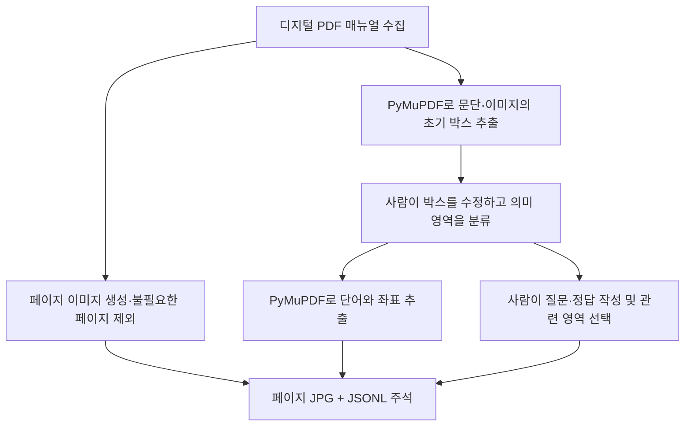
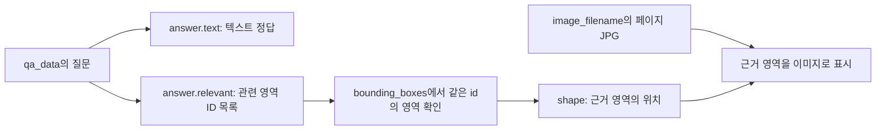

# PM209 데이터 명세 및 분석

확인일: 2026-10-20  
분석 대상: `datasets/PM209/`에 저장한 공식 배포 데이터와 메타데이터

## 1. 데이터셋 개요

PM209는 제품 매뉴얼을 바탕으로 질문에 답하는 **멀티모달 QA 데이터셋**이다. 매뉴얼의 글뿐 아니라 그림·표 등의 영역도 답변 근거로 연결할 수 있도록 구성되어 있다.

| 항목 | 내용 |
| --- | --- |
| 매뉴얼 | 영문 제품 매뉴얼 209개 |
| 브랜드 / 제품 종류 | 27개 브랜드 / 90개 제품 종류 |
| 페이지 | 유효 페이지 10,018개 |
| 질문·정답 | 질문 ID를 중복 제거한 QA 22,021개 |
| 원본 자료 | 디지털로 제작한 PDF 매뉴얼 |
| 현재 배포본 | 페이지 JPG, 페이지별 JSONL 주석, 매뉴얼 메타데이터 |
| 원본 PDF 포함 여부 | 현재 다운로드한 배포본에는 없음 |

출처는 [MPMQA: Multimodal Question Answering on Product Manuals](https://arxiv.org/abs/2304.09660) 연구와 [공식 저장소](https://github.com/AIM3-RUC/MPMQA)다. 페이지 수는 표지·빈 페이지 등을 제외한 배포본의 수량이며, 수집한 원본 PDF의 전체 페이지 합계를 뜻하지 않는다.

### 폴더 구성

```text
datasets/PM209/
├── PM209.zip                           내려받은 공식 배포 압축 파일
├── meta_data/
│   ├── name2meta.json                   매뉴얼별 브랜드·제품 종류
│   ├── brand_and_product_official.json  브랜드·제품별 개수 집계
│   └── brand_and_product_emanual.json   브랜드·제품별 개수 집계
├── images/
│   └── <매뉴얼 폴더>/images/*.jpg       페이지 전체 이미지
├── data/
│   ├── train.jsonl                      학습용 매뉴얼의 페이지 주석
│   ├── val.jsonl                        검증용 매뉴얼의 페이지 주석
│   └── test.jsonl                       평가용 매뉴얼의 페이지 주석
└── download_manifest.json               이번 다운로드·검증 작업의 기록
```

`download_manifest.json`은 다운로드 출처·수량·검증 결과를 기록하기 위해 만든 파일이다. 공식 페이지 주석이나 모델 입력 데이터에 해당하지 않는다.

### train / val / test의 차이

세 파일의 **필드 구조는 같으며, 서로 다른 매뉴얼을 담는다.** 같은 페이지를 분석 방법별로 나눈 파일이 아니다.

| 분할 | 매뉴얼 | 페이지 레코드 | 고유 QA |
| --- | ---: | ---: | ---: |
| train | 146 | 7,004 | 15,839 |
| val | 21 | 1,011 | 2,257 |
| test | 42 | 2,003 | 3,925 |
| 합계 | 209 | 10,018 | 22,021 |

페이지 수는 JSONL의 줄 수다. 현재 배포본에서는 QA 항목 총수와 고유 질문 ID 수가 모두 22,021개로, 질문 ID의 중복 기록은 없었다.

페이지당 질문 수는 고정되어 있지 않다. 각 페이지의 `qa_data` 항목 수를 집계한 결과는 다음과 같다.

| 분할 | 페이지당 최소 QA | 페이지당 최대 QA | 페이지당 평균 QA |
| --- | ---: | ---: | ---: |
| train | 1 | 19 | 2.26 |
| val | 1 | 19 | 2.23 |
| test | 1 | 13 | 1.96 |
| 전체 | 1 | 19 | 2.20 |

전체 10,018페이지 중 질문 1개인 페이지는 4,184개, 2개인 페이지는 2,855개다. 약 70%의 페이지에 질문이 1~2개씩 들어 있다. 질문 수와 그 페이지의 문단·그림·표 영역 수는 일대일로 대응하지 않는다.

## 2. PyMuPDF를 이용한 데이터 구축

### 2.1 전체 구축 과정

아래는 논문에서 설명한 데이터셋 제작 과정이다.



논문에 따르면 영역 주석에는 13명이 참여하고 2명이 검증했다. QA는 별도의 20명이 작성했다. 자세한 구축 절차는 [논문 PDF의 PM209 Dataset Construction 절](https://ojs.aaai.org/index.php/AAAI/article/download/26634/26406)을 기준으로 한다.

### 2.2 글자는 어떻게 추출했나?

디지털 PDF에는 화면에 보이는 픽셀 외에도 **문자 코드, 폰트 정보, 문자를 배치할 위치**가 들어 있을 수 있다. PyMuPDF는 MuPDF 엔진을 통해 이 정보를 해석하고, 텍스트와 위치를 가져올 수 있다.

PM209 제작자는 이 방식으로 단어와 단어의 위치를 추출했다. JSONL에서는 이를 `ocr_info`라는 이름으로 저장했다.

**`ocr_info`라는 이름만으로 이미지 OCR 모델을 사용했다고 판단하면 안 된다.** 논문은 디지털 PDF에서 PyMuPDF로 단어를 추출했다고 설명하며, 이미지 픽셀을 읽는 OCR 엔진을 별도로 사용했다는 설명은 확인되지 않았다.

PyMuPDF의 일반적인 텍스트 추출 원리는 [공식 텍스트 추출 문서](https://pymupdf.readthedocs.io/en/latest/app1.html)를 참고했다. 논문에 구체적인 함수 호출이 나오지는 않으므로 제작자가 어떤 API를 호출했는지까지 단정하지 않는다.

### 2.3 이미지가 있는 위치는 어떻게 찾았나?

PDF에는 삽입한 이미지 객체와 해당 이미지를 페이지에 배치하는 정보가 있다. PyMuPDF는 이 정보를 읽어 이미지의 위치와 범위를 얻을 수 있다. 일반적인 동작은 [공식 이미지 추출 문서](https://pymupdf.readthedocs.io/en/latest/recipes-images.html)에 설명되어 있다.

PM209는 문단과 이미지의 **초기 영역 박스**를 PyMuPDF로 추출한 뒤, 각각 `Text`와 `Product Image`라는 초기 분류를 붙였다. 이후 사람이 박스를 이동·확대·축소하고, 종류를 바꾸거나 영역을 추가·삭제했다.

따라서 최종 주석에는 다음 과정이 함께 들어 있다.

- PDF 내부 정보를 읽어 문단·이미지의 초기 위치를 찾는 작업
- 사람이 영역의 위치를 고치고, 어떤 종류의 내용인지 분류하는 작업

이미지 객체의 위치를 얻었다는 사실이, 그림 속 사물이나 글자의 의미까지 AI가 분석했다는 뜻은 아니다.

### 2.4 그림 안의 글자까지 가져왔나?

글자가 PDF 내부의 별도 텍스트 객체라면 텍스트 추출로 가져올 수 있다. 반면 **그림 픽셀에만 들어 있는 글자는 PDF 내부 텍스트 추출만으로 읽을 수 없다.** 이 경우에는 OCR 등의 추가 처리가 필요하다.

예를 들어 리모컨 사진 옆에 PDF 텍스트로 작성한 설명은 추출할 수 있다. 하지만 사진 자체에 인쇄된 글자가 픽셀로만 존재하면 같은 방식으로 추출할 수 없다.

현재 배포본의 `train`·`val`·`test` 전체를 확인한 결과는 다음과 같다.

| `structure` 값 | 영역 수 | 해당 영역 항목의 `ocr_info` |
| --- | ---: | --- |
| `Text` | 152,894 | 있음. 일부는 빈 배열 |
| `Title` | 32,588 | 있음. 일부는 빈 배열 |
| `Product Image` | 15,055 | 없음 |
| `illustration` | 6,809 | 없음 |
| `Table` | 2,320 | 없음 |
| `graphic` | 1,943 | 없음 |

**시각 영역 26,127개에는 `ocr_info` 필드가 없다.** 이는 해당 영역 항목의 필드 구성에 관한 결과다. 특히 `Table` 항목 2,320개는 모두 `id`, `structure`, `shape`만 가지며 셀 목록, 행·열 번호, 병합 정보, HTML 표는 없다.

**표 안의 글자는 별도의 `Text` 영역에 저장된 경우가 있다.** 실제 Bose 매뉴얼의 문제 해결 표에서는 `Problem`, `What to do`, `No sound`와 해결 방법 문장이 각각 `Text` 영역에 들어 있다. 표 항목에 `ocr_info`가 없다는 사실이 표 안의 텍스트 전체가 데이터에서 빠졌다는 뜻은 아니다.

구분해야 할 것은 **글자·문장의 추출**과 **그 문장이 어느 행·열의 셀에 속하는지 명시한 표 구조화**다. 이 데이터에는 전자가 별도 텍스트 영역으로 제공되는 사례가 있고, 후자의 셀 구조를 명시하는 필드는 없다. 좌표를 이용해 관계를 추정할 수는 있지만, 셀별 구조가 이미 주석되어 있다는 뜻은 아니다.

그림 위의 글자나 주변 설명도 별도 `Text` 영역에 들어갈 수 있다. 따라서 시각 영역의 종류·좌표, 같은 위치의 텍스트 영역, 픽셀 내부의 글자 추출 여부를 각각 확인해야 한다.

이 설명은 **PM209의 제작 절차와 현재 배포 데이터**에 관한 것이다. PyMuPDF 자체가 추가 OCR 기능을 연동할 수 있는지와는 구분해야 한다.

### 2.5 기존 파싱 재사용과 추가 OCR에 대한 결정

**기본 방침은 제공된 JSONL의 파싱 결과를 재사용하고, 전체 페이지에 별도 OCR 엔진을 다시 적용하지 않는 것이다.** 이미 파싱된 데이터는 그대로 활용해도 된다는 과제 안내에 따른 결정이다.

2026-10-21 추가 결정: 대상 그림에 VLM 설명과 읽을 수 있는 글자를 보강하는 작업을 계획했다. 아래는 기존 텍스트를 재사용하기로 한 초기 이유이며, 현재 그림 보강의 범위·저장 방식·GPU 작업은 [이미지 처리 및 설계 결정 문서](PM209_IMAGE_RETRIEVAL_COMPARISON.md)에 정리했다. VLM 설명은 배포 데이터의 원래 필드가 아닌 추가 생성 정보다.

생략 이유는 다음과 같다.

- **텍스트 기반 RAG를 준비할 입력이 이미 있다.** JSONL에는 본문·제목의 단어와 좌표, 영역 종류, 원본 페이지 연결 정보가 제공된다. 이를 이용해 이후 정제·청킹·검색을 준비할 수 있다.
- **추가 OCR에는 결과를 합치고 검수하는 작업이 따른다.** 기존 추출 텍스트와 중복되는 글자를 구분하고, 제품 번호·숫자 등의 오인식과 읽기 순서를 확인해야 한다. 별도 OCR 엔진으로 전체 페이지의 텍스트를 다시 추출하는 작업은 제외한다.
- **초기안의 검색 대상은 JSONL에 제공된 텍스트였다.** 이후 그림의 의미와 그림 안의 글자를 보강하기 위해 VLM 설명 생성 방식을 선택했다. 기존 파싱 결과와 추가 생성 정보는 출처를 구분해 활용한다.

**생략에 따른 한계:** JPG에 보이더라도 JSONL에 저장되지 않은 글자는 텍스트 검색에 포함되지 않는다. 실제 점검에서 추출 텍스트가 없는 8페이지 모두 JPG에는 글자가 있음을 확인했다. 따라서 이미지 속 글자가 답변 근거인 질문은 검색·답변이 제한될 수 있다. 이러한 질문의 비율이나 성능 영향은 아직 평가하지 않았다.

이 결정은 추가 OCR의 효과가 없다는 검증 결과가 아니라 **현재 실습의 범위와 작업량을 고려한 선택**이다. 이후 이미지 속 글자 누락으로 답변하지 못하는 사례를 개선할 때 해당 영역의 OCR 적용을 검토한다. 현재까지 새 OCR은 실행하지 않았으며, 배포 원본 데이터도 변경하지 않았다.

## 3. name2meta.json

매뉴얼 식별자에 브랜드와 제품 종류를 연결하는 사전이다. 실제 항목 예시는 다음과 같다.

```json
{
  "samsung_tv": {
    "brand": "Samsung",
    "product": "tv"
  }
}
```

- `samsung_tv`: 매뉴얼 식별자
- `brand`: 제조사·브랜드
- `product`: 제품 종류

209개 매뉴얼이 들어 있으며, 매뉴얼을 구분하거나 브랜드·제품별로 필터링할 때 사용한다.

`brand_and_product_official.json`과 `brand_and_product_emanual.json`은 브랜드·제품별 매뉴얼 **개수 집계**다. 각각 합계가 70개와 139개이며, 두 파일의 집계를 합치면 `name2meta`를 브랜드·제품별로 집계한 결과와 일치한다.

두 집계 파일에는 개별 매뉴얼 식별자가 없으므로, 특정 매뉴얼의 정보를 연결하려면 `name2meta`를 확인한다. `official`·`emanual`의 수집 출처 의미는 파일명만으로 단정하지 않았다.

## 4. images: 페이지 전체 이미지

`images`에는 **매뉴얼 한 페이지 전체를 렌더링한 JPG**가 들어 있다. 한 장에 글자·표·그림·배치가 함께 보인다.

JSONL의 `image_filename`이 해당 페이지 JPG의 상대 경로를 제공한다. 이 경로는 `datasets/PM209/`를 기준으로 읽으면 된다.

페이지 안의 개별 그림은 JSONL의 영역 좌표로 위치를 지정한다. `image_filename`이 페이지 안의 작은 그림 하나를 가리키는 것은 아니다.

### 실제 페이지 예시

아래는 `val.jsonl` 첫 번째 레코드에 연결된 Bose 매뉴얼의 안전 안내 페이지다.


이 페이지 레코드에는 의미 영역 32개와 QA 항목 5개가 연결되어 있다.

페이지를 JPG로 렌더링하는 작업과 글자·영역을 분석하는 작업은 별개다. 그림 내부 글자가 JPG에 보인다는 사실만으로, 그 글자가 JSONL에도 텍스트로 저장되었다고 판단할 수는 없다.

**이미지 경로는 `image_filename`을 사용한다.** 페이지 `id`의 끝 숫자와 실제 이미지 파일명의 숫자가 항상 같지는 않으므로, `id`에서 파일명을 추정하지 않는다.

## 5. JSONL의 상세 구조

### 5.1 JSONL의 저장 단위

JSONL은 줄마다 하나의 JSON 객체를 저장하는 형식이다. PM209에서는 **한 줄이 한 페이지 레코드**다.

페이지 레코드 안에는 페이지 정보, 여러 의미 영역, 여러 QA가 들어간다. 한 페이지에 여러 질문이 연결될 수 있다.

여기서 JSONL의 한 줄과 매뉴얼 화면의 글 한 줄은 서로 다른 단위다. 문서의 여러 줄짜리 문단도 한 영역 안에 들어갈 수 있다.

### 5.2 필드 트리

`{}`는 하위 필드를 가진 객체, `[]`는 여러 항목을 담는 배열이다. 아래의 `영역 객체`·`단어 객체`·`QA 객체`는 배열 안의 항목을 설명하기 위한 이름이며 실제 필드명은 아니다.

```text
페이지 레코드 {}
├── id: string                              페이지 식별자
├── image_filename: string                  페이지 JPG 상대 경로
│
├── bounding_boxes: array                   의미 영역 목록
│   └── 영역 객체 {}
│       ├── id: string                      영역 식별자
│       ├── structure: string               영역 종류
│       ├── shape: object                   영역 전체의 위치·크기
│       │   ├── x: number                   왼쪽 위치
│       │   ├── y: number                   위쪽 위치
│       │   ├── width: number               가로 길이
│       │   └── height: number              세로 길이
│       │
│       └── ocr_info: array                 단어 목록 (Text / Title에 존재)
│           └── 단어 객체 {}
│               ├── word: string            추출한 단어
│               └── bbox: object            해당 단어 하나의 위치·크기
│                   ├── x: number
│                   ├── y: number
│                   ├── width: number
│                   └── height: number
│
└── qa_data: array                          이 페이지와 연결된 QA 목록
    └── QA 객체 {}
        ├── id: string                      질문 식별자
        ├── question: object
        │   └── text: string                질문 문장
        └── answer: object
            ├── text: string                텍스트 정답
            └── relevant: array<string>     관련 의미 영역의 ID 목록
```

### 5.3 페이지의 `id`와 `image_filename`

`id`는 페이지를 식별하는 문자열이다. `image_filename`은 그 페이지의 실제 이미지 파일을 찾는 경로다.

같은 이름의 `id` 필드가 다른 위치에도 나오지만, 식별하는 대상은 다르다.

- 최상위 `id`: 페이지 식별자
- `bounding_boxes[].id`: 영역 식별자
- `qa_data[].id`: 질문 식별자

### 5.4 `bounding_boxes`: 의미 영역 목록

페이지를 본문·제목·그림 등으로 구분한 영역들의 배열이다. **이미지만 모아 놓은 목록이 아니다.**

각 영역의 `structure`는 다음 중 하나다. 아래 대소문자는 실제 JSONL의 값에 맞췄다.

- `Text`: 본문 문단
- `Title`: 제목
- `Product Image`: 제품 사진, 조작 화면, 제품 구성품 등
- `illustration`: 기능이나 사용 절차 등을 설명하는 그림
- `Table`: 행·열로 정보를 배치한 표 영역
- `graphic`: 부품 이름과 위치 등을 선·화살표·번호와 함께 보여 주는 도해

이 종류와 최종 박스에는 사람이 수정·분류한 결과가 반영되어 있다.

**영역 객체 하나는 본문·제목·그림·표 등의 영역 하나를 뜻한다.** 본문 문단이 여러 곳에 있으면 `structure`가 `Text`인 객체도 여러 개가 될 수 있다.

```text
bounding_boxes: 한 페이지의 영역 목록
├── 영역 객체 1: 제목
├── 영역 객체 2: 본문 문단 A
├── 영역 객체 3: 그림
├── 영역 객체 4: 표
└── 영역 객체 5: 본문 문단 B
```

#### 본문 영역 A와 B를 나누는 기준

본문은 문단 단위로 영역을 잡는 것이 기본이다. PyMuPDF가 문단의 초기 박스를 추출하고, 사람이 위치·크기를 수정하거나 영역을 추가·삭제하여 최종 박스를 정했다.

아래는 구분을 설명하기 위한 예시다.

```text
[본문 영역 A]
전원 케이블을 연결합니다.
연결하기 전에 전원이 꺼져 있는지 확인합니다.

[연결 방법 그림 영역]

[본문 영역 B]
연결을 완료하면 전원 버튼을 누릅니다.
```

A처럼 여러 줄이어도 하나의 문단 영역이 될 수 있다. 일정한 줄 수나 문장 수마다 나눈다는 뜻은 아니다. 확인한 논문에는 문단 사이의 간격 수치 등 세부 분리 규칙까지 공개되어 있지는 않다.

### 5.5 `shape`: 영역 전체의 위치

`bounding_boxes`의 영역 객체 안에 있는 `shape`는 **해당 영역 전체를 감싸는 사각형**이다. 예를 들어 본문 문단이라면 문단 전체의 위치와 크기를 나타낸다.

실제 첫 번째 val 페이지의 본문 영역 `..._187`은 다음 좌표를 가진다. 표시 숫자는 소수 둘째 자리로 반올림했다.

```json
{
  "id": "..._187",
  "structure": "Text",
  "shape": {
    "x": 70.00,
    "y": 146.38,
    "width": 491.58,
    "height": 43.26
  }
}
```

위와 이후 예시의 `...`는 긴 식별자의 앞부분을 생략한 표시다. 실제 데이터의 ID를 변경한 것은 아니다.

### 5.6 `ocr_info`: 영역에 속한 단어 목록

`Text`·`Title` 영역에는 `ocr_info` 배열이 있다. 배열의 각 항목에는 단어 문자열인 `word`와 그 단어의 위치인 `bbox`가 함께 들어간다.

앞의 본문 영역에는 `Please`, `take`, `the`, `time` 등의 단어가 순서대로 들어 있다. 첫 단어 예시는 다음과 같다.

```json
{
  "word": "Please",
  "bbox": {
    "x": 72.00,
    "y": 144.07,
    "width": 41.58,
    "height": 16.23
  }
}
```

일부 제목·본문 영역의 `ocr_info`는 빈 배열이다. 그림·표·도해 영역에는 `ocr_info` 필드 자체가 없으므로, 모든 영역에 단어가 들어 있다고 가정하면 안 된다.

저장 단위는 문서의 줄 전체가 아닌 **단어**다. 여러 줄짜리 문단이면 그 안의 단어와 좌표가 해당 문단의 `ocr_info` 배열에 들어간다. 그림·표는 별도의 영역 객체로 기록하며, 이 배포본에서 그림·표의 내부 내용을 `ocr_info`로 읽어 저장한 것은 아니다.

### 5.7 `bounding_boxes`, `shape`, `bbox`의 차이

```text
페이지
└── bounding_boxes                    여러 의미 영역을 담는 목록
    └── 본문 영역 하나
        ├── shape                     본문 문단 전체의 사각형
        └── ocr_info
            ├── 단어 항목 {}
            │   ├── word: "Please"
            │   └── bbox              Please 한 단어의 사각형
            ├── 단어 항목 {}
            │   ├── word: "take"
            │   └── bbox              take 한 단어의 사각형
            └── ...
```

- `bounding_boxes`: 영역의 **목록**
- `shape`: 영역 하나의 **좌표**
- `bbox`: 단어 하나의 **좌표**

`shape`와 `bbox`는 둘 다 페이지 전체를 기준으로 하는 `x`, `y`, `width`, `height`다. 단어의 `bbox`가 문단 영역의 왼쪽 위를 기준으로 한 상대 좌표인 것은 아니다.

```text
페이지 왼쪽 위가 기준점
    x는 오른쪽으로 증가
    y는 아래쪽으로 증가

오른쪽 끝 = x + width
아래쪽 끝 = y + height
```

화면에 페이지를 확대·축소해 표시한다면 박스 좌표도 같은 배율로 변환해야 한다. 위 실제 예시처럼 사람의 영역 박스와 자동 추출한 단어 박스의 경계가 조금 어긋날 수도 있다. 논리적으로 같은 영역에 속한다고 해서 단어 박스가 영역 박스에 완전히 포함된다는 보장은 없다.

### 5.8 그림·표 영역의 실제 예시

동일 페이지에서 번개 기호에 해당하는 `..._208` 영역은 다음과 같다. 숫자는 반올림했다.

```json
{
  "id": "..._208",
  "structure": "Product Image",
  "shape": {
    "x": 72.00,
    "y": 477.09,
    "width": 42.67,
    "height": 40.00
  }
}
```

이 항목에는 이미지의 종류와 위치가 있으며 `ocr_info`는 없다. 해당 그림을 보려면 페이지 JPG에서 `shape`에 해당하는 부분을 표시하거나 잘라서 사용하면 된다.

#### 표 전체 영역과 표 안의 텍스트 영역

`val.jsonl`의 같은 Bose 매뉴얼 페이지 `..._00009`에는 문제 해결 표가 있다. [실제 표가 있는 페이지 이미지](datasets/PM209/images/bose_home_theater_system_manuals_6be6168b-df9c-40c5-a332-96d84277e122/images/bose_home_theater_system_manuals_6be6168b-df9c-40c5-a332-96d84277e122_00009.jpg)와 JSONL을 함께 확인했다.

```text
bounding_boxes
├── Table 영역 ..._143       표 전체를 감싸는 shape
├── Text 영역 ..._133        "Problem"
├── Text 영역 ..._134        "What to do"
├── Text 영역 ..._135        "No sound"
├── Text 영역 ..._136        전원·케이블 연결 확인 등의 해결 방법
└── 그 밖의 텍스트 영역들
```

여기서 표 전체 영역과 표 안의 텍스트 영역은 `bounding_boxes`의 별도 항목으로 함께 존재한다. `Text` 항목에는 문장별 영역 위치와 `ocr_info`의 단어·좌표가 있다.

이미지를 보면 `No sound`와 해결 방법이 같은 행의 서로 다른 셀에 있음을 알 수 있다. 그러나 JSONL에는 “..._135는 몇 행 몇 열의 셀이고 ..._136과 같은 행이다”라는 셀 연결 정보가 명시되어 있지 않다. **표 내용의 텍스트가 일부 추출되어 있는 것과, 표의 행·열 관계가 구조화되어 있는 것은 다른 상태다.** 이 사례만으로 모든 표의 텍스트 추출이 완전하다고 판단할 수는 없다.

### 5.9 `qa_data`: 질문·정답과 관련 영역

`qa_data`는 사람이 작성한 질문·정답 주석이다. 원문 문단의 추출 결과와는 역할이 다르다.

- `id`: 질문을 식별하는 문자열
- `question.text`: 사람이 작성한 질문 문장
- `answer.text`: 사람이 작성한 텍스트 정답
- `answer.relevant`: 답변에 관련된 의미 영역의 ID 목록

**`answer.relevant`는 `bounding_boxes[].id`를 참조한다.** 이미지 파일명이나 좌표 그 자체를 저장하는 필드는 아니다.

실제 첫 번째 val 페이지의 QA `..._18`을 한국어로 요약하면 다음과 같다.

```text
질문: 삼각형 안의 번개 기호는 어떤 의미인가?
정답: 장치 내부에 감전 위험이 있는 전압이 있음을 알리는 경고다.

관련 영역 ID:
..._190, ..._208, ..._213, ..._214, ..._215
```

앞서 살펴본 번개 그림 `..._208`이 이 목록에 포함된다. 하나의 답변에 경고 문단과 그림 등 여러 영역을 함께 연결할 수 있다.



현재 배포본에서는 질문 ID마다 한 페이지의 `qa_data`에 기록되어 있다. 질문 하나에 연결되는 관련 영역은 여러 개일 수 있으며, 질문 개수와 관련 영역 개수는 구분해야 한다.

### 5.10 문단마다 질문이 붙어 있는가?

문단별로 정해진 질문 개수는 없다. **질문은 페이지의 `qa_data`에 모여 있고, 관련 영역과는 `answer.relevant`로 연결된다.** 질문의 근거로 선택되지 않은 문단도 있으며, 하나의 영역을 여러 질문의 근거로 연결할 수도 있다.

실제 `val.jsonl` 첫 페이지에서는 다음을 확인했다.

- 전체 영역 32개 중 본문(`Text`) 영역은 19개이며, QA는 5개다.
- 안내 문단 `..._187`은 이 페이지의 질문에 관련 영역으로 연결되지 않았다.
- 번개 기호 설명 문단 `..._190`은 질문 `..._18`의 관련 영역으로 연결되어 있다.
- 질문 `..._18`에는 설명 문단과 그림 등 총 5개 영역이 연결되어 있다.

```text
페이지
├── bounding_boxes: 본문·그림·표 등의 영역 목록
│   ├── 안내 문단 ..._187              연결된 질문 0개
│   ├── 번개 설명 문단 ..._190         질문 ..._18의 근거
│   ├── 번개 그림 ..._208              질문 ..._18의 근거
│   └── 다른 영역들
└── qa_data: 질문 5개
    └── 질문 ..._18
        └── answer.relevant
            └── ..._190, ..._208, ..._213, ..._214, ..._215
```

따라서 문단 수, 질문 수, 질문 하나에 연결된 관련 영역 수는 서로 구분해서 세어야 한다. 페이지당 질문 수의 전체 집계는 1절에 정리했다.

### 5.11 데이터셋에 QA가 있는 이유

PM209는 제품 매뉴얼을 읽고 질문에 답하는 모델을 연구하기 위한 데이터셋이다. **매뉴얼이 읽을 자료라면, QA는 학습 예제이자 평가용 문제·정답지**다.

- `question.text`: 모델에 제시할 문제
- `answer.text`: 모델의 텍스트 답변을 평가할 때 기준으로 삼는 정답
- `answer.relevant`: 모델이 관련 근거 영역을 찾았는지 평가할 때 기준으로 삼는 영역 목록

QA를 이용하면 답변 내용과 관련 근거 영역을 각각 평가할 수 있다. 다만 구체적인 채점 방법은 실험 목적에 맞게 정해야 한다.

데이터 분할의 일반적인 용도는 다음과 같다.

- **train:** 매뉴얼 내용과 질문·정답 예시로 모델을 학습시킨다.
- **val:** 학습 도중 성능을 확인하고 모델 선택이나 설정 조정에 사용한다.
- **test:** 학습·설정 조정에 사용하지 않은 문제로 최종 성능을 평가한다.

같은 문제를 학습과 최종 평가에 모두 사용하면 모델이 외운 답을 출력하는 것인지 구분하기 어려워진다. 이를 피하기 위해 학습·검증·평가 자료를 나눠 사용한다.

**데이터 파일을 불러오는 것만으로 모델이 자동 학습되지는 않는다.** 학습시키려면 별도의 학습 과정을 실행해야 한다. 추가 학습 없이 이미 학습된 모델의 성능을 평가하는 데만 이 데이터셋을 사용할 수도 있다.

## 6. 확인한 범위와 자료

- 세 JSONL 파일의 페이지 수와 고유 질문 수를 확인함.
- JSONL에서 참조하는 이미지 파일의 누락은 0개였음.
- `name2meta`의 항목 수와 브랜드·제품 종류 수를 확인함.
- `train`·`val`·`test` 전체의 영역 종류와 `ocr_info` 존재 여부를 확인함.
- 좌표·단어·QA 예시는 `val.jsonl` 첫 페이지의 실제 항목을 사용함.
- PyMuPDF의 구체적인 데이터 구축 함수 호출과 별도 이미지 OCR 엔진 사용 여부는 공개 논문 설명 이상으로 확인하지 못했음.

### 직접 열어볼 파일

- [name2meta.json](datasets/PM209/meta_data/name2meta.json)
- [val.jsonl](datasets/PM209/data/val.jsonl)
- [train.jsonl](datasets/PM209/data/train.jsonl)
- [test.jsonl](datasets/PM209/data/test.jsonl)
- [다운로드·검증 기록](datasets/PM209/download_manifest.json)

### 외부 근거

- [MPMQA 공식 저장소와 PM209 배포 안내](https://github.com/AIM3-RUC/MPMQA)
- [MPMQA 논문 PDF: PM209 Dataset Construction 및 데이터 분할](https://ojs.aaai.org/index.php/AAAI/article/download/26634/26406)
- [PyMuPDF 공식 문서: 텍스트 추출](https://pymupdf.readthedocs.io/en/latest/app1.html)
- [PyMuPDF 공식 문서: 이미지 처리·추출](https://pymupdf.readthedocs.io/en/latest/recipes-images.html)
