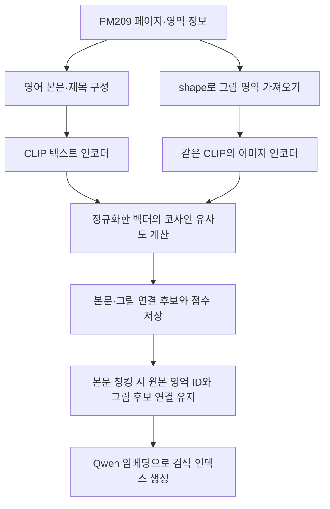
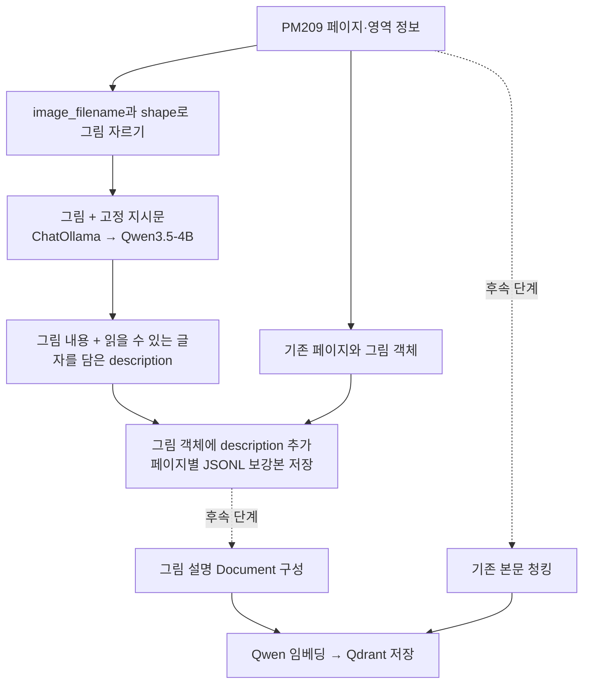
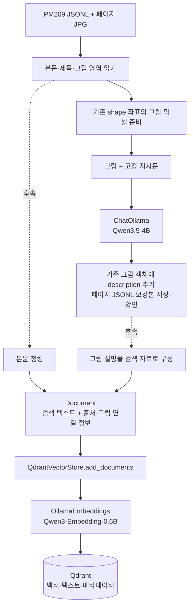
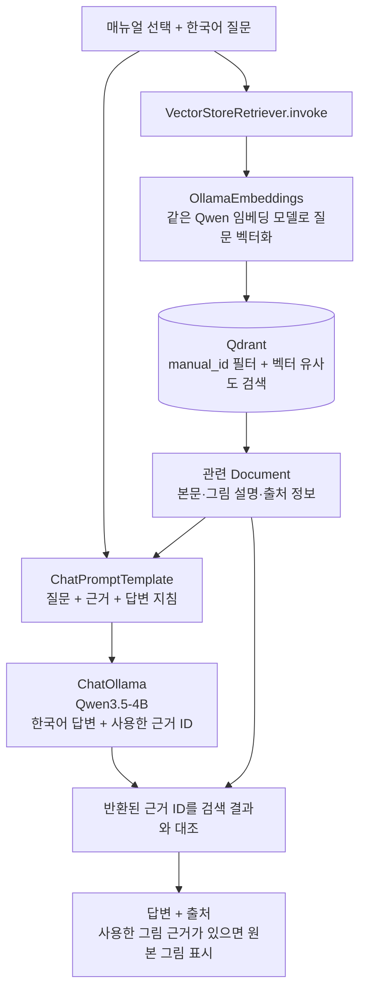

# PM209 이미지 처리 방식 검토·설계 결정 및 GPU 작업 안내

작성일: 2026-10-20 / 갱신일: 2026-10-21  
상태: **방식 B인 VLM 그림 설명 생성을 선택했다. GPU 노트북에서 이번에 할 일은 Step 1의 파싱 보강까지다.** 설명 생성용 코드와 그림 미리보기 3개가 있고, 실제 VLM 설명은 아직 생성하지 않았다. 청킹·임베딩·Qdrant·질문 답변은 후속 설계이며 구현 완료 상태가 아니다.

**최종 저장 결정:** 보강본의 기존 그림 객체에 `description` 문자열 하나만 추가한다. 기존 `id`, `structure`, `shape`를 그대로 사용하고, 읽을 수 있는 글자·숫자·단위도 설명 안에 포함한다. 별도 `visible_text`, `uncertainties`, `vlm_info` 필드는 추가하지 않는다. 현재 설명 생성 코드는 이전의 그림별 별도 파일 형식이므로, GPU에서 실행하기 전에 이 결정에 맞춰 수정해야 한다. 이 문서 갱신에서는 코드나 모델을 실행하지 않았다.

현재 결정은 **LangChain + Ollama, 그림 설명·답변용 Qwen3.5-4B, 검색용 Qwen3-Embedding-0.6B, 벡터 DB Qdrant**다. 한국어로 질문하고, 선택한 제품·매뉴얼 전체에서 본문과 그림 설명을 검색한다. 이번 GPU 작업에서는 이 중 그림 설명 생성만 실행한다.

- **결정 과정과 선정 이유:** 8절
- **GPU 노트북에서 해야 할 파싱 작업:** 9절
- **전체 LangChain 흐름과 아직 정하지 않은 항목:** 10절
- **다른 노트북의 Codex에 전달할 작업 요청:** 11절

1~7절에는 선택의 배경이 된 CLIP·VLM 비교 검토를 남겼다. CLIP 구현과 두 방식의 성능 비교는 현재 필수 작업이 아니다.

## 1. 목표와 비교 대상

**질문과 관련된 그림이 있으면 텍스트 답변과 함께 보여주고, 관련 그림이 없으면 텍스트로만 답변한다.** 같은 페이지에 있다는 이유만으로 모든 그림을 첨부하지 않는다.

검토한 방법은 두 가지다.

| 구분 | 방식 A: CLIP으로 본문·그림 매칭 | 방식 B: 생성형 VLM으로 그림 설명 생성 |
| --- | --- | --- |
| 준비 단계에서 하는 일 | 기존 영어 본문과 그림의 관련성을 계산한다. | 그림을 설명하는 텍스트를 생성한다. |
| 주요 추가 정보 | 본문 영역 ID와 그림 영역 ID의 연결 후보, 유사도 점수 | 그림 설명과 원본 그림 ID, 필요하면 관련 본문 ID |
| 검색 방법 | 본문을 검색하고 연결된 그림을 후보로 가져온다. | 본문과 그림 설명을 검색하고, 설명에 연결된 그림을 가져온다. |
| 기대하는 효과 | 기존 본문을 활용해 관련 그림을 찾는다. | 기존 본문에 없던 시각 정보를 검색 단서로 추가한다. |
| 핵심 한계 | 의미가 비슷하다고 실제 설명 관계까지 맞는 것은 아니다. | 생성한 설명이 틀리거나 중요한 세부 내용이 빠질 수 있다. |

두 방식 모두 **문서 준비 시 실행하는 전처리**로 설계한다. 질문할 때마다 원본 그림을 VLM으로 다시 분석하는 구성은 포함하지 않는다. 답변 단계에서는 같은 Qwen 모델에 검색된 텍스트를 전달한다.

CLIP도 넓은 의미에서 시각·언어 모델에 속한다. 이 문서에서는 출력의 차이를 드러내기 위해 벡터를 만드는 쪽을 **CLIP**, 설명문을 만드는 쪽을 **생성형 VLM**으로 구분한다.

## 2. 공통으로 활용할 기존 데이터

PM209의 페이지·영역 구조를 그대로 활용한다. 보강본도 원본과 같이 JSONL 한 줄이 한 페이지이며, `bounding_boxes`의 기존 그림 객체에 `description`만 추가한다. 별도 그림별 설명 파일도 검토했으나, 기존 구조에서 설명을 바로 확인할 수 있는 방식으로 최종 결정했다. 저장 경로는 6절을 따른다.

```text
페이지 레코드
├── id                              페이지 식별자
├── image_filename                  페이지 JPG 경로
├── bounding_boxes[]
│   ├── Text / Title 영역
│   │   ├── id                      본문·제목 영역 식별자
│   │   ├── shape                   영역 전체의 좌표
│   │   └── ocr_info[]
│   │       ├── word                단어
│   │       └── bbox                단어의 좌표
│   └── 그림 영역
│       ├── id                      그림 영역 식별자
│       ├── structure               그림 종류
│       └── shape                   그림 영역의 좌표
└── qa_data                         질문·정답 및 정답 근거 영역
```

- 본문 영역은 보통 문단 단위이며, `ocr_info`의 단어를 모아 비교·검색할 텍스트를 만든다. 개별 글자와 그림을 비교하는 것은 아니다.
- 그림은 `image_filename`의 JPG에서 `shape`에 해당하는 영역을 가져온다. 이미지 파일명을 페이지 ID의 끝 숫자로 추정하지 않는다.
- **이 문서에서 그림을 자른다는 것은 이미 파싱된 좌표에 해당하는 픽셀만 VLM 입력으로 준비한다는 뜻이다.** 그림 영역을 다시 검출하거나 새 경계를 정하는 작업은 아니다. PM209에서는 그림 영역 전체 좌표가 `shape`이고, `ocr_info` 안의 `bbox`는 단어 좌표다. 좌표값만으로는 그림 내용이 모델에 전달되지 않으므로 해당 영역의 이미지도 입력한다.
- 그림 객체에는 종류와 좌표가 있지만, 내용 설명이나 관련 본문 ID가 기본 필드로 제공되지는 않는다. 관련 글자는 별도 `Text` 영역에 있을 수 있다.
- 초기 비교 대상은 `Product Image`, `illustration`, `graphic`으로 통일한다. `Table`을 포함한다면 두 방식에 동일하게 적용하고, 숫자·단위·셀 관계는 별도로 확인한다.
- `illustration`·`graphic`에는 그림과 설명 글자가 함께 포함될 수 있다. 같은 그림이 여러 영역에 겹쳐 있는지도 확인하여 중복 처리와 중복 첨부를 줄인다.

## 3. 방식 A: CLIP으로 본문과 그림을 연결

### 처리 흐름



1. 우선 같은 페이지 안의 본문과 그림을 비교한다. 위·아래 문단을 모두 후보에 포함하고, 가장 가깝다는 이유만으로 연결하지 않는다.
2. 본문과 그림을 **동일한 CLIP 체크포인트의 각 인코더**로 벡터화한다.
3. 벡터를 길이 1로 정규화한 뒤 내적으로 코사인 유사도를 계산한다. 이는 [CLIP 공식 예제](https://github.com/openai/CLIP#zero-shot-prediction)에서 사용하는 방식이다.
4. 본문 ID와 유사도 점수를 그림 영역에 저장한다. 점수만으로 확정하지 않고 연결 후보로 관리한다.

```text
그림 영역
├── id
├── structure
├── shape
└── clip_links[]                    추가할 필드
    ├── text_region_id              관련 본문 후보의 ID
    └── similarity                  코사인 유사도
```

### 연결 판단

**페이지에서의 거리와 벡터의 유사도는 다른 정보다.** 거리는 후보를 찾는 보조 정보이고, CLIP 점수는 이미지·문장의 의미적 관련성을 추정하는 정보다. 어느 것도 단독으로 실제 설명 관계를 보장하지 않는다.

- 그림 번호나 본문의 명시적인 참조가 있으면 연결 근거로 활용한다. 두 방식에 공통으로 적용할 규칙으로 분리한다.
- 모든 점수가 낮으면 연결 없음으로 둘 수 있어야 한다. 상위 1개를 무조건 연결하지 않는다.
- 하나의 그림에 여러 본문이 관련될 수 있으므로 일대일 연결을 강제하지 않는다.
- 자동 연결을 확정할 최소 점수나 후보 간 점수 차이는 아직 정하지 않았다. 개발용 사례에서 실제 관계와 대조한 뒤 결정한다.
- 유사도는 정답 확률이 아니다. 비교 후보 사이의 softmax 값도 확정된 관련 확률로 취급하지 않는다.

원본 CLIP은 텍스트 입력 길이가 77토큰이다. 긴 문단은 입력 한도에 맞춰 문장·구간으로 비교하고 원래 본문 ID를 유지해야 한다. 구간 점수를 문단 점수로 합치는 규칙도 기록한다. 이는 이후 RAG의 검색용 청킹 규칙과 구분한다. [공식 API 설명](https://github.com/openai/CLIP#api)

### 질문할 때

```text
한국어 질문
→ Qwen 임베딩으로 영어 본문 청크 검색
→ 해당 본문 영역에 연결된 그림 후보 조회
→ 답변에 사용한 근거와 관련된 후보를 선택
→ 텍스트 답변 + 선택한 그림 / 관련 그림이 없으면 텍스트 답변만
```

CLIP 벡터는 사전 매칭에 사용하며, Qwen으로 만든 검색 벡터와 섞지 않는다. 답변용 텍스트 LLM은 실제 그림 픽셀을 보지 않으므로, 잘못 연결된 그림을 최종 단계에서 반드시 걸러낼 수 있다고 가정하지 않는다.

### 장점과 예상 한계

- 설명문을 생성하지 않고 기존 본문과 그림을 활용할 수 있다.
- 작은 인코더를 선택하면 준비 단계의 처리 부담을 줄일 여지가 있다. 실제 시간·메모리는 측정 전이므로 수치로 단정하지 않는다.
- 같은 제품의 전원 버튼과 초기화 버튼처럼 주제가 비슷한 문단을 구별하지 못할 수 있다.
- 관련 본문이 추출되지 않은 그림은 본문 검색을 통한 접근이 제한된다.
- 최초 범위가 같은 페이지이므로, 다른 페이지에 있는 설명과의 연결은 다루지 못한다.

## 4. 방식 B: 생성형 VLM으로 그림 설명을 만들어 검색

### 처리 흐름



1. 제공된 페이지 JPG에서 `shape`에 해당하는 그림을 잘라 VLM에 전달한다.
2. 보이는 그림 내용과 함께 읽을 수 있는 문구·숫자·단위·주의사항을 영어 설명에 포함하게 한다.
3. **기존 그림 객체에 `description` 하나만 추가**한다. 읽을 수 있는 원문 표기·숫자·단위를 설명에 포함하고, 읽을 수 없거나 확실하지 않은 내용은 추측해서 채우지 않는다. 그림 ID를 새로 만들거나 특정 본문에 강제로 연결하지 않는다.
4. 후속 단계에서 `description`을 기존 그림 ID에 연결된 독립적인 검색 자료로 만든다. 현재 코드는 이전 저장 형식이며 최종 보강본 형식에 맞춘 변경과 GPU 검증이 남아 있다. 청킹·임베딩·검색은 후속 작업이다.

```text
페이지 레코드                         기존 구조 유지
├── id
├── image_filename
├── bounding_boxes[]
│   ├── 본문·제목·표 등 기존 영역       기존 정보 유지
│   └── 그림 영역
│       ├── id                       기존 그림 ID
│       ├── structure                기존 그림 종류
│       ├── shape                    기존 그림 좌표
│       └── description              추가하는 유일한 필드
└── qa_data                          기존 평가 자료 유지, VLM 입력에는 제외
```

VLM에는 보이는 부품·조작 화면·화살표·배치·읽을 수 있는 표기 등을 구체적으로 설명하도록 지시한다. 단순히 “제품 그림이다”로 끝나면 검색 단서가 부족하다. 반대로 보이지 않는 버튼 기능이나 조작 시간을 추측해서 추가하면 안 된다.

**현재는 그림과 고정 지시문만 VLM에 전달한다.** 기존 본문, 평가용 QA, 정답 근거는 입력에 포함하지 않는다. 주변 본문을 추가로 활용하는 것은 후속 검토 사항이며, 그림에 보이지 않는 기능·조작 시간을 추측해서 채우지 않는다.

이미지 설명을 텍스트로 임베딩하고 원본 이미지와 연결하는 구성은 [LangChain의 멀티모달 RAG 예제](https://www.langchain.com/blog/semi-structured-multi-modal-rag)에서도 소개한다. 이 사례가 PM209에서 방식 A보다 성능이 좋다는 검증 결과를 뜻하지는 않는다.

### 질문할 때

```text
한국어 질문
→ Qwen 임베딩으로 본문 청크와 그림 설명 청크 검색
→ 답변용 Qwen이 검색된 본문·그림 설명으로 답변
→ 답변을 뒷받침하는 그림의 ID 선택
→ 프로그램이 해당 원본 그림을 표시
```

답변용 텍스트 LLM은 저장된 설명을 읽는다. 질문할 때 실제 이미지를 다시 해석하는 것은 아니므로, 설명에 빠진 작은 글자나 관계를 추가로 확인할 수는 없다.

### 장점과 예상 한계

- 그림 자체가 검색 대상이 되어, 본문과 그림의 연결을 미리 완벽하게 확정하지 않아도 그림을 찾을 수 있다.
- 기존 본문에 없는 시각 정보를 검색 단서로 보충할 가능성이 있다.
- 생성한 설명의 오류·추측이 검색과 답변으로 전달될 수 있다. 설명을 상세하게 쓴다는 사실만으로 정확해지는 것은 아니다.
- 최초 VLM 분석 시간과 생성 결과의 검수가 필요하다. 질문 시 부담은 줄지만 전체 처리 비용이 항상 적은 것은 아니다.
- 그림에서 글자를 읽는 과정이 포함될 수 있다. 별도 OCR 엔진을 실행하지 않더라도 추가 시각 분석을 수행하는 방식이다.

## 5. 두 방식의 위치와 모델 후보

```text
PM209의 기존 파싱 결과
→ 방식 A의 연결 후보 생성 또는 방식 B의 의미 설명 보강
→ RAG 청킹
→ Qwen 임베딩 모델로 검색용 청크 벡터화
→ 검색 및 답변
```

CLIP 자체도 매칭을 위해 임베딩한다. 따라서 두 방식은 청킹과 **Qwen 검색용 임베딩 이전의 전처리**이며, 모든 임베딩 이전이라는 뜻은 아니다. CLIP 매칭은 유사도 기반 연결이고, VLM 설명 생성은 시각 정보 보강이다. 두 작업을 모두 원문 추출 파싱이라고 부르지는 않는다.

| 역할 | 현재 선택 또는 검토 후보 | 선정 시 확인할 점 |
| --- | --- | --- |
| 방식 A의 매칭 | `openai/clip-vit-base-patch32` | 대표적인 기준 모델로 검토. 제품 도해와 영어 본문의 매칭, 입력 길이·해상도·처리 비용을 확인한다. |
| 방식 B의 설명 생성 | Ollama의 `qwen3.5:4b` | 기본 태그의 언어 모델은 Q4_K_M 양자화다. 모델 파일 크기와 실제 VRAM 점유는 다르며, GPU에서 실측해야 한다. |
| 후속 검색 임베딩 | `Qwen3-Embedding-0.6B` | 본문·그림 설명·질문에 같은 모델을 사용할 계획이다. 아직 구현하지 않았다. |
| 후속 답변 생성 | 같은 `Qwen3.5-4B` 재사용 | 검색된 본문과 그림 설명으로 답변할 계획이다. 아직 구현하지 않았다. |

실행 자원은 현재 논의한 로컬 VRAM 약 8GB를 기준으로 검토한다. 실제 메모리 사용량은 양자화·입력 해상도·입력 길이와 동시 적재 모델에 따라 달라지며 아직 측정하지 않았다.

현재 선택한 설명 생성 설정은 그림 1개씩, 긴 변 최대 1,536픽셀, 컨텍스트 4,096토큰, 추론 모드 끄기, 출력 최대 768토큰이다. 출력이 잘리거나 형식이 잘못되면 성공 결과로 저장하지 않는다. CLIP 방식은 영어 본문과 그림의 사전 매칭에 사용하는 비교안이며, 아직 구현하지 않았다.

SigLIP 2는 방식 A에서 바꿔볼 수 있는 인코더 후보지만, 최초 비교에서는 모델 종류를 계속 늘리지 않는다. 먼저 **유사도 기반 연결과 설명 기반 검색이라는 두 설계의 차이**를 확인한다.

## 6. 저장 구조 계획

설명 생성 결과는 **기존 그림 객체에 `description`만 추가한 페이지 JSONL 보강본**으로 저장한다. 한 줄이 한 페이지이고, 본문·제목·표·QA 등 기존 데이터는 유지한다. 아래 보강본은 최종 저장 형식을 구현하고 VLM 실행이 성공해야 생성된다.

```text
datasets/PM209/data/vlm/
├── train.jsonl            train 페이지 보강본
├── val.jsonl              val 페이지 보강본
├── test.jsonl             test 페이지 보강본
└── previews/
    └── train/
        ├── <그림 ID의 해시>.png
        └── manifest.jsonl    미리보기 파일과 원본 영역의 대응 정보
```

같은 파일명이라도 입력은 `data/train.jsonl`, 보강본은 `data/vlm/train.jsonl`처럼 폴더로 구분한다. 선택한 그림에만 `description`이 생기며, 미처리 영역에는 필드를 억지로 채우지 않는다. 처리한 split은 기존 페이지와 영역을 모두 보존하고, 실행 범위 밖의 자료도 삭제하지 않는다.

기존 페이지·영역 ID와 `image_filename`을 유지한다. 후속 청킹 때도 원래 그림 ID와 페이지 연결 정보를 메타데이터에 남겨 원본 그림을 표시할 수 있게 한다.

사용한 모델·지시문·실행 설정은 작업 결과 정리에 남기고, 그림 객체에는 반복해서 추가하지 않는다. 처리 실패를 성공한 설명으로 채우지 않으며 재개 시에는 저장된 설명이 있는 그림과 없는 그림을 구분한다. 재개와 출력 저장은 이 페이지별 보강본 구조에 맞춰 코드 수정이 필요하다.

## 7. 추후 비교한다면 사용할 방법

이 절은 두 방식을 실제로 비교할 때의 계획이다. 현재 선택한 VLM 파싱 보강을 마치기 위해 CLIP 구현이나 검색·답변 평가까지 수행할 필요는 없다.

### 7.1 먼저 작은 범위에서 확인할 것

train·val에서 대표 페이지를 선정하고, 동일한 페이지와 그림 영역에 두 방식을 적용한다. 원본 PDF를 확보하지 않아도 제공된 페이지 JPG와 영역 좌표를 기준으로 설명과 연결을 검토할 수 있다.

| 대표 사례 | 확인할 내용 |
| --- | --- |
| 위·아래 문단 사이의 그림 | 실제 설명 문단과 가까운 다른 문단을 구별하는가? |
| 같은 페이지에 비슷한 제품 그림이 여러 개 있음 | 버튼·부품·조작 단계의 차이를 구별하는가? |
| 캡션·그림 번호가 명확함 | 명시적인 연결을 유지하는가? |
| 그림은 있지만 질문과 무관함 | 불필요한 그림을 첨부하지 않는가? |
| 그림 내부에만 중요한 정보가 있음 | 방식 A의 접근 한계와 방식 B 설명의 정확성을 확인한다. |
| 여러 본문이 한 그림을 설명함 | 하나의 연결만 강제로 남기지 않는가? |

이 단계는 동작과 실패 유형을 확인하는 소규모 검토다. 적은 사례만으로 전체 데이터 성능 우위를 확정하지 않는다.

### 7.2 연결 품질과 최종 이미지 선택을 구분

| 평가 대상 | 비교할 내용 |
| --- | --- |
| 본문·그림 연결 자체 | 방식 A의 연결 후보를 사람이 확인한 관계와 대조한다. 현재 방식 B는 관련 본문 ID를 생성하지 않으므로 같은 관계 지표로 바로 비교하지 않는다. |
| 그림 설명 품질 | 실제 그림과 설명이 맞는지, 중요한 정보가 빠지거나 추측이 추가됐는지 검토한다. 방식 B 고유의 평가다. |
| 최종 이미지 선택 | 같은 질문에 필요한 그림을 찾았는지와 무관한 그림을 붙였는지 확인한다. |
| 텍스트 답변 | 숫자·조건·기능 설명의 정확성과 출처를 확인한다. 그림 첨부만으로 답변 정확도가 향상됐다고 판단하지 않는다. |
| 처리 비용 | 동일 장비에서 준비 시간, 질문 응답 시간, 최대 메모리, 추가 저장량을 기록한다. |

**`qa_data.answer.relevant`는 질문에 대한 정답 근거 영역이다.** 본문과 그림 사이의 모든 설명 관계를 정답으로 제공하는 필드는 아니다. 본문·그림 연결 자체를 평가하려면 별도의 소수 관계를 원문과 대조해 확인해야 한다.

최종 이미지 선택은 `answer.relevant`에서 실험 대상 그림 종류의 ID를 골라 평가할 수 있다. 필요한 그림을 찾은 정도와 선택한 그림의 정확성을 각각 보고, 정답 그림이 없는 질문에서 이미지를 붙인 비율도 확인한다. 영역이 겹치는 경우에는 ID 일치 여부와 실제 시각 근거가 포함됐는지를 함께 검토한다.

### 7.3 공통으로 고정할 조건

- **범위:** 사용자가 제품·매뉴얼을 먼저 선택하고, 해당 매뉴얼 전체를 검색한다.
- **데이터:** 같은 매뉴얼·페이지·그림 영역과 동일한 한국어 질문을 사용한다. 영어 QA를 번역한다면 번역본도 공통으로 고정한다.
- **본문 처리:** 같은 정제·청킹 규칙을 사용하고, 그림 번호·캡션 처리 규칙도 맞춘다.
- **검색·답변:** 같은 Qwen 임베딩 모델, 검색 설정, 답변 모델과 공통 답변 지침을 사용한다. 그림은 관련 후보 ID 또는 빈 목록으로 선택하게 한다.
- **평가 자료 분리:** CLIP 매칭과 VLM 분석 입력에는 `qa_data`의 질문·정답·정답 영역을 넣지 않는다. 개발용 검토에 정답을 사용하더라도 전처리 모델 입력과 구분한다. 조건 조정은 train·val에서 하고 test는 최종 평가에 사용한다.
- **기본 비교 기준:** 추가 처리가 없는 기존 본문 검색도 참고 결과로 남겨, 어느 방식에서 실제 이득이 생겼는지 확인한다.

**방식 B는 그림 설명 청크가 추가되어 검색 자료 자체가 늘어난다.** 따라서 최종 RAG 성능 차이는 두 전체 구성의 차이로 해석한다. 이를 VLM의 본문·그림 연결 능력이 CLIP보다 우수하다는 단독 증거로 사용하지 않는다. 연결 능력의 차이는 7.2의 관계 평가에서 따로 확인한다.

## 8. 지금까지의 결정 과정과 선정 이유

### 8.1 프로젝트와 현재 단계

PM209 제품 매뉴얼로 로컬 멀티모달 RAG를 설계한다. 최종 목표는 한국어 질문에 근거가 있는 답변을 제공하고, 답변에 관련된 그림이 있을 때 원본 그림도 함께 보여주는 것이다.

현재 과제는 **Step 1: 파싱과 정제**다. 이미 파싱된 데이터는 재사용해도 된다는 안내에 따라 PM209 JSONL을 활용하고, 부족한 그림의 의미 정보를 VLM으로 보강한다. 이 작업을 여기서는 **파싱 보강**이라고 부른다. 기존 PDF 전체를 다시 추출하는 작업이나 검색용 청킹과는 구분한다.

PM209는 209개 매뉴얼, 10,018개 페이지 JPG와 페이지별 JSONL을 제공한다. 데이터 구성의 상세 근거는 [데이터 명세](PM209_DATA_SPEC.md)를 참고한다. 예전 B2B 매뉴얼·Paddle 비교 프로젝트인 `rag_activity`와 이번 `RAG` 폴더는 별도 프로젝트다.

### 8.2 고민한 순서와 결론

| 고민한 항목 | 현재 결정 | 결정 이유와 한계 |
| --- | --- | --- |
| 기존 자료를 다시 파싱할지 | 본문·제목·영역 좌표가 있는 PM209 JSONL을 재사용한다. | 원본 PDF 재확보와 전체 재분석을 수행하지 않고 제공된 구조를 활용할 수 있다. 다만 그림 설명과 표 셀 관계까지 완성됐다는 뜻은 아니다. |
| 이미지 속 정보를 추가할지 | 대상 그림에 VLM 설명을 추가한다. | 그림 종류와 좌표만으로는 그림 내용이 텍스트 검색에 충분히 드러나지 않는다. |
| 가까운 본문과 그림을 연결할지 | 같은 페이지·거리만으로 확정 연결하지 않는다. | 위·아래 문단이 모두 가까워도 실제 설명 관계는 다를 수 있다. |
| CLIP·SigLIP으로 연결할지 | 비교 후보로 남기고, 현재 구현 범위에서는 제외한다. | 이들은 이미지·텍스트 벡터의 유사도를 구하는 도구다. 점수만으로 특정 문단과의 설명 관계를 보장할 수 없고, 그림 속 정보가 설명문으로 추가되는 것도 아니다. |
| VLM으로 description을 만들지 | 그림별 영어 설명을 미리 생성한다. | 그림 내용을 텍스트 검색 단서로 바꾸고 원본 그림에 연결할 수 있다. LangChain에서도 소개하는 구성이다. CLIP보다 정확하다고 실험으로 입증한 상태는 아니다. |
| 그림을 언제 분석할지 | 청킹·검색용 임베딩 전에 처리한다. | 문서 준비 때 만든 설명을 저장해 재사용하면 질문마다 그림을 다시 분석할 필요가 없다. |
| 설명과 본문을 반드시 연결할지 | 그림 설명을 독립적인 검색 자료로 사용한다. | 특정 문단에 강제로 붙이지 않아도 설명이 검색되면 원본 그림을 찾을 수 있다. |
| 설명 저장 구조 | 기존 그림 객체에 description 문자열만 추가한다. | id·structure·shape가 이미 있어 새 식별자나 그림별 별도 레코드가 필요하지 않다. 페이지별 train·val·test 구조의 보강본을 만든다. |
| 그림 분석 입력에 무엇을 넣을지 | 잘라낸 그림과 고정 지시문만 넣는다. | 초기 입력 구성을 일정하게 유지한다. 주변 본문·전체 페이지 추가는 미정이며, QA 정답과 정답 근거는 입력하지 않는다. |
| 설명에 글자를 포함할지 | 읽을 수 있는 표기·숫자·단위도 description 안에 담는다. | 별도 visible_text·uncertainties 필드는 생략한다. VLM에는 읽을 수 없는 글자를 추측하지 않도록 지시한다. |
| 사용 언어 | 문서·그림 설명은 영어, 사용자 질문·최종 답변은 한국어다. | 영어 매뉴얼을 한국어 질문으로 검색하는 교차 언어 검색이 필요하다. |
| 검색 범위 | 제품·매뉴얼을 먼저 고르고 해당 매뉴얼 전체에서 검색한다. | 비슷한 다른 제품의 사용법이 섞이는 것을 줄인다. QA가 있는 페이지만으로 검색 범위를 제한하지 않는다. |
| 프레임워크 | LangChain을 사용한다. | 모델 호출·Document·벡터 저장소·Retriever·프롬프트를 연결한다. 별도의 RunnableLambda·RunnableParallel·JsonOutputParser 클래스 사용은 필수가 아니다. |
| 모델 실행 | Ollama에서 로컬 모델을 실행한다. | ChatOllama와 OllamaEmbeddings는 LangChain의 연결 도구이며, 실제 모델이나 가중치 자체가 아니다. |
| 검색 임베딩 | Qwen3-Embedding-0.6B를 선택했다. | 한국어·영어 검색 지원, 검색 목적 지시문 활용, 로컬 자원과 Qwen 계열 사용 계획을 고려했다. PM209에서 BGE-M3·multilingual-E5보다 우수하다고 검증한 것은 아니다. |
| 모델 계열을 통일할지 | 생성과 임베딩 모두 Qwen 계열을 사용한다. | 구성을 이해하고 관리하기 위한 선택이다. 두 모델은 목적·가중치가 다르며, 같은 계열이라고 검색·답변 정확도가 자동 향상되지는 않는다. |
| 벡터 DB | Qdrant로 확정했다. | Chroma의 간편함과 FAISS의 벡터 검색 기능도 검토했다. 매뉴얼 ID 등 조건을 적용하는 검색과 데이터 관리를 함께 고려해 Qdrant를 골랐다. 실제 속도·정확도 우위는 미측정이다. |
| 질문을 바꿔 검색할지 | 초기에는 사용자의 원래 한국어 질문을 사용한다. | 질의 재작성·번역·분해는 현재 추가하지 않는다. 데이터셋의 QA는 평가 자료이고 사용자 질의 가공과는 별개다. |
| 답변에 어떤 그림을 보여줄지 | 답변에 사용한 그림 설명의 근거 ID를 확인해 원본 그림을 표시한다. | 같은 페이지의 그림을 모두 붙이지 않는다. 관련 그림 근거가 없으면 텍스트로 답변한다. |

### 8.3 선택한 모델과 실행 도구

| 역할 | 선택한 모델·도구 | 연결 방식 | 실행 시점 |
| --- | --- | --- | --- |
| 그림 설명 생성 | Qwen3.5-4B, Ollama 태그 `qwen3.5:4b` | `ChatOllama` | 이번 Step 1 |
| 본문·그림 설명·질문 임베딩 | Qwen3-Embedding-0.6B, Ollama 태그 `qwen3-embedding:0.6b` | `OllamaEmbeddings` | 후속 단계 |
| 벡터·검색 텍스트·출처 저장 | Qdrant | `QdrantVectorStore` | 후속 단계 |
| 최종 답변 생성 | 같은 Qwen3.5-4B 재사용 | `ChatOllama` | 후속 단계 |

실제 모델은 두 종류다. 문서와 질문은 **동일한 임베딩 체크포인트·벡터 차원**을 사용한다. 검색 모델이 반환한 벡터를 Qdrant가 비교하고, 답변 모델에는 검색된 텍스트를 전달한다. 모델 가중치를 새로 학습하는 작업은 계획에 포함하지 않는다.

그림 설명 모델은 **VRAM 약 8GB인 GPU 노트북에서 실행할 후보로 선택한 상태**다. 현재 PC에서는 GPU 적재·처리 속도·설명 품질을 검증하지 않았다. 정확한 GPU 모델·VRAM과 실행 환경은 해당 노트북에서 확인한다.

### 8.4 현재까지 준비된 것

| 항목 | 실제 상태 |
| --- | --- |
| PM209 데이터와 명세 | 로컬 데이터와 `PM209_DATA_SPEC.md`가 있다. |
| 그림 설명용 코드 | `src/describe_images.py`가 있다. 이전의 그림별 별도 저장·3필드 출력 방식이므로 description 단일 필드와 페이지별 보강본 저장으로 바꿔야 한다. 실제 GPU 추론 검증도 남아 있다. |
| 실행 의존성 | `requirements-images.txt`가 있다. 다른 노트북에서는 가상환경을 새로 만든다. |
| 잘라낸 그림 확인 | train의 그림 미리보기 3개와 `manifest.jsonl`이 있다. |
| VLM 설명 결과 | `data/vlm/train.jsonl`, `val.jsonl`, `test.jsonl` 보강본은 아직 생성하지 않았다. 기존 `*_images.jsonl`은 이전 저장안이다. |
| 임베딩·Qdrant·질문 답변 | 현재 PM209 프로젝트에서는 설계 상태다. |

현재 미리보기는 영역을 올바르게 잘랐는지 확인하기 위한 파일이며 VLM 분석 결과가 아니다.

## 9. GPU 노트북에서 해야 할 일: 파싱 보강까지

### 9.1 이번 작업의 입력과 종료 조건

**입력:** 기존 PM209 페이지 JSONL과 페이지 JPG.  
**처리:** 제공된 좌표의 그림을 VLM에 전달해, 그림 내용과 읽을 수 있는 글자·숫자·단위를 담은 영어 설명을 생성한다.  
**출력:** 기존 그림 객체에 `description`만 추가한 페이지별 JSONL 보강본.  
**종료:** 선택한 처리 범위의 설명 저장과 원본 대조를 마치고, 처리 범위·성공 수·실패 또는 미처리 항목을 기록한다.

이번 단계에서 본문 청킹, 검색용 임베딩, Qdrant 설치·인덱스 생성, Retriever, 질문 답변 UI는 구현·실행하지 않는다. 10절의 전체 흐름은 이후 작업을 위한 설계 기록이다.

### 9.2 가져갈 파일과 실행 환경

현재 설명 생성 코드는 [src/describe_images.py](src/describe_images.py) 하나다. Pillow가 제공된 좌표로 그림을 자르고, LangChain의 `ChatOllama`가 Ollama의 로컬 VLM을 호출한다. **GPU에서 생성 명령을 실행하기 전에 아래 저장 형식 변경부터 반영해야 한다.**

1. 모델 출력과 검증을 `description` 문자열 하나로 단순화하고 읽을 수 있는 원문 글자도 그 안에 포함하도록 지시한다.
2. 현재 별도 그림 레코드 출력 대신, 해당 페이지의 기존 그림 객체에 `description`을 추가해 `data/vlm/{split}.jsonl` 보강본으로 저장한다.
3. `visible_text`, `uncertainties`, `vlm_info` 같은 추가 필드는 생성하지 않는다. 그림 ID·좌표와 다른 원본 정보는 유지한다.
4. 소수 그림만 처리해도 해당 split의 다른 페이지·영역이 보강본에서 누락되지 않게 한다. 저장된 description을 재사용하도록 재개 처리를 맞춘다.

아래 명령은 이 변경을 반영한 뒤 기존 CLI를 유지해 실행하는 기준이다. 현재 코드가 최종 형식을 이미 출력한다고 가정하지 않는다.

| 준비할 항목 | 내용 |
| --- | --- |
| 문서 | 이 문서와 `PM209_DATA_SPEC.md` |
| 코드·의존성 | `src/describe_images.py`, `requirements-images.txt` |
| 데이터 | `datasets/PM209/data/train.jsonl`, `val.jsonl`, `test.jsonl`과 해당 `image_filename`이 가리키는 JPG들 |
| 매뉴얼 정보 | `datasets/PM209/meta_data/name2meta.json` |
| 참고 미리보기 | `datasets/PM209/data/vlm/previews/train/`의 그림 3개와 manifest |

프로젝트를 GPU 노트북으로 옮긴 뒤 그 노트북의 `RAG` 폴더를 작업 위치로 연다. 이 PC의 절대 경로를 그대로 사용할 필요는 없다. `.venv`는 복사해 재사용하지 않고 Python 3.10 이상으로 새로 만든다.

```powershell
python -m venv .venv
.\.venv\Scripts\python.exe -m pip install -r requirements-images.txt
```

NVIDIA 드라이버와 Ollama가 준비된 상태에서 실제 GPU·VRAM과 Ollama 버전을 확인한다. 이번 파싱 보강에 필요한 모델은 `qwen3.5:4b` 하나다.

```powershell
nvidia-smi
ollama --version
ollama pull qwen3.5:4b
```

Ollama가 실행 중이어야 한다. 현재 코드의 접속 기본값은 `http://localhost:11434`이며 다른 주소를 쓰면 `--url`로 전달한다. GPU 실행에 문제가 생기면 먼저 드라이버·Ollama·모델 적재 상태를 확인한다.

### 9.3 기존 그림 좌표 활용과 설명 생성 확인

1. `image_filename`으로 페이지 JPG를 연다.
2. `bounding_boxes` 중 `Product Image`, `illustration`, `graphic`의 `shape`를 사용해 그림을 자른다.
3. 그림과 영어 지시문을 Qwen3.5-4B에 전달한다.
4. 그림 내용과 읽을 수 있는 글자·숫자·단위가 포함된 `description` 문자열을 확인한다.
5. 해당 그림 객체에 `description`만 추가하고 페이지 단위로 JSONL 보강본에 저장한다.

여기서 2번은 기존 `shape` 위치의 픽셀을 가져오는 과정이다. 현재 코드도 메모리에서 그 영역을 잘라 VLM에 전달한다. 최종 저장 시에는 기존 `bounding_boxes[].id`에 해당하는 그림 객체에 설명을 넣고 새 ID를 만들지 않는다. 별도 그림 파일은 `--preview`로 확인할 때만 저장하며, 실제 설명 생성 과정에서 모든 그림을 추가 파일로 저장할 필요는 없다. 페이지 전체 이미지와 좌표를 함께 주는 방식도 가능하지만, 현재 설계는 설명할 대상 영역만 모델에 전달한다.

현재 `Table` 영역은 새로 처리하지 않는다. 기존 본문·표 텍스트는 제공된 상태를 유지하며, 병합 셀·다단 헤더·각주 관계를 새로 복원하는 작업도 이번 범위에 포함하지 않는다. 잘라낸 그림 안에 표 형태의 정보가 있더라도 완전한 셀 구조 복원을 보장하는 설정은 아니다.

GPU 없이 원본 영역을 자르는 것부터 확인할 수 있다. 아래 명령은 그림 3개와 대응 정보를 저장한다.

```powershell
.\.venv\Scripts\python.exe src/describe_images.py --types illustration graphic --limit 3 --preview
```

이어서 같은 종류의 그림 3개에 대해 설명을 생성한다. 초기 결과의 판독 품질과 GPU 적재 상태를 확인한 후 처리 범위를 넓힌다.

```powershell
.\.venv\Scripts\python.exe src/describe_images.py --types illustration graphic --limit 3
```

현재 코드의 초기 설정은 그림 1개씩, 긴 변 최대 1,536픽셀, 컨텍스트 4,096토큰, 출력 최대 768토큰, temperature 0, 추론 모드 끄기다. 이 설정이 8GB 환경에서 품질과 속도의 최적값이라고 검증된 것은 아니다.

첫 생성 뒤 코드가 GPU 적재 여부를 확인한다. `ollama ps`에서도 적재 상태를 확인한다. GPU에 일부 적재됐다는 사실만으로 모델 전체가 GPU에서 실행된다고 판단하지 않는다. 출력이 잘렸거나 JSON 형식이 잘못됐거나 GPU 적재를 확인하지 못하면 현재 코드는 오류로 중단한다.

### 9.4 원본 그림과 비교할 내용

| 확인 항목 | 확인 방법 |
| --- | --- |
| 영역·출처 | description이 올바른 기존 그림 객체에 추가됐는지, 페이지의 image_filename과 그림의 shape로 원본을 다시 찾을 수 있는지 확인한다. |
| 그림 내용 | 부품·버튼·화살표·배치·단계가 실제로 보이는 내용과 맞는지 확인한다. |
| 문자·숫자 | 제품 번호, 단위, 소수점, 경고 문구가 빠지거나 바뀌지 않았는지 확인한다. |
| 추측 | 보이지 않는 기능·시간·조작 방법이나 판독할 수 없는 글자를 만들어내지 않았는지 확인한다. |
| 결과 형식 | 기존 그림 객체에 비어 있지 않은 description 문자열만 추가됐고 원래 id·structure·shape가 유지됐는지 확인한다. |

처음 3개로 실행을 확인한 뒤 작은 글자·숫자, 비슷한 부품, 여러 단계의 도해 등 다른 유형도 소수 확인한다. 추가 파싱의 효과는 **기존 JSONL에 제공된 텍스트와 새 설명을 원본 그림에 대조**해 기록한다. 새 설명이 길어진 것만으로 개선됐다고 판단하지 않는다.

작은 글자를 못 읽으면 입력 해상도·잘라낸 범위를 먼저 확인한다. 그림 밖의 캡션은 현재 입력에서 제외되므로 누락될 수 있다. 주변 본문이나 전체 페이지를 입력에 추가하는 변경은 자동으로 적용하지 않고, 실패 사례와 함께 후속 선택으로 남긴다.

### 9.5 범위 확대와 중단 후 재개

- 기본 실행은 train에서 새 그림 5개를 처리한다. 전체 후보는 23,807개 영역이며 중복 없는 독립 그림 수라는 뜻은 아니다.
- `--manual`로 특정 매뉴얼, `--split`으로 train·val·test, `--types`로 그림 종류를 제한한다.
- `--limit`은 이번 실행에서 새로 처리할 개수이고, `--all`은 선택 범위 전체다. 최종 처리 범위는 GPU 노트북에서 초기 시간·품질을 확인한 뒤 정한다.
- train·val에서 설명 지시문과 입력 설정을 점검한다. test에 적용할 때는 설정을 고정하고 평가용 QA를 모델 입력에 넣지 않는다.
- 최종 구현에서는 보강본에 저장된 description이 있는 그림을 재사용하고 없는 그림부터 이어서 처리한다. 페이지별 저장과 재개 처리 변경이 필요하다.
- 현재 스크립트는 실패한 그림에서 멈추는 방식이다. 페이지별 보강본으로 바꿀 때도 완료한 설명을 잃지 않도록 저장 시점을 확인한다. 실패 자동 건너뛰기·자동 재시도는 필수로 추가하지 않는다.
- 설정을 바꿔 비교할 때는 결과 폴더를 분리한다. 동일 그림 객체를 여러 줄로 중복 추가하지 않고, 어떤 설정의 보강본인지 작업 정리에 남긴다.

기존 미리보기와 같은 매뉴얼에서 새 그림 5개를 처리하는 예시는 다음과 같다.

```powershell
.\.venv\Scripts\python.exe src/describe_images.py --split train --manual Apple_iphone-13-pro-max-07300325A-repair --limit 5
```

### 9.6 결과 저장과 이번 작업의 마무리

저장 구조와 필드는 4·6절을 따른다. 기존 그림 ID를 유지하고, 해당 그림 객체에 description을 추가한 페이지 보강본을 `data/vlm/train.jsonl`, `val.jsonl`, `test.jsonl`로 저장한다. 처리하지 않은 split의 보강본 파일은 없어도 된다.

페이지의 기존 id·image_filename·bounding_boxes·qa_data를 유지한다. 대상 그림에 추가되는 정보는 description 하나이며 읽힌 글자도 그 설명에 포함한다. 모델과 실행 설정은 작업 정리에 한 번 기록한다. 미리보기 PNG는 확인용이고, 원본 그림은 페이지 JPG와 기존 shape로 다시 가져올 수 있다.

작업 후 이 문서에 다음 결과를 짧게 덧붙이면 된다. 현재 코드가 자동으로 이 보고서를 생성하는 것은 아니다.

- 사용한 GPU·VRAM, 모델 태그·체크포인트, 실제 실행 설정.
- 처리한 split·매뉴얼·그림 종류와 대상 수·성공 수·실패 또는 남은 수.
- 결과 JSONL 경로와 중단·재개 시 사용할 명령.
- 실제 원본과 맞았던 예시, 빠진 글자나 잘못 설명한 예시의 페이지·그림 ID.
- 확인한 처리 시간과 메모리. 일부 처리 시간으로 전체 시간을 추정했다면 실측과 추정을 구분한다.

**이 결과를 남기면 선택한 범위의 Step 1 파싱 보강 작업을 마친다.** 모든 그림 처리나 검색 성능 검증까지 완료했다고 표현하지 않는다.

## 10. 전체 LangChain 설계: 후속 작업을 위한 기록

### 10.1 문서 준비 흐름



`Document`는 검색할 텍스트와 메타데이터를 담는 LangChain 객체다. 저장 파일 형식의 이름은 아니다. QdrantVectorStore가 임베딩 호출과 저장을 연결한다.

본문과 그림 설명을 같은 임베딩 모델로 처리해 하나의 컬렉션에 넣는 구성을 계획한다. `manual_id`, `page_id`, `region_id` 또는 원본 영역 ID 목록, `content_type`, 이미지 경로·좌표를 메타데이터로 보존한다. 이미지 파일은 로컬에 두고 DB에는 연결 정보를 저장한다.

### 10.2 질문·답변 흐름



질문 단계에서 Qwen3.5-4B는 검색된 본문과 그림 설명 텍스트를 읽는다. 설명에 포함되지 않은 시각 정보를 원본 그림에서 추가로 확인하는 구성은 현재 계획에 없다. 사용한 근거 ID가 검색 결과에 실제 존재하는지 프로그램에서 확인하고, 그림 설명의 ID이면 원본 이미지 경로·좌표로 연결한다. ID가 유효하다는 것만으로 설명 내용이나 그림의 관련성이 검증되는 것은 아니다.

### 10.3 아직 결정하지 않은 것

| 항목 | 현재 상태 |
| --- | --- |
| 본문 청킹 규칙·크기·겹침 | 후속 Step 2에서 결정한다. 그림 설명은 그림 하나를 하나의 검색 자료로 삼는 초기안이다. |
| 임베딩 입력 구성 | 검색 목적 지시문, 제목·메타데이터 포함 범위, 긴 입력 처리와 최종 차원은 구현 시 확정한다. |
| 검색 방식 | 초기 설계는 의미 검색이다. BM25 혼합·리랭커는 현재 포함하지 않는다. |
| 거리 함수·정규화·Top-k | 아직 확정하지 않았다. 과거 B2B 프로젝트의 코사인·상위 3개 설정을 자동으로 이어받지 않는다. |
| Qdrant 실행 방식 | Qdrant 선택만 확정했다. Python 로컬 모드와 노트북의 로컬 서버 실행 중 어느 것을 쓸지는 미정이다. 두 방식의 기능·성능을 같다고 가정하지 않는다. |
| Qdrant 인덱스·필터 설정 | 실제 청크 수와 검색 범위에 맞춰 정한다. manual_id 조건을 사용하는 설계는 확정이다. |
| 최종 답변 형식·화면 | 근거 ID와 선택 그림을 반환하는 흐름만 정했다. 구체적인 출력 형식과 UI는 후속 단계다. |
| 원본 그림 재분석·주변 본문 추가 | 실패 사례를 확인한 뒤 검토할 수 있는 확장안이다. |
| 전량 분석 범위·시간 | GPU에서 샘플 처리 후 판단한다. 현재 전체 소요 시간을 실측하지 않았다. |

커리큘럼 Step 2의 임베딩 모델·DB 비교 과제는 후속 단계에서 별도로 다룬다. 현재 Qwen과 Qdrant를 선정한 것은 초기 설계 결정이며 비교 실험을 완료했다는 뜻이 아니다.

## 11. GPU 노트북의 Codex에 전달할 요청

아래 내용을 프로젝트 폴더와 함께 전달하면 이번 작업 범위를 이어갈 수 있다.

```text
이 프로젝트는 PM209 제품 매뉴얼 RAG이고, 현재 할 일은 Step 1의 파싱 보강까지다.
PM209_IMAGE_RETRIEVAL_COMPARISON.md의 8~10절과 PM209_DATA_SPEC.md를 먼저 읽어라.
기존 JSONL의 본문·영역 좌표를 재사용하고, 그림 영역만 잘라 Qwen3.5-4B로
영어 description 하나만 생성한다. 읽을 수 있는 글자·숫자·단위도 설명에 포함한다.
기존 그림의 id·structure·shape를 유지하고 그 객체에 description만 추가해라.
visible_text·uncertainties·vlm_info 등 별도 필드는 만들지 않는다.
LangChain ChatOllama와 Ollama를 쓰며 코드 src/describe_images.py가 있다.
코드는 이전의 그림별 별도 저장·3필드 출력이므로, 먼저 최종 설계에 맞게 수정해라.
페이지 구조를 유지한 data/vlm/train.jsonl·val.jsonl·test.jsonl 보강본으로 저장하고,
소수 그림만 처리해도 기존 페이지와 다른 영역·QA가 누락되지 않게 해라.
이미 description이 있는 그림을 재사용하도록 저장과 재개 처리도 맞춰라.
기존 그림 미리보기 3개만 있고 실제 VLM 설명 생성은 아직 검증하지 않았다.
이 노트북의 NVIDIA GPU·실제 VRAM·Ollama 환경부터 확인하고 그림 3개로 시작해라.
원본 그림과 설명의 글자·숫자·관계를 확인하고 초기 속도·메모리를 측정해라.
전체 데이터 자동 실행은 하지 말고 먼저 샘플 결과와 처리 가능 범위를 알려줘라.
설정과 처리 범위가 정해지면 그림 ID·페이지 경로·좌표를 보존한 JSONL로 저장해라.
QA 정답과 정답 근거는 그림 분석 입력이나 검색 자료에 넣지 않는다.
이번 작업은 페이지 JSONL 보강본 저장과 원본 대조, 처리 결과 기록까지다.
청킹·Qwen 임베딩·Qdrant·질문 답변은 설계만 되어 있으며 이번 실행 범위가 아니다.
후속 구성은 Qwen3-Embedding-0.6B, Qdrant, 답변용 Qwen3.5-4B이고,
한국어 질문을 선택한 매뉴얼 전체에서 검색해 사용한 근거의 그림을 표시할 계획이다.
```

## 참고 자료

- [PM209 데이터 명세 및 분석](PM209_DATA_SPEC.md)
- [MPMQA 공식 저장소](https://github.com/AIM3-RUC/MPMQA): 데이터 배포와 원 연구의 코드.
- [MPMQA 논문](https://ojs.aaai.org/index.php/AAAI/article/download/26634/26406): 영역 주석, 질문별 근거 영역, 원 연구의 검색·영역 선택 방식.
- [CLIP 공식 구현](https://github.com/openai/CLIP): 이미지·텍스트 인코딩과 유사도 계산.
- [CLIP 기준 모델](https://huggingface.co/openai/clip-vit-base-patch32): 모델 구성과 제약.
- [Qwen3-VL-4B-Instruct 공식 모델 카드](https://huggingface.co/Qwen/Qwen3-VL-4B-Instruct): 이미지 이해·설명 생성 후보.
- [Qwen3.5-4B 공식 모델 카드](https://huggingface.co/Qwen/Qwen3.5-4B): 현재 선택한 그림 설명 모델.
- [Ollama의 Qwen3.5-4B](https://ollama.com/library/qwen3.5:4b): 로컬 실행용 모델 구성.
- [LangChain ChatOllama](https://docs.langchain.com/oss/python/integrations/chat/ollama): 이미지 입력과 로컬 모델 연결.
- [LangChain의 이미지 설명 기반 검색 구성](https://www.langchain.com/blog/semi-structured-multi-modal-rag): 생성된 설명을 검색하고 원본 이미지에 연결하는 접근.
- [Qwen3-Embedding-0.6B 공식 모델 카드](https://huggingface.co/Qwen/Qwen3-Embedding-0.6B): 후속 검색 임베딩 모델의 입력 방식과 지원 범위.
- [LangChain Qdrant 연동](https://docs.langchain.com/oss/python/integrations/vectorstores/qdrant): 벡터 저장소 연결과 실행 방식.
- [Qdrant 인덱싱](https://qdrant.tech/documentation/manage-data/indexing/): 조건부 검색과 인덱스 구성의 선정 근거.
