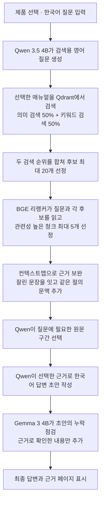

# PM209 매뉴얼 RAG는 어떻게 답할까?

사용자는 화면에서 제품을 고르고 한국어로 질문한다. 답변 아래에서는 근거가 된 매뉴얼 페이지를 열어볼 수 있다.

## 질문에서 최종 답변까지

## 검색에서 20개를 찾고 5개로 좁히는 이유

1. **후보 찾기.** Qwen3-Embedding 0.6B는 영어 질문을 벡터로 바꿔 뜻이 비슷한 문서 조각(청크)을 찾는다. BM25는 제품명·버튼명처럼 질문과 단어가 겹치는 청크를 찾는다. Qdrant는 두 검색의 **순위에 50%씩** 비중을 줘 후보를 최대 20개 추린다.
2. **순서 다시 매기기.** BGE 리랭커(`BAAI/bge-reranker-v2-m3`)는 영어 질문과 후보 청크의 텍스트를 한 쌍씩 읽고 관련성 점수를 매긴다. 이 점수가 높은 최대 5개가 답변 근거의 출발점이다.
3. **주변 문맥 붙이기.** 컨텍스트맵은 각 청크가 같은 페이지의 어느 절이나 표·그림 설명에 연결되는지 기록한 정보다. 상위 청크의 본문 문장이 중간에 끊겼다면 조건이 맞을 때 다음 청크에서 문장 끝을 잇고, 연결된 부모 문맥을 가져온다. 이어서 Qwen이 원래 한국어 질문을 보고 필요한 원문 구간을 고른다. 이 과정이 **문맥 압축**이다.

## Qwen이 답하고 Gemma가 점검하는 방식

Qwen은 질문에 필요한 사실과 근거를 연결해 초안을 쓴다. 그다음 **LangChain의 `ChatOllama`를 통해 노트북의 Ollama에서 실행되는 Gemma 3 4B를 호출**한다. 무엇을 점검하고 언제 문장을 붙일지는 프로젝트 코드에 정해 두었다. [Gemma 연결 코드](../src/verification.py) · [답변 생성과 점검 코드](../scripts/manual_chat.py)

Gemma는 **원래 질문, 이미 찾은 근거, Qwen 초안**을 함께 본다. 근거에는 있는데 초안에서 빠진 내용이 발견되면 Gemma를 한 번 더 호출해 보완 문장을 만든다. 보완 문장이 근거 검사를 통과하면 초안 뒤에 붙이고, 추가할 내용이 없으면 초안을 그대로 보여준다.

예를 들어 “Wi-Fi 창에는 무엇이 표시되나요?”라는 질문의 매뉴얼 근거에는 **연결 상태**와 **연결된 AP 이름**이 모두 있었다. 실제 답변은 AP 이름만 언급했고 Gemma도 추가하지 않았다. 이 사례는 검색으로 필요한 근거를 찾은 일과 최종 답변에 그 내용을 담은 일이 서로 다른 평가 대상임을 보여준다.

## Agentic RAG 실험과 현재 구성

이전에 실험한 **Agentic RAG**에서는 Qwen이 근거를 본 뒤 바로 답할지, 다시 검색할지, 부모 문맥이나 표 전체를 더 읽을지 선택했다. LangGraph가 그 선택에 따라 다음 단계를 실행했다. 현재 UI에서는 검색과 리랭킹 순서가 정해져 있고, Gemma의 역할은 **이미 찾은 근거 안에서 답변의 누락을 점검하는 것**이다. [Agentic RAG 실험 기록](qa100_agentic_20261117/REPORT.md)

## 질의셋과 최종 답변 평가 방법

1. **질문을 뽑는다.** PM209 테스트셋에 이미 있는 영문 질문을 한국어로 옮겼다. 이전 실험의 질문은 제외하고, 원본 정답의 근거 유형에 따라 본문 34개·표 33개·그림 33개를 뽑았다. 최종 표본을 확정하는 과정에서 응답 생성에 실패한 그림 1문항을 교체했고, 이후 번역이나 근거 문제로 채점이 어려운 5문항도 같은 매뉴얼·같은 유형의 새 질문으로 교체했다. 마지막 교체 때는 기존 95개 답변과 점수를 유지했다.
2. **모델 입력과 채점 자료를 구분한다.** 시스템에는 선택한 제품과 한국어 질문만 준다. 평가자는 PM209 원본 정답과 제품 매뉴얼을 읽고, 그 질문에 답하려면 어떤 사실이나 동작이 꼭 필요한지 먼저 적어 둔다. 원본 정답과 매뉴얼이 충돌하면 실제 매뉴얼을 우선한다.
3. **사용자에게 표시된 최종 답변을 채점한다.** Gemma는 답변의 누락을 점검하고, 최종 점수는 Codex가 매겼다. 필수 항목 하나를 충족하면 1, 틀리거나 빠뜨리면 0으로 센다. 뜻이 같은 표현·단위와 매뉴얼에 있는 다른 유효한 방법도 인정한다. 별개의 잘못된 사실을 덧붙이면 충족 개수에서 건당 1을 빼되 최저점은 0이다. 가능 여부를 반대로 안내하는 등 미리 정한 결정적 오류나 무응답은 해당 문항을 0점 처리한다.

**계산 예시.** “패널에서 어떤 안전 모드를 사용할 수 있나요?”의 필수 항목은 모드 5개다. 실제 답변은 그중 Normal과 Reduced 두 개만 정확히 제시해 **2 ÷ 5 × 100 = 40점**을 받았다. 반면 버튼의 *용도*를 묻는 질문이라면 버튼을 눌렀을 때 일어나는 일을 설명하는 것으로 충분하다. 화면상의 위치는 필수 항목에 넣지 않는다.

**전체 점수는 100개 문항 점수의 평균**이다. 필수 항목이 한 개인 질문과 다섯 개인 질문도 전체 평균에서는 같은 비중을 갖는다. 문항 점수는 반올림하지 않고 계산한 뒤, 최종 평균만 소수 첫째 자리로 표시했다.

| 자료 유형 | 평가 문항 | 최종 답변 평균 점수 |
|---|---:|---:|
| 본문 | 34 | 88.0점 |
| 표 | 33 | 73.9점 |
| 그림 | 33 | 80.3점 |
| **전체** | **100** | **80.8점** |

100문항 중 만점은 76개, 부분점수는 10개, 0점은 14개였다. **80.8점**에는 부분점수가 반영되어 있다. [상세 채점 기준](qa100_holdout_20261123/intent_review_v1/채점기준_v2.md) · [100문항 평가 보고서](qa100_holdout_20261123/score_v2_full100/REPORT.md)
