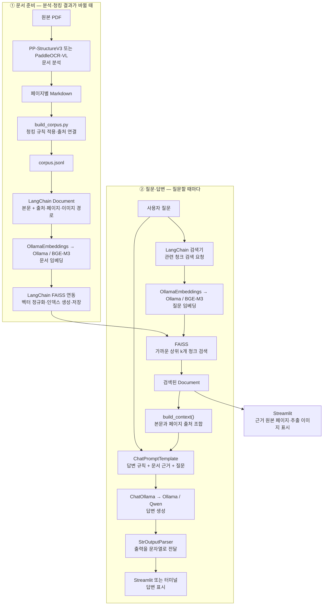

# 프로젝트 핵심 정리

## 프로젝트 의도와 수행 내용

**PP-StructureV3와 PaddleOCR-VL로 같은 PDF를 분석하고, 각각의 결과를 LangChain 기반 로컬 RAG에 연결해 문서 분석·검색·답변의 관계를 직접 확인한 프로젝트다.** Paddle 계열 문서 분석 방식과 RAG의 구성 원리를 학습하고, 실제 결과의 차이와 실패 원인을 설명하는 것이 목적이다.

1. B2B Dashboard 매뉴얼 42페이지를 CPU 경량 Structure·GPU Structure·GPU VL의 세 구성으로 분석했다.
2. 원본과 대조해 본문 누락·오인식, 제목과 설명의 연결, 읽기 순서, 표의 행·열·값을 비교했다.
3. 분석 결과에 청킹 규칙을 적용하고 BGE-M3·FAISS·Qwen을 연결해 문서 기반 질문·답변을 구현했다.
4. 분석 방식별 코퍼스·인덱스로 같은 질문의 검색을 비교하고, 기존·VL의 실제 답변도 확인했다.
5. Streamlit에서 분석 방식을 선택하고 답변·원본 페이지·추출 이미지를 함께 확인할 수 있게 했다.

공개 사전학습 모델을 적용하고 실행 조건과 연결 코드를 구성했다. 모델 학습이나 파인튜닝은 수행하지 않았다.

## 문서 분석에 사용한 세 가지 구성

| 구성 | 사용 목적·실행 조건 | 주요 모델 |
|---|---|---|
| CPU 경량 PP-StructureV3 | 처음 CPU 노트북에서 간단한 RAG를 구성하기 위한 경량 설정. 페이지 폭 2,000px | 레이아웃 `PP-DocLayout-S`, 글자 검출 `PP-OCRv5_mobile_det`, 영어 인식 `en_PP-OCRv5_mobile_rec`, 표 구조 `SLANet_plus` |
| GPU PP-StructureV3 | GPU 노트북에서 더 큰 모델로 분석 품질 개선을 시도한 구성. 실제 VRAM 약 8GB에 맞춰 페이지 폭 1,200px·배치 1 | 레이아웃 `PP-DocLayout_plus-L`, 영역 분석 `PP-DocBlockLayout`, 글자 검출·인식 `PP-OCRv5_server_det`·`PP-OCRv5_server_rec`, 표 구조 `SLANeXt_wired`·`SLANeXt_wireless` |
| GPU PaddleOCR-VL 1.6 | 역할별 모델을 조합하는 Structure와 시각·언어 모델 기반 분석을 비교하기 위한 구성. 같은 8GB GPU에서 페이지 폭 1,200px·배치 1 | 레이아웃 `PP-DocLayoutV3`와 문서 인식 `PaddleOCR-VL-1.6-0.9B` |

세 구성 모두 같은 PDF 42페이지 분석을 완료했다. CPU 경량 결과에는 Markdown·추출 이미지를 저장했고, 새 GPU 두 결과에는 JSON도 함께 저장했다. 문서 분석 비교에는 수동 보정 전 출력을 사용했다.

두 Structure는 같은 PP-StructureV3 파이프라인에서 모델과 설정을 바꾼 것이다. 새 GPU 구성은 정확도 개선을 기대한 후보이며, 이 문서에서 더 좋은 결과가 보장된 구성은 아니다. CPU와 GPU 결과는 모델뿐 아니라 입력 해상도도 달라서 결과 차이를 GPU나 모델 크기 하나의 효과로 해석하지 않는다.

RAG에는 세 구성을 **별도 프로필로 연결**했다. CPU 경량 결과에 원본 대조 보정을 적용한 `existing`, 보정 없는 GPU 결과인 `structure`·`vl`을 선택해 각각의 인덱스를 검색한다.

## 구성 요소와 역할: LangChain 흐름 기준

LangChain은 문서·임베딩·검색·프롬프트·답변 모델을 연결하는 프레임워크다. 아래는 실제 코드의 실행 순서이며, 문서 분석은 Paddle이, 청킹은 `build_corpus.py`가 담당한다.

### 1. 문서 준비: 검색 자료 만들기

| 순서 | 구성 요소 | 역할 |
|---|---|---|
| 1. 문서 분석 | PP-StructureV3 / PaddleOCR-VL | PDF의 글자·표·배치를 분석해 Markdown·JSON·이미지를 생성 |
| 2. 청킹·출처 연결 | `split_page()`와 코퍼스 생성 코드 | 기능 항목을 나누고 페이지 문맥·원본 PDF·이미지 경로·해시를 보관. 표·경계가 불명확한 페이지는 전체 유지 |
| 3. 문서 객체 생성 | LangChain `Document` | 본문은 `page_content`, 페이지·항목·출처·이미지는 `metadata`로 담음 |
| 4. 임베딩 | `OllamaEmbeddings` → Ollama의 BGE-M3 | 청크 본문을 1,024차원 벡터로 변환 |
| 5. 벡터 저장 | LangChain FAISS 연동 | 정규화한 문서 벡터와 Document를 로컬 인덱스로 저장 |

기존 Structure에는 원본 PDF로 확인한 보정을 적용했고 새 Structure·VL에는 적용하지 않았다. 청킹은 이 매뉴얼에 맞춘 제목·번호 기반 규칙을 사용했다.

### 2. 질문·답변: 검색한 근거로 답하기

| 순서 | 구성 요소 | 역할 |
|---|---|---|
| 1. 질문 임베딩 | `OllamaEmbeddings` → BGE-M3 | 질문을 문서와 같은 벡터 공간으로 변환 |
| 2. 검색 | FAISS + `VectorStoreRetriever` | 질문과 가까운 상위 청크를 Document로 반환. `as_retriever(...).invoke(question)` 사용 |
| 3. 근거 구성 | `build_context()` | 검색 본문에 페이지 번호를 붙이고 입력 길이 한도 안에서 답변 근거를 구성 |
| 4. 프롬프트 구성 | `ChatPromptTemplate` | 답변 규칙·문서 근거·질문을 결합 |
| 5. 답변 생성 | `ChatOllama` → Ollama의 Qwen3 | 검색된 텍스트를 읽고 한국어 답변과 페이지 출처를 생성 |
| 6. 출력 | `StrOutputParser` → Streamlit / 터미널 | 모델 출력을 문자열로 받아 순서대로 표시 |

질문 벡터화는 Retriever가 FAISS 검색을 호출하는 과정에서 수행한다. 답변 체인은 실제 코드에서 다음과 같이 연결했다.

```python
chain = PROMPT | llm | StrOutputParser()
```

검색은 별도 함수로 실행하고 결과를 답변 체인에 전달한다. 검색을 먼저 수행한 뒤 답변하는 **2-step RAG** 구조다. LangChain이 하나의 순서를 강제해 전체 작업을 자동 처리하는 것은 아니다. [LangChain 공식 RAG 설명](https://docs.langchain.com/oss/python/deepagents/retrieval#2-step-rag)

## 전체 흐름



그림의 LangChain 검색기는 `VectorStoreRetriever`다. `store.as_retriever(search_kwargs={"k": 3})`로 검색기를 만들고, `retriever.invoke(question)`으로 실행한다. 실행하면 BGE-M3 질문 임베딩 → 질문 벡터 정규화 → FAISS 검색 → 상위 Document 반환이 이어진다. Qwen 답변 생성은 그다음 단계다.

Ollama는 BGE-M3와 Qwen을 로컬에서 실행하며, LangChain의 `OllamaEmbeddings`와 `ChatOllama`가 Ollama에 요청을 보낸다. 검색된 이미지 경로는 화면 표시에 사용하고 Qwen에는 텍스트 근거를 전달한다.

문서·청킹 내용이 바뀔 때 검색 자료를 준비한다. 질문할 때마다 전체 PDF 분석이나 전체 문서 임베딩을 반복하지 않는다. FAISS는 정규화한 벡터의 제곱 L2 거리를 사용해 코사인 유사도와 같은 순위로 검색한다. 기본 검색 근거 수는 3개이며 최적값으로 검증된 설정은 아니다.

## 청크 분할 규칙과 비교 해석

청크를 나누는 함수는 [src/build_corpus.py의 `split_page()`](src/build_corpus.py)다. 같은 파일의 `build()`에서 페이지별 Markdown을 읽고 이 함수를 호출해 검색 자료인 `corpus.jsonl`을 만든다. **경량 Structure·새 Structure·VL 모두 같은 분할 함수를 사용한다.**

문서 분석은 제목·본문·표 등의 영역과 내용을 인식하는 단계이며, 청킹은 그 결과를 검색에 사용할 단위로 묶거나 나누는 단계다. 현재는 문서 분석을 완료한 뒤 Markdown을 청킹하고, 그다음 임베딩과 인덱스를 만든다. 질문을 받을 때마다 청킹하지 않는다.

### 현재 `split_page()` 규칙

1. 기본은 페이지 전체를 한 청크로 유지한다.
2. HTML `<table>` 또는 Markdown 표 행이 있으면 페이지 전체를 유지한다. 화면 캡처에서 추출한 표도 이 조건에 포함된다.
3. `## 1 기능명`처럼 번호와 제목 사이에 공백이 있는 2단계 Markdown 제목을 찾는다. `1. 기능명`, `1) 기능명` 형식도 허용한다.
4. 첫 번호 제목부터 뒤쪽의 `##` 제목 구간이 2개 이상이면 분할을 시도한다. 이때 번호가 있는 제목들의 번호는 연속적이어야 한다. `3 → 4`처럼 중간 번호부터 시작해도 된다. 첫 번호 제목 뒤의 번호 없는 `##` 제목도 분할 대상에 포함될 수 있다.
5. 번호가 글자에 붙은 줄(`3Search` 등), 숫자만 있는 제목, 빈 설명 구간 등이 있으면 페이지 전체를 유지한다.
6. 분할할 때 각 제목부터 다음 제목 직전까지를 한 청크로 묶고, 첫 번호 제목 앞의 공통 페이지 설명을 각 청크에 붙인다.

이는 이 매뉴얼에 맞춘 제목·번호 기반 규칙이다. 고정 글자 수로 자르거나 LLM이 의미를 판단해 모든 기능을 나누는 방식은 아니다. 큰 페이지를 반드시 작은 청크로 나누는 길이 제한도 없다.

`split_page()`는 **검색 자료 생성 전의 분할**을 담당한다. [src/rag.py의 `build_context()`](src/rag.py)는 **검색 후의 근거 구성**을 담당하며, 검색된 청크에 페이지 번호를 붙여 합친다. 현재 8,000자 한도를 넘는 청크는 통째로 제외하므로, 큰 청크가 답변 근거에 들어가지 못할 수 있다.

### 같은 규칙인데 청크 수가 달라지는 이유

분석 결과의 제목 형식·번호 보존·표 포함 여부가 달라서 같은 규칙도 다른 분할 결과를 만든다. 예를 들어 같은 캡처를 이미지로 남긴 출력과 표로 변환한 출력은 표 보존 조건의 적용 여부가 달라질 수 있다.

| 보정 전 분석 결과 | 페이지 수 | 청크 수 | 여러 청크로 분할된 페이지 수 |
|---|---:|---:|---:|
| 기존 CPU 경량 Structure | 42 | 59 | 9 |
| 새 GPU Structure | 42 | 44 | 1 |
| GPU VL | 42 | 55 | 9 |

기존 RAG의 73개 청크는 원본 대조 보정을 적용한 뒤의 값이며, 경량 모델의 원래 출력은 59개다. 경량 결과도 번호·제목 기반 분할에 잘 맞는 페이지가 있었다. **청크 수는 문서 분석 정확도 점수가 아니다.**

이번 비교는 각 분석 결과에 동일한 분할 규칙을 적용한 실험이다. 각 결과를 같은 내용·크기의 청크로 맞춘 실험은 아니므로 검색 차이에는 문서 인식 차이와 그에 따른 청크 구성 차이가 함께 반영된다. 본문·표 인식, 제목·읽기 순서, 청크 구성, 검색·답변 품질을 구분해 해석한다.

## 연결한 RAG와 확인 결과

| 프로필 | 사용한 분석 결과 | 청크 수 | 보정 |
|---|---|---:|---|
| `existing` | 기존 CPU 경량 Structure | 73 | 원본 대조 보정 적용 |
| `structure` | 새 8GB GPU Structure | 44 | 없음 |
| `vl` | 새 8GB GPU VL | 55 | 없음 |

기존 코퍼스는 유지하고 새 두 결과에는 별도 인덱스를 만들었다. 청크 수는 제목 형식·표 포함 여부·보정에도 영향을 받으므로 정확도 점수가 아니다.

문서 분석에서 선택한 원문 구절 19개의 정규화 일치는 새 Structure 8개·VL 18개, 정형 표 3개의 168셀 일치는 Structure 108개·VL 168개였다. 이번 본문·정형 표에서는 VL이 더 잘 보존했지만 작은 캡처 오인식·번호 누락·읽기 순서 문제도 남았다. 이는 전체 문서 정확도가 아니며 입력 조건이 다른 기존 경량 모델과의 단일 모델 비교도 아니다. [분석 보고서](tests/reports/analysis_review.md)

### 이미지 평가: 화면을 남겼는가, 화면 속 글자도 읽었는가?

PDF에 붙어 있는 **대시보드 화면 캡처**를 평가했다. 비교 대상은 새 GPU Structure와 GPU VL이며, 이미 저장된 분석 결과를 확인했다. CPU 경량 결과는 이번 이미지 평가에서 제외했다.

원본 PDF의 6페이지에서 **화면 캡처 7개**를 골랐다. 각 캡처에서 버튼명·날짜·필드명 등 확인할 문구를 5개씩 정해 **총 35개 문구**를 비교했다.

확인한 내용은 다음과 같다.

- **이미지 저장:** 원본 화면 캡처가 추출 이미지 파일에 얼마나 온전히 남았는가?
- **이미지 연결:** 저장된 이미지가 Markdown에도 연결되어 화면에서 확인할 수 있는가?
- **글자 추출과 전달:** 캡처 속 문구가 JSON에 정확히 남았는가? 그 문구가 RAG에 사용하는 Markdown 텍스트까지 전달됐는가?

이미지 저장·연결은 원본 캡처 면적의 95% 이상이 남으면 통과로 셌다. 여러 조각으로 저장된 경우에는 조각들이 합쳐서 덮는 면적을 확인했다. 문구는 해당 캡처 영역에서 확인하며, 이미지 파일 속에만 보이거나 캡처 밖 본문에 같은 단어가 있는 경우는 글자 추출 성공으로 세지 않았다.

| 확인 항목 | GPU Structure | GPU VL |
|---|---:|---:|
| 화면 캡처를 이미지 파일로 보존했는가? | 7개 중 6개 | 7개 중 4개 |
| 화면 캡처를 보존한 이미지가 Markdown에도 연결됐는가? | 7개 중 5개 | 7개 중 4개 |
| 캡처 속 문구가 JSON에 정확히 남았는가? | 35개 중 9개 | 35개 중 6개 |
| 그 문구가 Markdown 텍스트에도 남았는가? | 35개 중 1개 | 35개 중 6개 |

**이미지를 보여줄 수 있어도, 그 안의 글자를 RAG가 읽을 수 있다는 뜻은 아니다.** 현재 RAG는 Markdown의 텍스트를 사용하고 Qwen에 이미지 픽셀을 전달하지 않는다. JSON에만 있는 글자도 현재 RAG 입력에는 들어가지 않는다.

실제 사례를 보면 차이가 분명하다.

- **Structure 9페이지:** 확인할 문구 5개를 JSON에는 모두 남겼지만, Markdown에는 화면 이미지만 연결했다. 따라서 그 5개 문구는 캡처의 텍스트로 RAG에 전달되지 않았다.
- **Structure 31페이지:** 화면 캡처 이미지 파일은 저장했지만 Markdown에서 연결하지 않았다. 파일이 있다는 것과 RAG 화면에 연결된다는 것도 다르다.
- **VL 23페이지:** 원본 날짜 `2026-09-01`을 `2020-08-01`로 잘못 출력했다. 텍스트가 나왔어도 내용이 정확한지 확인해야 한다.

현재 VL은 `use_ocr_for_image_block=False` 설정이어서 **이미지로 분류된 영역의 내부 글자를 별도로 OCR하지 않았다.** 표로 분류한 영역에서는 텍스트를 출력하기도 했다. 따라서 이 결과는 현재 설정으로 얻은 결과이며, VL 자체의 이미지 이해 능력 전체를 평가한 점수는 아니다.

위 사례는 분석 출력을 살펴본 뒤 원본과 대조하려고 고른 일부 캡처다. 전체 이미지의 정확도나 버튼 위치·표의 필드와 값 연결까지 평가한 것은 아니다. 추출 이미지가 연결되지 않아도 Streamlit의 원본 PDF 페이지에서는 화면을 확인할 수 있다.

세부 계산 방법과 문구별 결과는 [이미지 평가 보고서](tests/reports/image_evaluation.md), 확인할 문구와 위치는 [평가 기준](tests/fixtures/image_checks.json)에 있다.

### RAG 검색·답변 평가

고정 질문 10개로 세 프로필의 검색을 비교했다. 숫자는 필요한 페이지를 모두 찾은 질문 수이며 답변 정확도가 아니다.

| 검색 범위 | 기존 보정 RAG | 새 Structure RAG | VL RAG |
|---|---:|---:|---:|
| top-3 | 8/10 | 6/10 | 8/10 |
| top-5 | 8/10 | 9/10 | 9/10 |

기존·VL 각각 6개 질문에서 실제 답변도 생성했다. VL은 상세 조건 열기와 20pt 배점을 함께 묻는 질문에 두 페이지의 근거를 사용해 답했지만 H1 Tag의 `M`을 점수 항목이라고 잘못 해석했다. 기존 RAG도 같은 H1 질문에서 오답을 냈다. 기존 보정 코퍼스와 새 보정 없는 결과의 차이도 함께 고려해야 한다. 정량 RAG 기록은 CPU 실험이며 이후 GPU 실행 옵션과 UI를 추가했다. [RAG 검증 보고서](tests/reports/rag_vl_review.md)

## 이번 실습으로 확인한 내용

- 문서 분석 품질이 좋아져도 청킹·검색·답변이 모두 자동으로 좋아지는 것은 아니다.
- 필요한 페이지를 검색해도 입력 길이 때문에 근거가 제외되거나 답변 모델이 표 기호·범례를 잘못 해석할 수 있다.
- 이미지에서 텍스트·표를 추출하는 것, 이미지를 화면에 표시하는 것, 답변 모델이 이미지 픽셀을 이해하는 것은 서로 다른 기능이다. 현재는 앞의 두 기능을 구현했다.
- RAG는 검색한 외부 문서를 답변 입력에 제공하는 구성이다. 실제 대시보드의 실시간 점수를 조회하거나 모델을 재학습시키는 시스템은 아니다.

세부 실행은 [README.md](README.md), 코드 설명은 [src/README.md](src/README.md), 비교 자료는 [tests/README.md](tests/README.md), 다음 작업 상태는 [HANDOFF.md](HANDOFF.md)를 참고한다.
