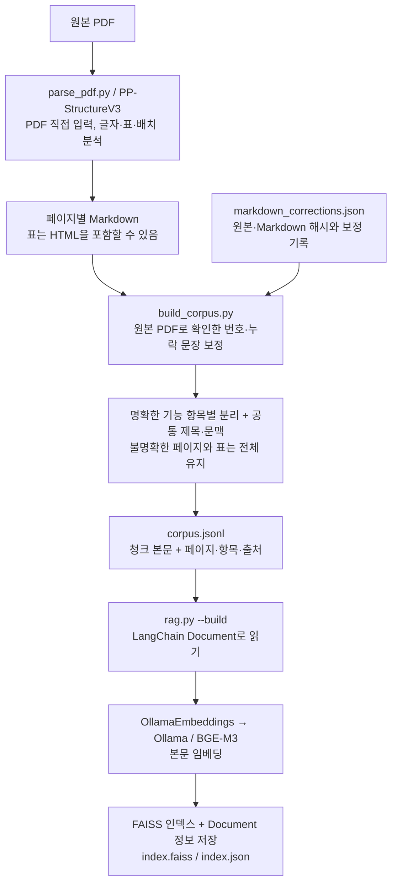
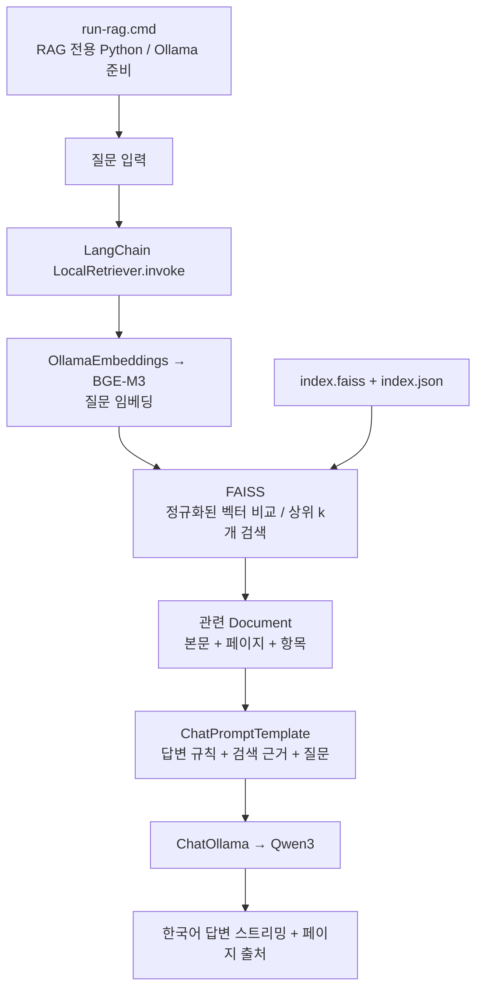

# rag_activity — PDF 매뉴얼 로컬 RAG

**PDF → Paddle Markdown → 기능 항목별 청크 → LangChain Document → BGE-M3 / FAISS 검색 → Qwen 답변**으로 구성합니다.
RAG는 검색한 문서를 LLM의 입력에 제공하는 방식이며 모델을 재학습시키지 않습니다.

Python 파일 설명은 [src/README.md](src/README.md), Paddle 계열의 역할과 발전 과정은 [paddle.md](paddle.md)를 참고하세요.

## 구성과 역할

| 구성 요소 | 역할 |
|---|---|
| PaddlePaddle | 문서 분석 모델을 실행하는 딥러닝 프레임워크 |
| PaddleOCR / PP-StructureV3 | PDF의 글자·표·배치를 분석해 페이지별 Markdown 저장 |
| 직접 작성한 청킹 규칙 | 명확한 기능 항목을 나누고 각 청크에 페이지의 공통 문맥 추가 |
| LangChain Document | 청크 본문과 페이지·항목·출처 정보를 담는 파이썬 객체 |
| LangChain OllamaEmbeddings | Ollama에서 BGE-M3를 호출하는 연결 클래스 |
| BGE-M3 (`bge-m3:567m`) | 문서와 질문을 1,024차원 벡터로 변환 |
| FAISS / LangChain LocalRetriever | 로컬 벡터 인덱스 검색, 결과를 Document로 반환 |
| ChatPromptTemplate / ChatOllama | 질문·문서 근거·답변 규칙 구성 및 Qwen 호출 |
| Qwen3 (`qwen3:4b-instruct`) | 검색된 문서 본문을 읽고 한국어 답변 생성 |
| Ollama | BGE-M3와 Qwen을 같은 PC에서 실행하는 프로그램 |

Windows / Python 3.10 / CPU 환경입니다. RAG 패키지는 프로젝트의 `.venv`, Paddle 패키지는 별도 `paddle-env`에 설치합니다.
모델 가중치는 기존 Ollama 저장소를 사용합니다. OpenAI API나 별도 벡터 DB 서버는 필요하지 않습니다.

## 문서 준비 흐름



현재 PDF는 `documents/B2B Dashboard Manual_v3.pdf`, 총 **42페이지**입니다.
현재 규칙과 원본 대조 보정을 적용하면 **73개 청크**를 만듭니다. 17개 페이지에서 48개 항목 청크가 생성되고, 나머지 25개 페이지는 페이지 전체를 유지합니다.

청킹은 다음 기준을 사용합니다.

- 명확한 번호가 붙은 기능 제목에서 분리하고, 상위 메뉴·제목·화면 소개를 각 청크 본문에 포함합니다.
- 앞 페이지의 번호를 이어받는 3·4번, 5·6번도 분리합니다. 청크 ID의 순번과 원본 항목 번호는 별개입니다.
- 항목 아래의 일반 번호 목록과 하위 제목은 함께 유지합니다.
- 표는 분할하지 않습니다.
- 번호가 깨졌거나 빠진 경우, 설명이 비어 있는 경우, 경계가 불명확한 경우에는 페이지 전체를 유지합니다.
- 이 규칙은 현재 매뉴얼의 Markdown 형식에 맞춘 보수적인 규칙이며, 의미를 자동 판단하는 AI 청킹은 아닙니다.

예를 들어 20페이지는 `1 Business Unit and Country`, `2 Issue Filter`, `3 Page Details`로 분리합니다.
각 청크에는 `MONITORING RESULTS > Spec Monitoring` 경로와 화면 소개가 함께 들어갑니다.

청크를 나누는 주체는 Paddle이 아니라 **직접 작성한 `build_corpus.py`**입니다. Paddle은 문서를 분석해 Markdown을 만드는 역할입니다.
원본 대조에서 9·11·15·20·22·23·24·31·32페이지의 제목 형식, 번호 또는 설명 누락을 확인했습니다.
원본에서 확인한 문장만 `data/rag/markdown_corrections.json`에 기록해 청킹 전에 적용합니다. Paddle의 원래 Markdown은 수정하지 않습니다.
원본 PDF 또는 해당 Markdown이 바뀌면 해시 검사로 보정 적용을 중단합니다. 재파싱 후에는 보정 기록을 다시 검토해야 합니다.
32페이지 `Add item`의 본문이 DICT List/Change Log를 설명하는 것은 원본 문서의 내용이므로 그대로 유지했습니다.

파싱 시 PDF 경로를 Paddle에 직접 전달합니다. 페이지를 별도 PNG로 변환하는 코드는 없으며 렌더링은 Paddle 내부에서 처리합니다.
Paddle이 Markdown의 그림 영역을 이미지 파일로 함께 저장할 수 있습니다. `run_summary.json`은 원본 해시와 전체 페이지 처리 완료를 확인하는 기록입니다.

## 질문·답변 흐름



질문할 때는 `rag.py → llm_client.py`가 실행됩니다. PDF 분석이나 전체 문서 임베딩을 다시 수행하지 않습니다.
질문마다 독립적으로 검색하며 이전 대화는 전달하지 않습니다.

FAISS는 정규화한 문서·질문 벡터의 **제곱 L2 거리**를 비교하는 `IndexFlatL2`를 사용합니다.
정규화한 벡터에서는 `제곱 거리 = 2 - 2 × 코사인 유사도`이므로 검색 순위는 코사인 검색과 같습니다.
화면의 점수는 코사인 유사도로 환산한 값이며 정답 확률이 아닙니다.
기본 `top-k=3`은 출발 설정입니다. 최적값으로 검증된 것은 아니며 `--top-k`로 비교할 수 있습니다.

Qwen에는 벡터가 아닌 **검색된 본문과 출처**가 전달됩니다. Markdown 이미지 링크는 실제 이미지 입력이 아닙니다.
프롬프트는 문서에 근거한 답변, 원문 메뉴명 유지, 페이지 표시, 근거 부족 시 한계 설명을 지시합니다.

## 실행 방법

현재 PC에는 RAG 환경과 인덱스가 준비되어 있습니다.

1. **`run-rag.cmd`를 더블클릭**합니다.
2. `질문>`에 질문을 입력합니다.
3. `/exit`로 종료합니다.

예시 질문: **Spec Monitoring에서 이슈 필터를 초기화하려면?**

CPU에서는 모델을 불러오고 첫 답변을 생성하는 데 시간이 걸릴 수 있습니다.
시작 오류는 `outputs/rag/startup.log`에서 확인합니다. 코드 변경 전부터 열려 있던 채팅 창은 다시 실행하세요.

### 새 PC 준비

1. Python 3.10을 설치하고 저장소를 받습니다.
2. [Ollama Windows 안내](https://docs.ollama.com/windows)의 독립 실행 ZIP을 `%LOCALAPPDATA%\B2B-RAG\ollama`에 압축 해제합니다.
3. RAG 폴더의 PowerShell에서 전용 환경을 설치합니다.

```powershell
powershell.exe -NoProfile -ExecutionPolicy Bypass -File .\scripts\setup-rag.ps1
```

4. 서버를 시작하고 모델을 처음 한 번 내려받습니다.

```powershell
powershell.exe -NoProfile -ExecutionPolicy Bypass -File .\scripts\start-local-llm.ps1
$env:OLLAMA_HOST = '127.0.0.1:11435'
$ragRuntimeDir = powershell.exe -NoProfile -ExecutionPolicy Bypass -File .\scripts\get-runtime-dir.ps1
$ragOllamaExe = Join-Path $ragRuntimeDir 'ollama\ollama.exe'
& $ragOllamaExe pull bge-m3:567m
& $ragOllamaExe pull qwen3:4b-instruct
```

5. `run-rag.cmd`를 실행합니다. 모델 해시가 저장된 인덱스와 다르면 아래 갱신 명령을 실행합니다.

PDF·Markdown·코퍼스·FAISS 인덱스는 저장소에 포함할 수 있습니다. 가상환경과 모델 가중치는 Git에서 제외합니다.
현재 저장소의 이전 `index.json` 형식만 있는 경우에도 인덱스 갱신이 필요합니다.

### 데이터 갱신 및 확인

아래 명령은 RAG 폴더의 PowerShell에서 실행합니다.

```powershell
# 청킹 규칙 또는 Markdown 변경: 코퍼스 + 전체 임베딩 + 인덱스 갱신
powershell.exe -NoProfile -ExecutionPolicy Bypass -File .\scripts\build-rag.ps1

# 답변 생성 없이 검색만 확인
.\.venv\Scripts\python.exe -X utf8 -B .\src\rag.py "Spec Monitoring에서 이슈 필터를 초기화하려면?" --search-only

# 검색 개수를 바꿔 비교
.\.venv\Scripts\python.exe -X utf8 -B .\src\rag.py "모니터링 점수 계산 기준은?" --search-only --top-k 5

# 모델 호출 없는 회귀 테스트
.\.venv\Scripts\python.exe -X utf8 -B -m unittest discover -s tests -v
```

PDF가 바뀌면 **PDF 분석 → 코퍼스·인덱스 갱신** 순서로 실행합니다.
PDF를 새로 분석할 때만 Paddle 전용 환경이 필요합니다.

```powershell
# 새 PC에서 Paddle 환경을 처음 만들 때
$ragRuntimeDir = powershell.exe -NoProfile -ExecutionPolicy Bypass -File .\scripts\get-runtime-dir.ps1
python -m venv (Join-Path $ragRuntimeDir 'paddle-env')
$ragParserPython = Join-Path $ragRuntimeDir 'paddle-env\Scripts\python.exe'
& $ragParserPython -m pip install -r .\requirements-parser-lock.txt

# PDF 전체 분석
powershell.exe -NoProfile -ExecutionPolicy Bypass -File .\scripts\parse-pdf.ps1
powershell.exe -NoProfile -ExecutionPolicy Bypass -File .\scripts\build-rag.ps1
```

다른 PDF 지정 방법은 [documents/README.md](documents/README.md)를 참고하세요.
Ollama 주소는 `http://127.0.0.1:11435`입니다.
`get-runtime-dir.ps1`은 일반 LocalAppData와 Codex 앱의 LocalCache 아래 `B2B-RAG`를 순서대로 찾습니다.

## 파일 구성

| 위치 | 내용 |
|---|---|
| `src/` | 실행용 Python 4개와 파일별 설명 |
| `scripts/` | RAG 환경 설치, 서버 시작, 파싱·인덱스 갱신 |
| `documents/` | 원본 PDF |
| `outputs/parsing/pp_structurev3/` | 페이지별 Markdown·이미지와 파싱 완료 기록 |
| `data/rag/corpus.jsonl` | 청크를 한 줄에 하나씩 저장한 JSONL |
| `data/rag/markdown_corrections.json` | 원본 대조로 확인한 보정과 적용 대상 해시 |
| `data/rag/index.faiss` | 정규화된 벡터의 FAISS 인덱스 |
| `data/rag/index.json` | Document 본문·출처, 모델·코퍼스·인덱스 해시 |
| `requirements-rag.txt` / `requirements-rag-lock.txt` | RAG 직접 의존성과 검증된 전체 버전 |
| `requirements-parser*.txt` | 별도 Paddle 환경의 의존성 |
| `tests/test_rag.py` | 청킹·검색·저장·변경 감지 회귀 테스트. 평소 실행에는 사용하지 않음 |

`Document`는 파일 형식이 아닌 파이썬 객체입니다. 실행 중에는 객체로 사용하고 디스크에는 JSON과 FAISS 파일로 보관합니다.
`outputs/legacy`의 이전 수동 설명·검색 기록은 현재 검색에 사용하지 않습니다. 이번 원본 대조 보정은 위의 `markdown_corrections.json`만 사용합니다.

## 한계와 설계 근거

- 항목 청킹은 검색 근거를 좁히기 위한 선택입니다. 필요한 맥락이 여러 청크에 흩어질 수 있으므로 실제 질문으로 페이지 단위 방식과 비교해야 합니다.
- 이미지에만 남은 내용, OCR 누락·오류는 검색 코드나 LangChain 도입만으로 복구되지 않습니다.
- 리랭킹·키워드 혼합 검색·자동 부모 페이지 확장·대화 기억은 추가하지 않았습니다.
- FAISS Flat 검색은 모든 벡터를 비교합니다. 현재 작은 문서 규모를 위한 선택이며 대규모 운영의 최적 구성으로 검증한 것은 아닙니다.
- 매뉴얼 사용법을 안내하며 실제 대시보드의 현재 점수를 조회하지 않습니다.
- PDF·코퍼스·임베딩 모델이 바뀌면 오래된 인덱스 사용을 차단합니다. FAISS와 JSON 저장 쌍의 해시도 검사합니다.
- [유지보수가 종료된 langchain-community](https://github.com/langchain-ai/langchain-community/issues/674)는 사용하지 않습니다. LangChain의 `BaseRetriever`에 작은 FAISS 검색 구현을 연결합니다.

참고: [OllamaEmbeddings](https://docs.langchain.com/oss/python/integrations/embeddings/ollama), [ChatOllama](https://docs.langchain.com/oss/python/integrations/chat/ollama), [FAISS 거리 기준](https://github.com/facebookresearch/faiss/wiki/MetricType-and-distances).
