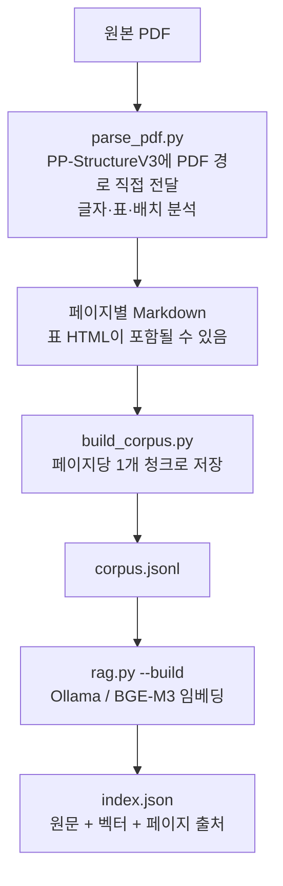
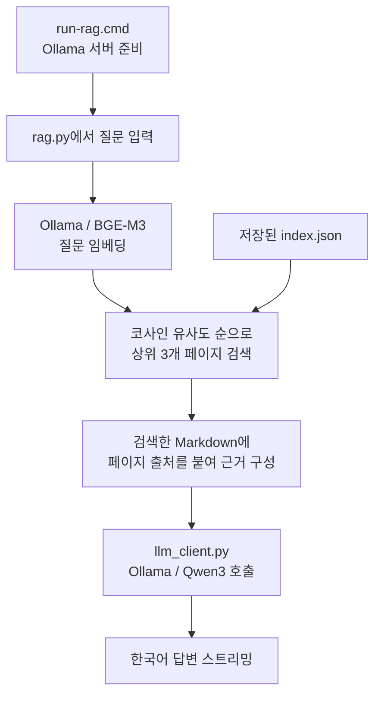

# rag_activity — PDF 매뉴얼 로컬 RAG

**PDF 직접 입력 → Paddle Markdown → 페이지별 청크 → 벡터 검색 → Qwen 답변**으로 구성한 최소 RAG입니다. RAG는 검색한 문서 내용을 LLM에 제공하는 방식이며 모델을 재학습시키지 않습니다.

이 문서는 전체 구성과 실행 방법을 설명합니다. Python 구현은 [src 코드 안내](src/README.md)를 참고하세요.

Paddle 계열의 역할과 발전 과정은 [paddle.md](paddle.md)에 간단히 정리했습니다.

## 현재 구성

- 문서: `documents/B2B Dashboard Manual_v3.pdf`, 총 42페이지
- 검색 자료: Paddle Markdown **페이지당 1개, 총 42개 청크**
- 문서 분석: PaddleOCR의 **PP-StructureV3**, PaddlePaddle 기반
- 임베딩: Ollama의 **BGE-M3** (`bge-m3:567m`), 1,024차원
- 답변: Ollama의 **Qwen3** (`qwen3:4b-instruct`)
- 실행: Windows, Python 3.10, CPU

| 구성 요소 | 하는 일 |
|---|---|
| PaddlePaddle | 문서 분석 모델의 추론 실행 기반 |
| PaddleOCR / PaddleX / PP-StructureV3 | PDF를 직접 받아 내부에서 페이지를 처리하고 글자·표·배치를 분석 |
| 직접 작성한 Python 코드 | Markdown을 청크로 저장하고 벡터 유사도로 검색 |
| Ollama | BGE-M3와 Qwen3를 로컬 API로 실행 |
| BGE-M3 | 문서와 질문을 숫자 벡터로 변환 |
| Qwen3 | 검색한 텍스트를 근거로 답변 생성 |

애플리케이션은 **pdfplumber·BeautifulSoup·pypdfium2를 직접 사용하지 않습니다.** Paddle Markdown에 포함된 HTML 표도 별도로 해석하지 않고 그대로 사용합니다. BeautifulSoup과 pypdfium2는 PaddleX 내부 기능에 필요하므로 설치 환경과 잠금 파일에 남아 있습니다. LangChain·LlamaIndex·별도 벡터 DB 서버는 사용하지 않습니다.

## 문서 준비 흐름



페이지별 분석 결과는 **Markdown만 저장**합니다. `run_summary.json`은 원본 식별·전체 페이지 완료 확인에 필요하므로 유지합니다. 표의 정답 여부를 검수하는 자료가 아닙니다.

페이지를 PNG로 변환·저장하는 코드는 없습니다. PDF 페이지의 이미지 처리는 Paddle 내부에 맡깁니다. Markdown 저장 시 Paddle이 그림 영역의 이미지 파일을 함께 저장할 수는 있습니다. 파싱은 실행할 때마다 PDF 전체를 처리하며, 별도 해상도 지정·페이지 선택·완료 페이지 재사용 기능은 제거했습니다.

원본 PDF 표와의 비교, 수동 설명 추가, 메뉴 연결 요약, 별도 OCR 대체 경로는 없습니다. 문서 내용은 Paddle의 Markdown 결과에 의존합니다.

## 질문·답변 흐름



평소에는 `rag.py → llm_client.py`가 실행됩니다. PDF를 다시 분석하지 않으며, Qwen은 검색된 텍스트만 받습니다. 이미지 링크를 전달해도 이미지 자체를 읽는 것은 아닙니다. 질문마다 독립적으로 검색하고 이전 대화는 전달하지 않습니다.

## 실행 방법

아래 실행은 PDF 분석과 검색 인덱스 생성이 완료된 환경을 기준으로 합니다. 새로 내려받은 저장소에는 코드와 설명 문서만 있습니다.

1. **`run-rag.cmd`를 더블클릭**합니다.
2. `질문>`에 질문을 입력합니다.
3. `/exit`으로 종료합니다.

Ollama 서버는 시작 스크립트가 준비합니다. 코드 수정 전에 열어 둔 채팅은 다시 열어야 합니다. CPU에서는 첫 글자까지 수십 초 이상, 전체 답변은 1~2분 이상 걸릴 수 있습니다. 오류는 `outputs/rag/startup.log`에서 확인합니다.

| 실행 시점 | 사용하는 Python 파일 |
|---|---|
| PDF 분석 | `parse_pdf.py` |
| 검색 자료·인덱스 갱신 | `build_corpus.py` → `rag.py --build` |
| 평소 질문·답변 | `rag.py` → `llm_client.py` |

## 폴더와 기록

```text
RAG/
├─ README.md                    전체 구성·흐름·실행 안내
├─ run-rag.cmd                  사용자 실행 파일
├─ requirements-parser.txt      파싱 주요 패키지
├─ requirements-parser-lock.txt 파싱 환경의 고정 버전 목록
├─ documents/                   원본 PDF
├─ data/rag/
│  ├─ corpus.jsonl              페이지별 Markdown 청크
│  └─ index.json                청크·벡터·원본 및 모델 식별 정보
├─ src/                         Python 구현과 파일별 README
├─ scripts/                     시작·파싱·인덱스 갱신 PowerShell
└─ outputs/
   ├─ parsing/                  Paddle 결과·실행 기록·과거 보관 이미지
   ├─ rag/                      시작 오류 로그·과거 검사 기록
   └─ legacy/                   사용하지 않는 이전 수동 검수 설명 보관
```

검색 근거와 답변은 화면에 표시합니다. 별도 답변 JSON 저장과 처리 시간·토큰 속도 측정은 하지 않습니다. 기존 검수 이미지·원본 텍스트·과거 검사 파일은 보관 자료이며 현재 검색 자료 생성에 사용하지 않습니다.

## 환경과 관리 명령

### 새 PC에서 처음 준비할 때

원본 PDF, 추출된 Markdown, 코퍼스·인덱스, 실행 로그, 모델과 가상환경은 Git에 포함하지 않습니다. 기존 PC의 로컬 파일은 그대로 유지합니다.

1. Windows에 Python 3.10과 Git을 설치하고 이 저장소를 내려받습니다.
2. [Ollama 공식 Windows 안내](https://docs.ollama.com/windows)의 독립 실행 ZIP을 `%LOCALAPPDATA%\B2B-RAG\ollama`에 압축 해제합니다. 그 안에 `ollama.exe`와 동봉 라이브러리가 있어야 합니다.
3. 프로젝트 루트의 PowerShell에서 파싱 환경을 준비합니다.

```powershell
$ragRuntimeDir = Join-Path ([Environment]::GetFolderPath('LocalApplicationData')) 'B2B-RAG'
python -m venv (Join-Path $ragRuntimeDir 'paddle-env')
$ragParserPython = Join-Path $ragRuntimeDir 'paddle-env\Scripts\python.exe'
& $ragParserPython -m pip install -r .\requirements-parser-lock.txt
```

4. 아래 관리 명령의 **서버 시작 → 최초 모델 다운로드**를 실행합니다. Paddle 분석 모델은 첫 파싱 시 다운로드되므로 인터넷이 필요합니다.
5. 사용할 PDF를 `documents/`에 넣습니다. 기본 파일명은 `B2B Dashboard Manual_v3.pdf`이며, 다른 이름은 [PDF 입력 안내](documents/README.md)처럼 `--pdf`로 지정합니다.
6. **PDF 분석 → 청크·인덱스 갱신**을 실행한 뒤 `run-rag.cmd`를 엽니다.

### 저장 위치와 관리 명령

모델과 파싱 가상환경의 위치는 `scripts/get-runtime-dir.ps1`이 찾습니다. 일반 `%LOCALAPPDATA%\B2B-RAG`를 먼저 확인하고, 없으면 `%LOCALAPPDATA%\Packages\OpenAI.Codex_*\LocalCache\Local\B2B-RAG`에서 찾습니다. 현재 PC에는 Codex 앱 저장 폴더에 설치되어 있습니다. `ollama/ollama.exe`는 실행 파일, `models/`는 BGE-M3·Qwen3, `paddle-env/`는 파싱 가상환경입니다. 시작·파싱 스크립트는 찾은 위치의 모델과 캐시를 사용합니다. 현재 주요 파싱 패키지는 PaddlePaddle 3.3.1, PaddleOCR 3.7.0이며 버전 목록은 요구사항 파일을 참고하세요.

Ollama 주소는 **`http://127.0.0.1:11435`**입니다. 같은 PC 안에서 통신하며 OpenAI API는 사용하지 않습니다. 최초 모델 다운로드에는 인터넷이 필요합니다.

아래 명령은 **RAG 폴더의 PowerShell**에서 실행합니다. `python`은 설치된 Python 3.10을 가리켜야 합니다.

```powershell
# 서버 시작
powershell.exe -NoProfile -ExecutionPolicy Bypass -File .\scripts\start-local-llm.ps1

# 검색만 확인
python -B .\src\rag.py "H1 Tag의 M은 무슨 뜻인가요?" --search-only

# PDF 직접 분석: 매번 전체 페이지 처리, 파싱 전용 가상환경 사용
powershell.exe -NoProfile -ExecutionPolicy Bypass -File .\scripts\parse-pdf.ps1

# Markdown 청크와 검색 인덱스 갱신
powershell.exe -NoProfile -ExecutionPolicy Bypass -File .\scripts\build-rag.ps1

# 최초 모델 다운로드·재설치: 위 서버 시작 후 Ollama 명령 사용
$env:OLLAMA_HOST = '127.0.0.1:11435'
$ragRuntimeDir = powershell.exe -NoProfile -ExecutionPolicy Bypass -File .\scripts\get-runtime-dir.ps1
$ragOllamaExe = Join-Path $ragRuntimeDir 'ollama\ollama.exe'
& $ragOllamaExe pull qwen3:4b-instruct
& $ragOllamaExe pull bge-m3:567m
```

모델 다운로드 전용 Python 파일은 사용하지 않습니다. 다운로드 명령의 `OLLAMA_HOST`는 현재 RAG 서버를 지정합니다. 모델이 이미 설치되어 있으면 다운로드를 다시 실행할 필요가 없습니다.

PDF를 바꾸면 **파싱 → 코퍼스·인덱스 갱신**을 실행합니다. 현재 파싱 스크립트의 기본 결과 폴더와 `documents/`의 원본을 기준으로 동작합니다.

## 단순화에 따른 한계

- 모든 페이지를 포함해도 그 안의 모든 정보가 추출되었다는 뜻은 아닙니다. Markdown에 이미지 링크만 있는 영역은 검색할 텍스트가 부족할 수 있습니다.
- 표의 OCR 오류·누락을 원본 PDF와 대조하거나 수동 설명으로 보완하지 않습니다. 정확도는 Paddle 추출 품질에 의존합니다.
- 관련 페이지 자동 확장·MMR·질문 유형별 표 필터를 제거했습니다. 여러 페이지를 연결해야 하는 질문의 답변이 부족할 수 있습니다.
- 한 페이지를 하나의 청크로 사용합니다. 현재 매뉴얼보다 긴 페이지를 사용하면 청크 분할과 입력 길이 설정을 조정해야 할 수 있습니다.
- LLM은 필요한 근거가 있어도 틀리거나 답변을 거절할 수 있습니다. 실제 현재 업무 점수는 조회하지 않습니다.
