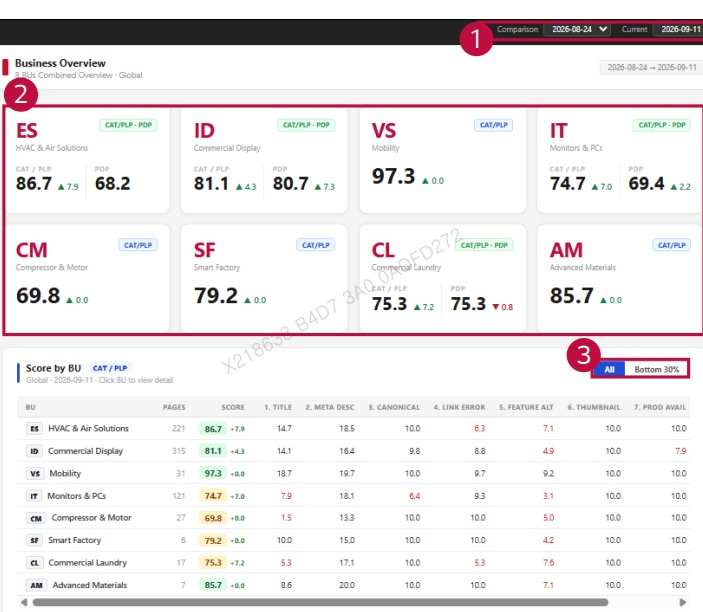

### 2. Dashboard Usage Guide 

2.2 Components by Page > MONITORING RESULTS > Business 

## Feature Guide 

View monitoring scores across business units. Click a business unit card to view its country results.

## 1 Date Comparison 

Select the Comparison and Current dates to compare scores from the two selected dates.

## 2 Business Unit Scores 

Check the CAT/PLP and PDP scores and their changes. Click a business unit card to view its country overview.

## 3 Score Filter 

Select All to show every business unit. Select Bottom 30% to focus on the business units with the lowest scores.

