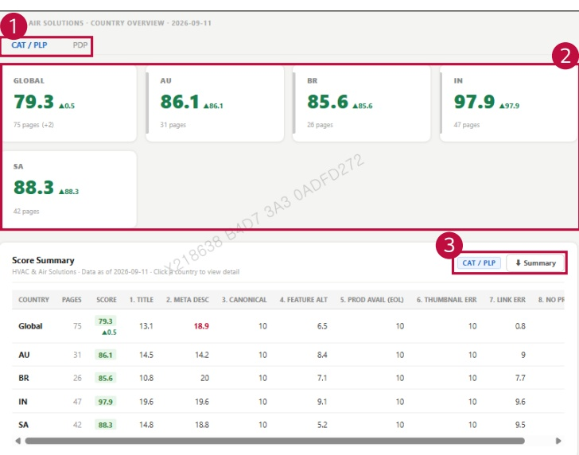

### 2. Dashboard Usage Guide 

2.2 Components by Page > MONITORING RESULTS > Business > Business Unit 

## Feature Guide 

Click a business unit card to view this screen. Compare country scores and monitored page counts for the selected business unit.

## 1 Page Type 

## 2 Country Results 

Check each country's score and change. Click a country card or its name in the table to view the detailed results.

## 3 Summary Download 

Check the active page type beside the Summary button. Click Summary to download the country score summary.

