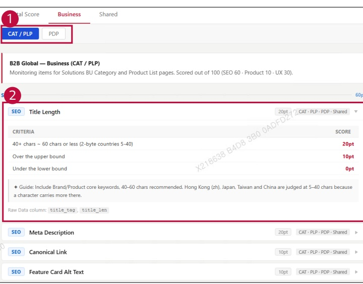

### 2. Dashboard Usage Guide 

2.2 Components by Page > REFERENCE > Monitoring Item > Business, Shared 

## Feature Guide 

View the evaluation criteria and scores for each monitoring item.

## 1 Page Type 

## 2 Item Details 

Click an item's arrow to show its criteria and scores. Read the Guide and Raw Data field names for reference. Click it again to hide the details.

