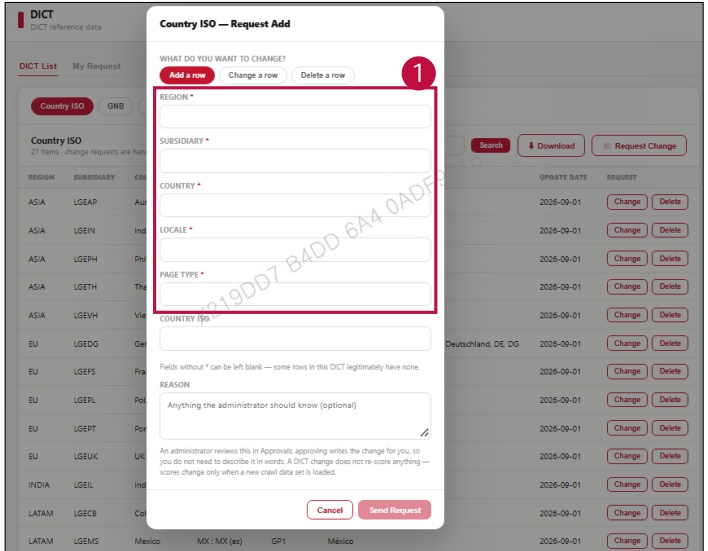

### 2. Dashboard Usage Guide 

2.2 Components by Page > REFERENCE > DICT 

## Feature Guide 

Click Request Change, then select Add a row to add a new row.

1Add a row 

Type the required values for Region, Subsidiary, Country, Locale, and Page Type. Click Send 

Request to submit the request.

