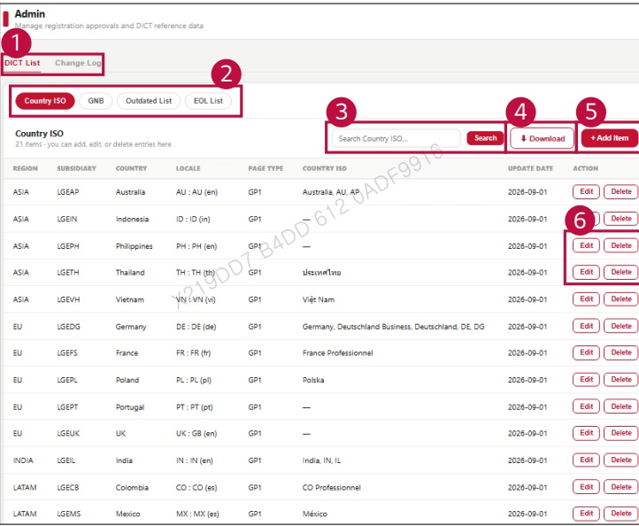

### 2. Dashboard Usage Guide 

2.2 Components by Page > ADMIN > DICT Management 

## Feature Guide 

Manage DiCT reference entries and view their change history in the admin view.

## 1 DICT List and Change Log 

Click DICT List to manage the current entries. Click Change Log to view past changes.

## 2 DICT Type 

Select Country ISO, GNB, Outdated List, or EOL List to manage that reference data.

3Search 

Type a keyword and click Search to find an entry.

4Download 

Click Download to download the selected data as a CSV file.