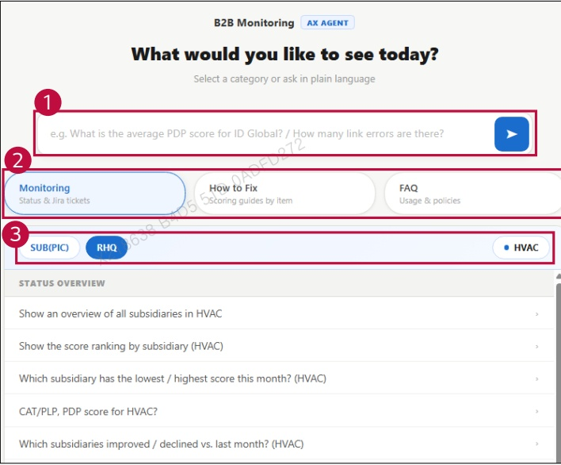

### 2. Dashboard Usage Guide 

2.2 Components by Page > WORKSPACE > AX Agent 

Dashboard Screen 

## Feature Guide 

Use the AX Agent to check monitoring status, find improvement guides, or get help with dashboard usage.

## 1 Question Input 

Type a question or select a suggested question. Press Enter or click the arrow button to send your question.

## 2 Category Selection 

Select Monitoring for status and Jira tickets, How to Fix for improvement guides, or FAQ for dashboard usage and policies.

3Suggested Questions View frequently used questions for your department.