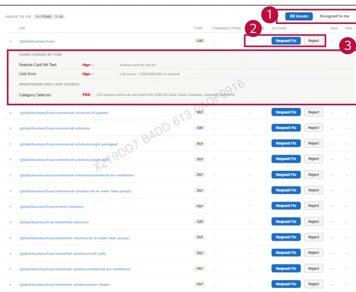

### 2. Dashboard Usage Guide 

2.2 Components by Page > MONITORING RESULTS > Business > Business Unit 

## Dashboard Screen 

## Feature Guide 

Click Pages to Fix and scroll down to view this screen. Review pages that need attention and submit a fix request or a rejection for review.

## 1 All Issues/Assigned to me 

Select All issues to view the fullist. Select Assigned to me to show the issues assigned to your account.

## 2 Request Fix or Reject 

Click Request Fix to open the Jira ticket form. Click Reject to type a reason and submit the issue for rejection review.

## 3 Page Details 

Click the arrow button to show the page's item results and score changes. Click it again to hide the details.

