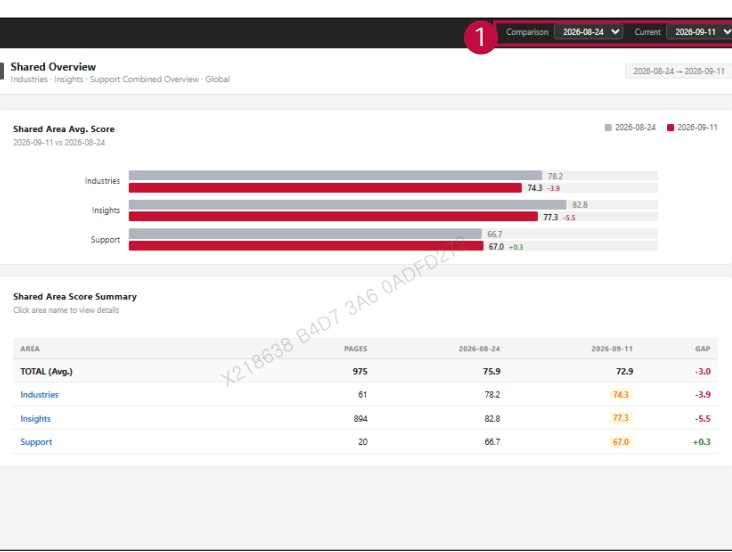

### 2. Dashboard Usage Guide 

2.2 Components by Page > MONITORING RESULTS > Shared 

## Feature Guide 

The chart compares current and previous scores for each shared unit. The table below shows page counts, scores, and score changes.

## 1 Date Comparison 

Select the Comparison and Current dates. Use the chart and summary table to check each shared area's score change.

