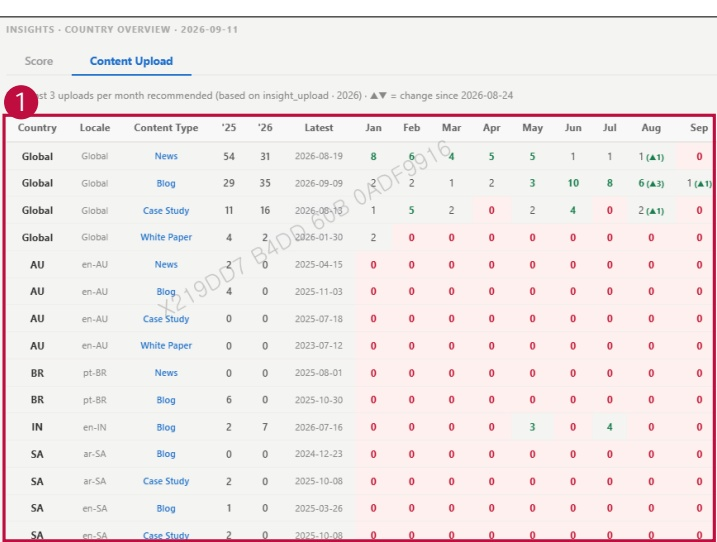

### 2. Dashboard Usage Guide 

2.2 Components by Page > MONITORING RESULTS > Shared > Insights > Content Upload 

## Feature Guide 

Click Content Upload on the Insights page to view this screen.

## 1 Content Upload 

Check monthly upload counts by country and content type to find months with no uploads.At least three uploads per month are recommended.

