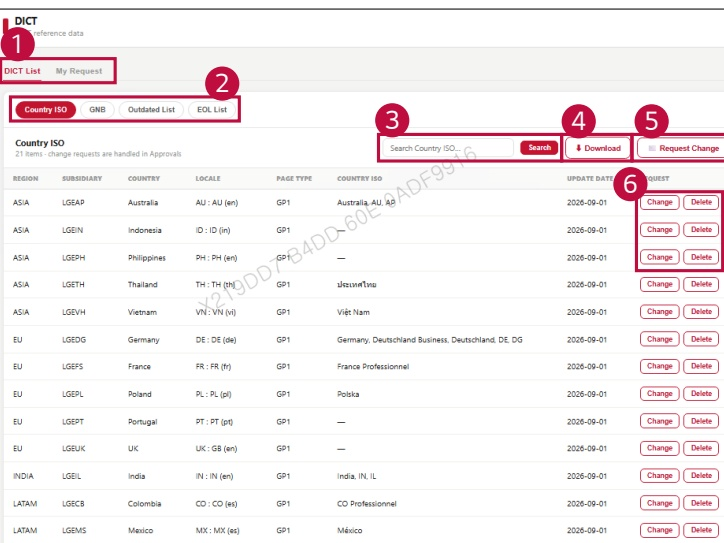

### 2. Dashboard Usage Guide 

2.2 Components by Page > REFERENCE > DICT 

## Feature Guide 

View DICT reference data and submit requests to change or delete an entry.

## 1 DICT List and My Requests 

Click DICT List to view the reference data. Click My Request to check the requests you have submitted.

## 2 DICT Type 

Select Country ISO, GNB, Outdated List, or EOL List to view the corresponding reference data.

3Search 

Type a keyword and click Search to find an entry.

## 4 Download 