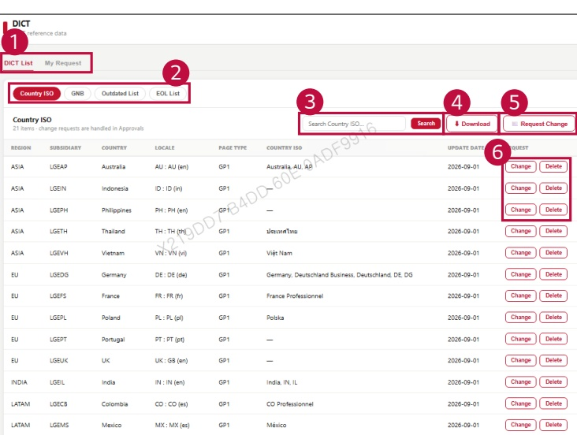

### 2. Dashboard Usage Guide 

2.2 Components by Page > REFERENCE > DICT 

## Feature Guide 

View DICT reference data and submit requests to change or delete an entry.

## 5 Request Change 

## 6 Change, Delete 