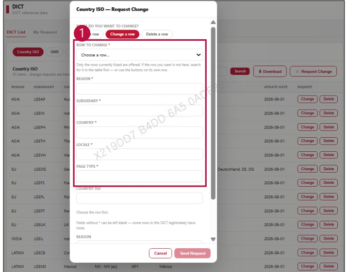

### 2. Dashboard Usage Guide 

2.2 Components by Page > REFERENCE > DICT 

## Feature Guide 

1Change a row 

Select Row to Change, then type the updated values for Region, Subsidiary, Country,

Locale, and Page Type.

