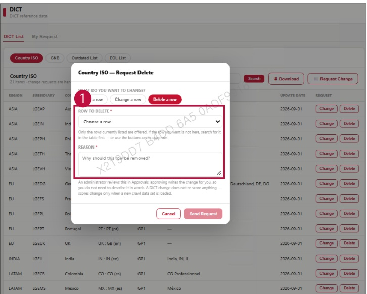

### 2. Dashboard Usage Guide 

2.2 Components by Page > REFERENCE > DICT 

## Feature Guide 

Click Request Change, then select Delete a row to delete an existing row.

## 7 Delete a row 

Select Row to Delete, type the reason in Reason, then click Send Request to submit the deletion request.

