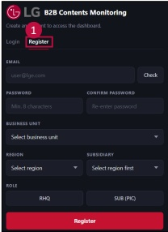
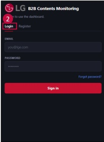

### 1. About dashboard 

### 1.3 Access > Registration & Login 

## Registration & Login Screen 

## Access Details 

## Register 

User must create a valid account through the Reqister tab 

* If you are already reqistered, you do not need to reqister again.Please go to the Loqin tab and log in with your EP ID (Initial password: 123456)

Click the "Register" tab on the login page.

-Type your email address (ID) and password.

Password must contain at least 8 characters 

Submit the reqistration request 

## Login 

-Loq in using your reqistered email and password 

-If login fails, check your account permission.