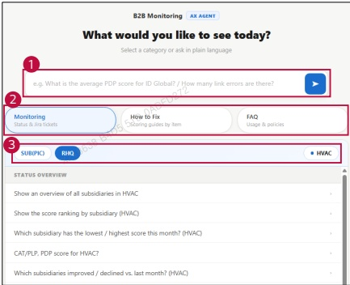

### 2. Dashboard Usage Guide 

### 2.2 Components by Page >WORKSPACE >AX Agent 

## Dashboard Screen 

## Feature Guide 

Use the AX Agent to check monitoring status, find improvement guides, or get help with dashboard usage.

## Question Input 

Typea questionor selecta suggested questionPress Enterorclick the arrowbutton to send your questtion.

## Category Selection 

Select Monitoring for status and Jira tickets, How to Fix for improvement guides, or FAQ for dashboard usage and policies.

## Suggested Questions 

View frequently used questions for your department 