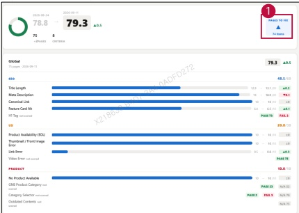

### 2. Dashboard Usage Guide 

### 2.2 Components by Page >MONITORING RESULTS > Business > Business Unit 

## Dashboard Screen 

## Feature Guide 

Click a country card to view this screen. Check the selected country's tota score and item results. Compare the current and previous scores to identify changes.

## Pages to Fix 

Click Pages to Fix to show or hide the pages that need attention.