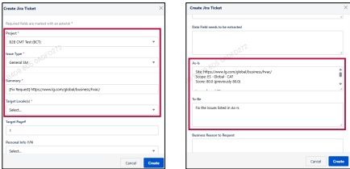

### 2. Dashboard Usage Guide 

2.2 Components by Page >MONITORING RESULTS > Business > Business Unit > Jira Ticket 

## Dashboard Screen 

## Feature Guide 

## Jira Ticket Creation Guide 

Click Request Fix to open the Jira ticket creation form.

## 1 

## ②

## Project, Issue Type, Summary, Target Locale(s)

Select theProject,Issue Type,and Target Locale(s.InSummary,briefly descibe h request and include the URL of the page to be corrected.

## As-Is & To-Be 

As-Is:Typethe page URL, monitoring score, and a brief description of the issue.To-Be: Type the correct value or content that should replace the current version 