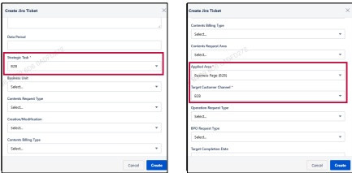

### 2. Dashboard Usage Guide 

2.2 Components by Page >MONITORING RESULTS > Business > Business Unit > Jira Ticket 

## Dashboard Screen 

## Feature Guide 

Jira Ticket Creation Guide 

Click Request Fix to open the Jira ticket creation form 

## 3 

## 4 

Strategic Task 

Set Strategic Task to B2B and select the relevant Business Unit.

Applied Area & Target Customer Channel Select Business Page (B2B) for Applied Area and B2B for Target Customer Channel 