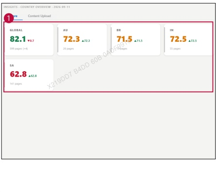

### 2. Dashboard Usage Guide 

2.2 Components by Page >MONITORING RESULTS > Shared > Shared Unit 

## Dashboard Screen 

## Feature Guide 

Click Insights, Industries, or Support in the Shared menu to view this screen.Compare country scores and monitored page counts for the selected shared unit.

## Shared Unit Scores 

View monitoring scores and page counts by country for the selected Shared Unit.