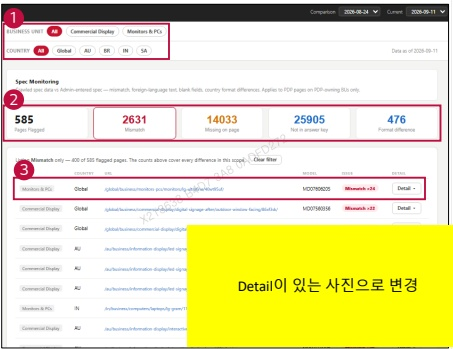

### 2. Dashboard Usage Guide 

### 2.2 Components by Page >MONITORING RESULTS > Spec Monitoring 

## Dashboard Screen 

## Feature Guide 

Compare product specifications collected from LG.com with the reference specifications and check the differences by page.

## Business Unit and Country 

Select a businessunit andcountryto filtertheresults.SelectAlltoview all available results.

## Issue Filter 

Check the flagged page count and diferences by issue type.Select an issue card to filter the list. Click "Clear filter" to reset it.

## Page Details 

Find the page or model in the list and click Detail to compare the reference specification yalues with those collected from LG.com.

