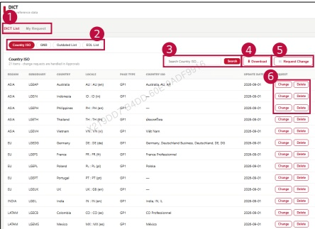

### 2. Dashboard Usage Guide 

2.2 Components by Page > REFERENCE>DICT 

## Dashboard Screen 

##  Feature Guide 

View DICT reference data and submit requests to change or delete an entry.

## DICT List and My Requests 

Click DICT List to view the reference data.Click My Request to check the requests you have submitted.

## DICT Type 

Select Country ISO, GNB, Outdated List, or EOL List to view the corresponding reference data.

## Search 

Type a keyword and click Search to find an entry 

## Download 

Click Download to export the selected data as a CSV file 