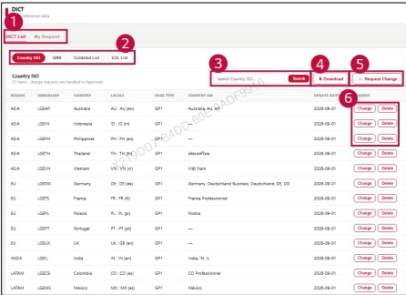

### 2. Dashboard Usage Guide 

2.2 Components by Page > REFERENCE>DICT 

## Dashboard Screen 

## Feature Guide 

View DICT reference data and submit requests to change or delete an entry.

## Request Change 

Click Request Change to open the page for Add, Change, and Delete requests.

## Change, Delete 

Click Change or Delete to update or delete the corresponding enty.