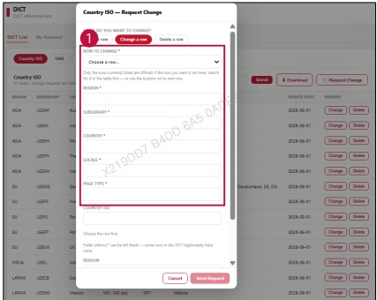

### 2. Dashboard Usage Guide 

2.2 Components by Page > REFERENCE>DICT 

## Dashboard Screen 

## Feature Guide 

Click Request Change, then select Change a row to update an existing row.

## Change a row 

Select Rowto Change,thentype the updated values for Region,Subsidiaryounry,Locale, and Page Type.

