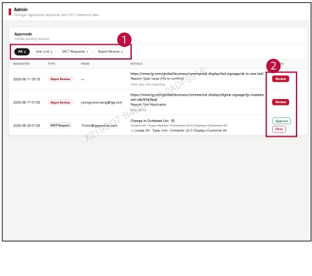

### 2. Dashboard Usage Guide 

### 2.2 Components by Page >ADMIN >Approvals 

## Dashboard Screen 

## Feature Guide 

Review pending user registration, DICT, and rejection requests in one place 

## Request Type 

Select All or a request type to filter the list.The number beside each tab shows the pending request count.

## Review and Decision 

Click Review to open a rejection request. For requests with decision buttons,click Approve to accept or Deny to reject the request.

