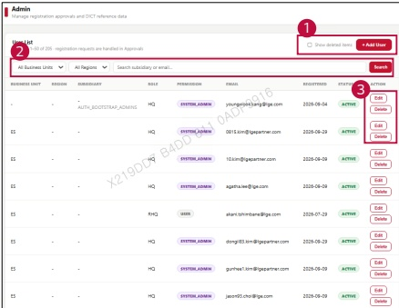

### 2. Dashboard Usage Guide 

### 2.2 Components by Page >ADMIN >User List 

## Dashboard Screen 

## Feature Guide 

Find user accounts and check their assigned business unit, region, role, and permission.

## User Management 

Click Add User to open the new user form.Select Show deleted items to include deleted accounts in the list.

## Find Users 

Select a business unit or region or type a subsidiary or email address.Click Search to show the matching accounts.

## Edit & Delete 

Click Edit to update user information or Delete to delete the user account.