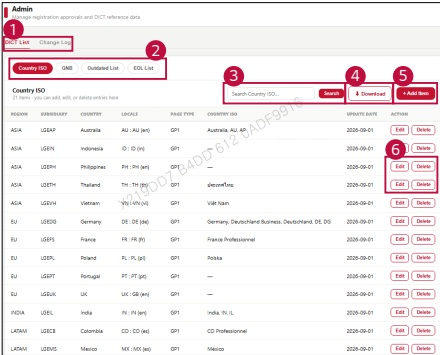

### 2. Dashboard Usage Guide 

2.2 Components by Page >ADMIN > DICT Management 

## Dashboard Screen 

## Feature Guide 

Manage DlCT reference entries and view their change history in the admin view.

## Add item 

Open DlCT Listto managethecurrententries.OpenChange Log to review pastchanges.

## Edit & Delete 

Click Edit or Delete to update or delete the corresponding entry.