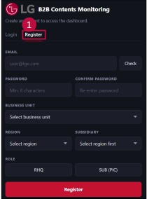
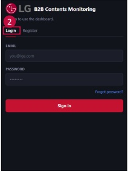

### 1. About dashboard

1.3 Access > Registration & Login

Registration & Login Screen

## Access Details

## 1 Register

User must create a valid account through the Register tab.

 $ ^{*} $ If you are already registered, you do not need to register again.

Please go to the Login tab and log in with your EP ID

(Initial password: 123456)

- Click the "Register" tab on the login page.

- Type your email address (ID) and password.

Password must contain at least 8 characters.

Submit the registration request.

## 2 Login

- Log in using your registered email and password.

- If login fails, check your account permission.