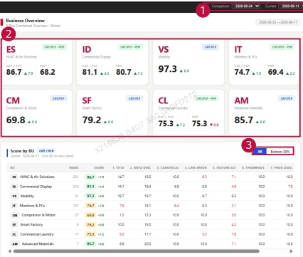

### 2. Dashboard Usage Guide

2.2 Components by Page > MONITORING RESULTS > Business

## Dashboard Screen

<table border=1 style='margin: auto; word-wrap: break-word;'><tr><td style='text-align: center; word-wrap: break-word;'>BU</td><td style='text-align: center; word-wrap: break-word;'>PAGES</td><td style='text-align: center; word-wrap: break-word;'>SCORE</td><td style='text-align: center; word-wrap: break-word;'>1. TITLE</td><td style='text-align: center; word-wrap: break-word;'>2. META DESC</td><td style='text-align: center; word-wrap: break-word;'>3. CAMONICAL</td><td style='text-align: center; word-wrap: break-word;'>4. LINK ERROR</td><td style='text-align: center; word-wrap: break-word;'>5. FEATURE ALT</td><td style='text-align: center; word-wrap: break-word;'>6. THUMMANUAL</td><td style='text-align: center; word-wrap: break-word;'>7. PROD AVAIL</td></tr><tr><td style='text-align: center; word-wrap: break-word;'>ES</td><td style='text-align: center; word-wrap: break-word;'>HVAC &amp; Air Solutions</td><td style='text-align: center; word-wrap: break-word;'>221</td><td style='text-align: center; word-wrap: break-word;'>95.7</td><td style='text-align: center; word-wrap: break-word;'>+7.8</td><td style='text-align: center; word-wrap: break-word;'>16.5</td><td style='text-align: center; word-wrap: break-word;'>10.0</td><td style='text-align: center; word-wrap: break-word;'>6.2</td><td style='text-align: center; word-wrap: break-word;'>7.1</td><td style='text-align: center; word-wrap: break-word;'>10.0</td></tr><tr><td style='text-align: center; word-wrap: break-word;'>ID</td><td style='text-align: center; word-wrap: break-word;'>Commercial Display</td><td style='text-align: center; word-wrap: break-word;'>315</td><td style='text-align: center; word-wrap: break-word;'>81.1</td><td style='text-align: center; word-wrap: break-word;'>+4.3</td><td style='text-align: center; word-wrap: break-word;'>14.1</td><td style='text-align: center; word-wrap: break-word;'>16.4</td><td style='text-align: center; word-wrap: break-word;'>9.8</td><td style='text-align: center; word-wrap: break-word;'>8.8</td><td style='text-align: center; word-wrap: break-word;'>4.9</td></tr><tr><td style='text-align: center; word-wrap: break-word;'>VT</td><td style='text-align: center; word-wrap: break-word;'>Mobility</td><td style='text-align: center; word-wrap: break-word;'>21</td><td style='text-align: center; word-wrap: break-word;'>97.3</td><td style='text-align: center; word-wrap: break-word;'>+0.8</td><td style='text-align: center; word-wrap: break-word;'>18.7</td><td style='text-align: center; word-wrap: break-word;'>19.7</td><td style='text-align: center; word-wrap: break-word;'>10.0</td><td style='text-align: center; word-wrap: break-word;'>9.7</td><td style='text-align: center; word-wrap: break-word;'>9.2</td></tr><tr><td style='text-align: center; word-wrap: break-word;'>IT</td><td style='text-align: center; word-wrap: break-word;'>Monitors &amp; PCs</td><td style='text-align: center; word-wrap: break-word;'>121</td><td style='text-align: center; word-wrap: break-word;'>74.7</td><td style='text-align: center; word-wrap: break-word;'>+7.8</td><td style='text-align: center; word-wrap: break-word;'>7.9</td><td style='text-align: center; word-wrap: break-word;'>18.1</td><td style='text-align: center; word-wrap: break-word;'>6.4</td><td style='text-align: center; word-wrap: break-word;'>9.3</td><td style='text-align: center; word-wrap: break-word;'>3.1</td></tr><tr><td style='text-align: center; word-wrap: break-word;'>CM</td><td style='text-align: center; word-wrap: break-word;'>Compressor &amp; Motor</td><td style='text-align: center; word-wrap: break-word;'>27</td><td style='text-align: center; word-wrap: break-word;'>69.8</td><td style='text-align: center; word-wrap: break-word;'>+0.8</td><td style='text-align: center; word-wrap: break-word;'>1.5</td><td style='text-align: center; word-wrap: break-word;'>13.3</td><td style='text-align: center; word-wrap: break-word;'>10.0</td><td style='text-align: center; word-wrap: break-word;'>10.0</td><td style='text-align: center; word-wrap: break-word;'>5.0</td></tr><tr><td style='text-align: center; word-wrap: break-word;'>EF</td><td style='text-align: center; word-wrap: break-word;'>Smart Factory</td><td style='text-align: center; word-wrap: break-word;'>6</td><td style='text-align: center; word-wrap: break-word;'>79.2</td><td style='text-align: center; word-wrap: break-word;'>+0.8</td><td style='text-align: center; word-wrap: break-word;'>10.0</td><td style='text-align: center; word-wrap: break-word;'>15.0</td><td style='text-align: center; word-wrap: break-word;'>10.0</td><td style='text-align: center; word-wrap: break-word;'>10.0</td><td style='text-align: center; word-wrap: break-word;'>4.2</td></tr><tr><td style='text-align: center; word-wrap: break-word;'>CL</td><td style='text-align: center; word-wrap: break-word;'>Commercial Laundry</td><td style='text-align: center; word-wrap: break-word;'>17</td><td style='text-align: center; word-wrap: break-word;'>75.3</td><td style='text-align: center; word-wrap: break-word;'>+1.2</td><td style='text-align: center; word-wrap: break-word;'>5.3</td><td style='text-align: center; word-wrap: break-word;'>17.1</td><td style='text-align: center; word-wrap: break-word;'>10.0</td><td style='text-align: center; word-wrap: break-word;'>5.3</td><td style='text-align: center; word-wrap: break-word;'>7.9</td></tr><tr><td style='text-align: center; word-wrap: break-word;'>AM</td><td style='text-align: center; word-wrap: break-word;'>Advanced Materials</td><td style='text-align: center; word-wrap: break-word;'>7</td><td style='text-align: center; word-wrap: break-word;'>85.7</td><td style='text-align: center; word-wrap: break-word;'>+0.8</td><td style='text-align: center; word-wrap: break-word;'>8.6</td><td style='text-align: center; word-wrap: break-word;'>20.0</td><td style='text-align: center; word-wrap: break-word;'>10.0</td><td style='text-align: center; word-wrap: break-word;'>10.0</td><td style='text-align: center; word-wrap: break-word;'>7.1</td></tr></table>

## Feature Guide

View monitoring scores across business units. Click a business unit card to view its country results.

## Date Comparison

Select the Comparison and Current dates to compare scores from the two selected dates.

## Business Unit Scores

Check the CAT/PLP and PDP scores and their changes. Click a business unit card to view its country overview.

## Score Filter

Select All to show every business unit. Select Bottom 30% to focus on the business units with the lowest scores.