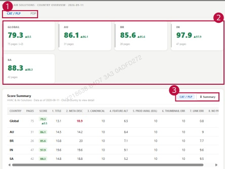

### 2. Dashboard Usage Guide

2.2 Components by Page > MONITORING RESULTS > Business > Business Unit

## Dashboard Screen

<table border=1 style='margin: auto; word-wrap: break-word;'><tr><td style='text-align: center; word-wrap: break-word;'>COUNTRY</td><td style='text-align: center; word-wrap: break-word;'>PAGES</td><td style='text-align: center; word-wrap: break-word;'>SCORE</td><td style='text-align: center; word-wrap: break-word;'>1. TITLE</td><td style='text-align: center; word-wrap: break-word;'>2. META DISC</td><td style='text-align: center; word-wrap: break-word;'>3. CANOMICAL</td><td style='text-align: center; word-wrap: break-word;'>4. FEATURE ALT</td><td style='text-align: center; word-wrap: break-word;'>5. PROD AVAIL (EOL)</td><td style='text-align: center; word-wrap: break-word;'>6. THUMMINAL ERR</td><td style='text-align: center; word-wrap: break-word;'>7. LINK ERR</td><td style='text-align: center; word-wrap: break-word;'>8. NO PP</td></tr><tr><td style='text-align: center; word-wrap: break-word;'>Global</td><td style='text-align: center; word-wrap: break-word;'>75</td><td style='text-align: center; word-wrap: break-word;'>79.3\n0.5</td><td style='text-align: center; word-wrap: break-word;'>13.1</td><td style='text-align: center; word-wrap: break-word;'>18.9</td><td style='text-align: center; word-wrap: break-word;'>10</td><td style='text-align: center; word-wrap: break-word;'>6.5</td><td style='text-align: center; word-wrap: break-word;'>10</td><td style='text-align: center; word-wrap: break-word;'>10</td><td style='text-align: center; word-wrap: break-word;'>0.8</td><td style='text-align: center; word-wrap: break-word;'></td></tr><tr><td style='text-align: center; word-wrap: break-word;'>AU</td><td style='text-align: center; word-wrap: break-word;'>31</td><td style='text-align: center; word-wrap: break-word;'>86.1</td><td style='text-align: center; word-wrap: break-word;'>14.5</td><td style='text-align: center; word-wrap: break-word;'>14.2</td><td style='text-align: center; word-wrap: break-word;'>10</td><td style='text-align: center; word-wrap: break-word;'>8.4</td><td style='text-align: center; word-wrap: break-word;'>10</td><td style='text-align: center; word-wrap: break-word;'>10</td><td style='text-align: center; word-wrap: break-word;'>9</td><td style='text-align: center; word-wrap: break-word;'></td></tr><tr><td style='text-align: center; word-wrap: break-word;'>BR</td><td style='text-align: center; word-wrap: break-word;'>26</td><td style='text-align: center; word-wrap: break-word;'>85.6</td><td style='text-align: center; word-wrap: break-word;'>10.8</td><td style='text-align: center; word-wrap: break-word;'>20</td><td style='text-align: center; word-wrap: break-word;'>10</td><td style='text-align: center; word-wrap: break-word;'>7.1</td><td style='text-align: center; word-wrap: break-word;'>10</td><td style='text-align: center; word-wrap: break-word;'>10</td><td style='text-align: center; word-wrap: break-word;'>7.7</td><td style='text-align: center; word-wrap: break-word;'></td></tr><tr><td style='text-align: center; word-wrap: break-word;'>IN</td><td style='text-align: center; word-wrap: break-word;'>47</td><td style='text-align: center; word-wrap: break-word;'>97.9</td><td style='text-align: center; word-wrap: break-word;'>19.6</td><td style='text-align: center; word-wrap: break-word;'>19.6</td><td style='text-align: center; word-wrap: break-word;'>10</td><td style='text-align: center; word-wrap: break-word;'>9.1</td><td style='text-align: center; word-wrap: break-word;'>10</td><td style='text-align: center; word-wrap: break-word;'>10</td><td style='text-align: center; word-wrap: break-word;'>9.6</td><td style='text-align: center; word-wrap: break-word;'></td></tr><tr><td style='text-align: center; word-wrap: break-word;'>SA</td><td style='text-align: center; word-wrap: break-word;'>42</td><td style='text-align: center; word-wrap: break-word;'>88.3</td><td style='text-align: center; word-wrap: break-word;'>14.8</td><td style='text-align: center; word-wrap: break-word;'>18.8</td><td style='text-align: center; word-wrap: break-word;'>10</td><td style='text-align: center; word-wrap: break-word;'>5.2</td><td style='text-align: center; word-wrap: break-word;'>10</td><td style='text-align: center; word-wrap: break-word;'>10</td><td style='text-align: center; word-wrap: break-word;'>9.5</td><td style='text-align: center; word-wrap: break-word;'></td></tr></table>

## Feature Guide

Click a business unit card to view this screen. Compare country scores and monitored page counts for the selected business unit.

## Page Type

Select CAT/PLP or PDP to view the results for that page type.

## Country Results

Check each country's score and change. Click a country card or its name in the table to view the detailed results.

## Summary Download

Check the active page type beside the Summary button. Click Summary to download the country score summary.