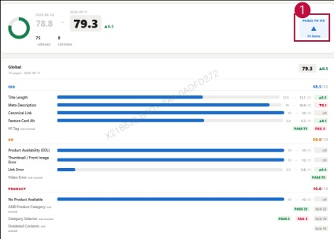

### 2. Dashboard Usage Guide

2.2 Components by Page > MONITORING RESULTS > Business > Business Unit

Dashboard Screen

## Feature Guide

Click a country card to view this screen. Check the selected country's total score and item results. Compare the current and previous scores to identify changes.

## Pages to Fix

Click Pages to Fix to show or hide the pages that need attention.