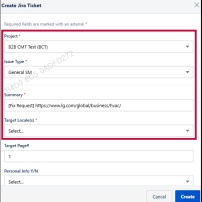
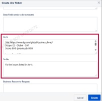

### 2. Dashboard Usage Guide

2.2 Components by Page > MONITORING RESULTS > Business > Business Unit > Jira Ticket

## Dashboard Screen

## Feature Guide

## Jira Ticket Creation Guide

Click Request Fix to open the Jira ticket creation form.

## 1 Project, Issue Type, Summary, Target Local $ e(s) $

Select the Project, Issue Type, and Target Localе(s). In Summary, briefly describe the request and include the URL of the page to be corrected.

## As-Is & To-Be

As-ls: Type the page URL, monitoring score, and a brief description of the issue. To-Be: Type the correct value or content that should replace the current version.