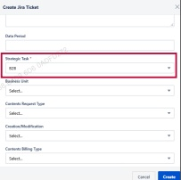
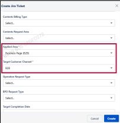

### 2. Dashboard Usage Guide

2.2 Components by Page > MONITORING RESULTS > Business > Business Unit > Jira Ticket

## Dashboard Screen

## Feature Guide

## Jira Ticket Creation Guide

Click Request Fix to open the Jira ticket creation form.

## 3 Strategic Task

Set Strategic Task to B2B and select the relevant Business Unit.

## 4 Applied Area & Target Customer Channel

Select Business Page (B2B) for Applied Area and B2B for Target Customer Channel.