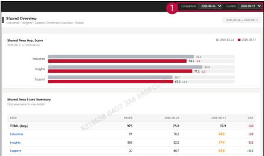

### 2. Dashboard Usage Guide

### 2.2 Components by Page > MONITORING RESULTS > Shared

Dashboard Screen

## Feature Guide

The chart compares current and previous scores for each shared unit. The table below shows page counts, scores, and score changes.

## 1 Date Comparison

Select the Comparison and Current dates. Use the chart and summary table to check each shared area's score change.