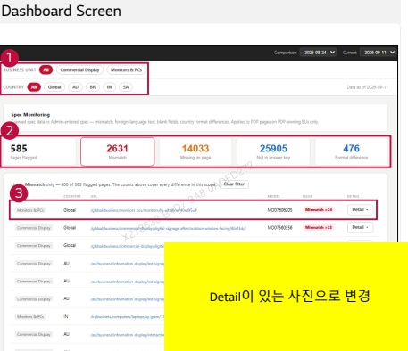
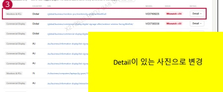

### 2. Dashboard Usage Guide

2.2 Components by Page > MONITORING RESULTS > Spec Monitoring

Dashboard Screen

## Feature Guide

Compare product specifications collected from LG.com with the reference specifications and check the differences by page.

## 1 Business Unit and Country

Select a business unit and country to filter the results. Select All to view all available results.

## Issue Filter

Check the flagged page count and differences by issue type. Select an issue card to filter the list. Click "Clear filter" to reset it.

## Page Details

Find the page or model in the list and click Detail to compare the reference specification values with those collected from LG.com.