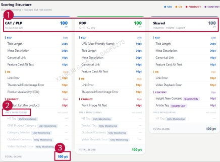

### 2. Dashboard Usage Guide

2.2 Components by Page > REFERENCE > Monitoring Item > Total Score

## Dashboard Screen

## Feature Guide

Check the monitoring items and points for CAT/PLP, PDP, and Shared in this page.

## Page Type

Find the column for the page type you want to check, such as CAT/PLP, PDP, or a shared area.

## Only Monitoring

Check this section for items that the dashboard tracks without adding them to the total score.

## Total Score

Each page type has a maximum score of 100 points. Only the scored items contribute to this total.