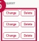

### 2. Dashboard Usage Guide

2.2 Components by Page > REFERENCE > DICT

## Dashboard Screen

<table border=1 style='margin: auto; word-wrap: break-word;'><tr><td style='text-align: center; word-wrap: break-word;'>Country ISO</td><td style='text-align: center; word-wrap: break-word;'>Country ID</td><td style='text-align: center; word-wrap: break-word;'>Questionnaire</td><td style='text-align: center; word-wrap: break-word;'>Questionnaire</td><td style='text-align: center; word-wrap: break-word;'>Questionnaire</td><td style='text-align: center; word-wrap: break-word;'>Questionnaire</td><td style='text-align: center; word-wrap: break-word;'>Request Change</td></tr><tr><td style='text-align: center; word-wrap: break-word;'>ADA</td><td style='text-align: center; word-wrap: break-word;'>ADAPA</td><td style='text-align: center; word-wrap: break-word;'>Australia</td><td style='text-align: center; word-wrap: break-word;'>AGI: AU (en)</td><td style='text-align: center; word-wrap: break-word;'>QPI</td><td style='text-align: center; word-wrap: break-word;'>2020-08-01</td><td rowspan="3"></td></tr><tr><td style='text-align: center; word-wrap: break-word;'>ASA</td><td style='text-align: center; word-wrap: break-word;'>LSDAP</td><td style='text-align: center; word-wrap: break-word;'>Indonesia</td><td style='text-align: center; word-wrap: break-word;'>OJ: AD (en)</td><td style='text-align: center; word-wrap: break-word;'>QPI</td><td style='text-align: center; word-wrap: break-word;'>2020-08-01</td></tr><tr><td style='text-align: center; word-wrap: break-word;'>ASIA</td><td style='text-align: center; word-wrap: break-word;'>LSDPH</td><td style='text-align: center; word-wrap: break-word;'>Philippines</td><td style='text-align: center; word-wrap: break-word;'>IR: IN (en)</td><td style='text-align: center; word-wrap: break-word;'>QPI</td><td style='text-align: center; word-wrap: break-word;'>2020-08-01</td></tr><tr><td style='text-align: center; word-wrap: break-word;'>ASA</td><td style='text-align: center; word-wrap: break-word;'>LSDTH</td><td style='text-align: center; word-wrap: break-word;'>Thailand</td><td style='text-align: center; word-wrap: break-word;'>TH: TH (en)</td><td style='text-align: center; word-wrap: break-word;'>QPI</td><td style='text-align: center; word-wrap: break-word;'>2020-08-01</td><td style='text-align: center; word-wrap: break-word;'>Change Steps</td></tr><tr><td style='text-align: center; word-wrap: break-word;'>ADA</td><td style='text-align: center; word-wrap: break-word;'>LSDVA</td><td style='text-align: center; word-wrap: break-word;'>Vietnam</td><td style='text-align: center; word-wrap: break-word;'>VN: VN (en)</td><td style='text-align: center; word-wrap: break-word;'>QPI</td><td style='text-align: center; word-wrap: break-word;'>2020-08-01</td><td style='text-align: center; word-wrap: break-word;'>Change Steps</td></tr><tr><td style='text-align: center; word-wrap: break-word;'>EU</td><td style='text-align: center; word-wrap: break-word;'>LSDSD</td><td style='text-align: center; word-wrap: break-word;'>Germany</td><td style='text-align: center; word-wrap: break-word;'>DE: DE (en)</td><td style='text-align: center; word-wrap: break-word;'>QPI</td><td style='text-align: center; word-wrap: break-word;'>2020-08-01</td><td style='text-align: center; word-wrap: break-word;'>Change Steps</td></tr><tr><td style='text-align: center; word-wrap: break-word;'>EU</td><td style='text-align: center; word-wrap: break-word;'>LSDPS</td><td style='text-align: center; word-wrap: break-word;'>France</td><td style='text-align: center; word-wrap: break-word;'>FR: FR (en)</td><td style='text-align: center; word-wrap: break-word;'>QPI</td><td style='text-align: center; word-wrap: break-word;'>2020-08-01</td><td style='text-align: center; word-wrap: break-word;'>Change Steps</td></tr><tr><td style='text-align: center; word-wrap: break-word;'>EU</td><td style='text-align: center; word-wrap: break-word;'>LSDPS</td><td style='text-align: center; word-wrap: break-word;'>Poland</td><td style='text-align: center; word-wrap: break-word;'>PL: PL (en)</td><td style='text-align: center; word-wrap: break-word;'>QPI</td><td style='text-align: center; word-wrap: break-word;'>2020-08-01</td><td style='text-align: center; word-wrap: break-word;'>Change Steps</td></tr><tr><td style='text-align: center; word-wrap: break-word;'>EU</td><td style='text-align: center; word-wrap: break-word;'>LSDST</td><td style='text-align: center; word-wrap: break-word;'>Portugal</td><td style='text-align: center; word-wrap: break-word;'>PT: PT (en)</td><td style='text-align: center; word-wrap: break-word;'>QPI</td><td style='text-align: center; word-wrap: break-word;'>2020-08-01</td><td style='text-align: center; word-wrap: break-word;'>Change Steps</td></tr><tr><td style='text-align: center; word-wrap: break-word;'>EU</td><td style='text-align: center; word-wrap: break-word;'>LSDXA</td><td style='text-align: center; word-wrap: break-word;'>UK</td><td style='text-align: center; word-wrap: break-word;'>UK: GB (en)</td><td style='text-align: center; word-wrap: break-word;'>QPI</td><td style='text-align: center; word-wrap: break-word;'>2020-08-01</td><td style='text-align: center; word-wrap: break-word;'>Change Steps</td></tr><tr><td style='text-align: center; word-wrap: break-word;'>INDIA</td><td style='text-align: center; word-wrap: break-word;'>LSDL</td><td style='text-align: center; word-wrap: break-word;'>India</td><td style='text-align: center; word-wrap: break-word;'>IN: IN (en)</td><td style='text-align: center; word-wrap: break-word;'>QPI</td><td style='text-align: center; word-wrap: break-word;'>2020-08-01</td><td style='text-align: center; word-wrap: break-word;'>Change Steps</td></tr><tr><td style='text-align: center; word-wrap: break-word;'>LATAN</td><td style='text-align: center; word-wrap: break-word;'>LSDCE</td><td style='text-align: center; word-wrap: break-word;'>Colombia</td><td style='text-align: center; word-wrap: break-word;'>CO: CO (en)</td><td style='text-align: center; word-wrap: break-word;'>QPI</td><td style='text-align: center; word-wrap: break-word;'>2020-08-01</td><td style='text-align: center; word-wrap: break-word;'>Change Steps</td></tr><tr><td style='text-align: center; word-wrap: break-word;'>LATAN</td><td style='text-align: center; word-wrap: break-word;'>LSDMS</td><td style='text-align: center; word-wrap: break-word;'>Mexico</td><td style='text-align: center; word-wrap: break-word;'>MEX: M (en)</td><td style='text-align: center; word-wrap: break-word;'>QPI</td><td style='text-align: center; word-wrap: break-word;'>2020-08-01</td><td style='text-align: center; word-wrap: break-word;'>Change Steps</td></tr></table>

## Feature Guide

View DICT reference data and submit requests to change or delete an entry.

## 1 DICT List and My Requests

Click DICT List to view the reference data. Click My Request to check the requests you have submitted.

## 2 DICT Type

Select Country ISO, GNB, Outdated List, or EOL List to view the corresponding reference data.

## Search

Type a keyword and click Search to find an entry.

## Download

Click Download to export the selected data as a CSV file.