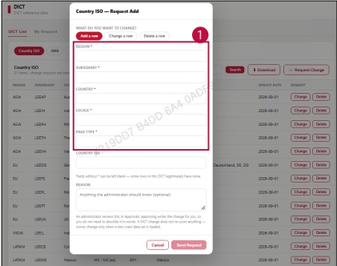

### 2. Dashboard Usage Guide

2.2 Components by Page > REFERENCE > DICT

## Dashboard Screen

## Feature Guide

Click Request Change, then select Add a row to add a new row.

## Add a row

Type the required values for Region, Subsidiary, Country, Localе, and Page Type. Click Send Request to submit the request.