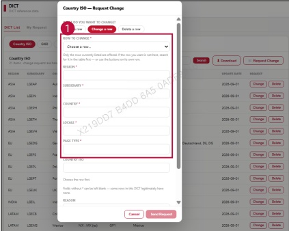

### 2. Dashboard Usage Guide

2.2 Components by Page > REFERENCE > DICT

## Dashboard Screen

## Feature Guide

Click Request Change, then select Change a row to update an existing row.

## Change a row

Select Row to Change, then type the updated values for Region, Subsidiary, Country, Localе, and Page Type.