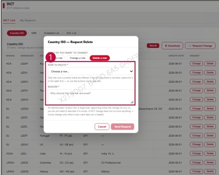

### 2. Dashboard Usage Guide

2.2 Components by Page > REFERENCE > DICT

## Dashboard Screen

## Feature Guide

Click Request Change, then select Delete a row to delete an existing row.

## Delete a row

Select Row to Delete, type the reason in Reason, then click Send Request to submit the deletion request.