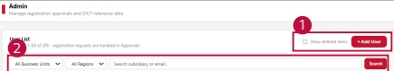
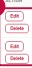

### 2. Dashboard Usage Guide

2.2 Components by Page > ADMIN > User List

## Dashboard Screen

<table border=1 style='margin: auto; word-wrap: break-word;'><tr><td style='text-align: center; word-wrap: break-word;'>BUSINESS UNIT</td><td style='text-align: center; word-wrap: break-word;'>REGION</td><td style='text-align: center; word-wrap: break-word;'>SUBSIDIARY</td><td style='text-align: center; word-wrap: break-word;'>ROLE</td><td style='text-align: center; word-wrap: break-word;'>PROMISES</td><td style='text-align: center; word-wrap: break-word;'>FRAIL</td><td style='text-align: center; word-wrap: break-word;'>RECISTMENTS</td><td style='text-align: center; word-wrap: break-word;'>STATUS</td><td style='text-align: center; word-wrap: break-word;'>ACTION</td></tr><tr><td style='text-align: center; word-wrap: break-word;'>-</td><td style='text-align: center; word-wrap: break-word;'>-</td><td style='text-align: center; word-wrap: break-word;'>-</td><td style='text-align: center; word-wrap: break-word;'>HQ</td><td style='text-align: center; word-wrap: break-word;'>SYSTEM ADMIN</td><td style='text-align: center; word-wrap: break-word;'>youngerick@langbig.com</td><td style='text-align: center; word-wrap: break-word;'>2026-08-04</td><td style='text-align: center; word-wrap: break-word;'>ACTIVE</td><td style='text-align: center; word-wrap: break-word;'>Edit</td></tr><tr><td style='text-align: center; word-wrap: break-word;'>-</td><td style='text-align: center; word-wrap: break-word;'>-</td><td style='text-align: center; word-wrap: break-word;'>AUTH.JCOOTSTAR.ADMIN</td><td style='text-align: center; word-wrap: break-word;'>HQ</td><td style='text-align: center; word-wrap: break-word;'>SYSTEM ADMIN</td><td style='text-align: center; word-wrap: break-word;'>0015 km@gepartner.com</td><td style='text-align: center; word-wrap: break-word;'>2026-08-20</td><td style='text-align: center; word-wrap: break-word;'>ACTIVE</td><td style='text-align: center; word-wrap: break-word;'>Edit</td></tr><tr><td style='text-align: center; word-wrap: break-word;'>-</td><td style='text-align: center; word-wrap: break-word;'>-</td><td style='text-align: center; word-wrap: break-word;'>-</td><td style='text-align: center; word-wrap: break-word;'>HQ</td><td style='text-align: center; word-wrap: break-word;'>SYSTEM ADMIN</td><td style='text-align: center; word-wrap: break-word;'>10.km@fgapartner.com</td><td style='text-align: center; word-wrap: break-word;'>2026-08-09</td><td style='text-align: center; word-wrap: break-word;'>ACTIVE</td><td style='text-align: center; word-wrap: break-word;'>Edit</td></tr><tr><td style='text-align: center; word-wrap: break-word;'>-</td><td style='text-align: center; word-wrap: break-word;'>-</td><td style='text-align: center; word-wrap: break-word;'>-</td><td style='text-align: center; word-wrap: break-word;'>HQ</td><td style='text-align: center; word-wrap: break-word;'>SYSTEM ADMIN</td><td style='text-align: center; word-wrap: break-word;'>agatha.ie@fga.com</td><td style='text-align: center; word-wrap: break-word;'>2026-08-09</td><td style='text-align: center; word-wrap: break-word;'>ACTIVE</td><td style='text-align: center; word-wrap: break-word;'>Edit</td></tr><tr><td style='text-align: center; word-wrap: break-word;'>-</td><td style='text-align: center; word-wrap: break-word;'>-</td><td style='text-align: center; word-wrap: break-word;'>-</td><td style='text-align: center; word-wrap: break-word;'>HQ</td><td style='text-align: center; word-wrap: break-word;'>SYSTEM ADMIN</td><td style='text-align: center; word-wrap: break-word;'>alank.tsh@bana@fga.com</td><td style='text-align: center; word-wrap: break-word;'>2026-07-29</td><td style='text-align: center; word-wrap: break-word;'>ACTIVE</td><td style='text-align: center; word-wrap: break-word;'>Edit</td></tr><tr><td style='text-align: center; word-wrap: break-word;'>-</td><td style='text-align: center; word-wrap: break-word;'>-</td><td style='text-align: center; word-wrap: break-word;'>-</td><td style='text-align: center; word-wrap: break-word;'>HQ</td><td style='text-align: center; word-wrap: break-word;'>SYSTEM ADMIN</td><td style='text-align: center; word-wrap: break-word;'>dong@13.sim@fgapartner.com</td><td style='text-align: center; word-wrap: break-word;'>2026-08-29</td><td style='text-align: center; word-wrap: break-word;'>ACTIVE</td><td style='text-align: center; word-wrap: break-word;'>Edit</td></tr><tr><td style='text-align: center; word-wrap: break-word;'>-</td><td style='text-align: center; word-wrap: break-word;'>-</td><td style='text-align: center; word-wrap: break-word;'>-</td><td style='text-align: center; word-wrap: break-word;'>HQ</td><td style='text-align: center; word-wrap: break-word;'>SYSTEM ADMIN</td><td style='text-align: center; word-wrap: break-word;'>gunha1.tsm@fgapartner.com</td><td style='text-align: center; word-wrap: break-word;'>2026-08-09</td><td style='text-align: center; word-wrap: break-word;'>ACTIVE</td><td style='text-align: center; word-wrap: break-word;'>Edit</td></tr><tr><td style='text-align: center; word-wrap: break-word;'>-</td><td style='text-align: center; word-wrap: break-word;'>-</td><td style='text-align: center; word-wrap: break-word;'>-</td><td style='text-align: center; word-wrap: break-word;'>HQ</td><td style='text-align: center; word-wrap: break-word;'>SYSTEM ADMIN</td><td style='text-align: center; word-wrap: break-word;'>jao92.cho@fga.com</td><td style='text-align: center; word-wrap: break-word;'>2026-08-09</td><td style='text-align: center; word-wrap: break-word;'>ACTIVE</td><td style='text-align: center; word-wrap: break-word;'>Edit</td></tr></table>

## Feature Guide

Find user accounts and check their assigned business unit, region, role, and permission.

## User Management

Click Add User to open the new user form. Select Show deleted items to include deleted accounts in the list.

## Find Users

Select a business unit or region or type a subsidiary or email address. Click Search to show the matching accounts.

## Edit & Delete

Click Edit to update user information or Delete to delete the user account.