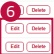

### 2. Dashboard Usage Guide

2.2 Components by Page > ADMIN > DICT Management

## Dashboard Screen

<table border=1 style='margin: auto; word-wrap: break-word;'><tr><td colspan="9">Admin</td></tr><tr><td colspan="2">1</td><td colspan="7">Your registration approvals and DCT reference date</td></tr><tr><td style='text-align: center; word-wrap: break-word;'>Post List</td><td style='text-align: center; word-wrap: break-word;'>Change Log</td><td style='text-align: center; word-wrap: break-word;'></td><td style='text-align: center; word-wrap: break-word;'></td><td style='text-align: center; word-wrap: break-word;'></td><td style='text-align: center; word-wrap: break-word;'></td><td style='text-align: center; word-wrap: break-word;'></td><td style='text-align: center; word-wrap: break-word;'></td><td style='text-align: center; word-wrap: break-word;'></td></tr><tr><td style='text-align: center; word-wrap: break-word;'>Country ISO</td><td style='text-align: center; word-wrap: break-word;'>GMD</td><td style='text-align: center; word-wrap: break-word;'>Outdated List</td><td style='text-align: center; word-wrap: break-word;'>EDL List</td><td style='text-align: center; word-wrap: break-word;'></td><td style='text-align: center; word-wrap: break-word;'></td><td style='text-align: center; word-wrap: break-word;'></td><td style='text-align: center; word-wrap: break-word;'></td><td style='text-align: center; word-wrap: break-word;'></td></tr><tr><td colspan="4">Country ISO\n2 items, you can add, edit, or delete entries here</td><td style='text-align: center; word-wrap: break-word;'>Search Country ISO...</td><td style='text-align: center; word-wrap: break-word;'>Search</td><td style='text-align: center; word-wrap: break-word;'>&amp; Download</td><td style='text-align: center; word-wrap: break-word;'>+ Add Item</td><td style='text-align: center; word-wrap: break-word;'></td></tr><tr><td style='text-align: center; word-wrap: break-word;'>REGION</td><td style='text-align: center; word-wrap: break-word;'>SERDURY</td><td style='text-align: center; word-wrap: break-word;'>COUNTRY</td><td style='text-align: center; word-wrap: break-word;'>LANDSCLE</td><td style='text-align: center; word-wrap: break-word;'>PAGE TYPE</td><td style='text-align: center; word-wrap: break-word;'>COUNTRY ISO</td><td style='text-align: center; word-wrap: break-word;'>OPPORT DATE</td><td style='text-align: center; word-wrap: break-word;'>ACTION</td><td style='text-align: center; word-wrap: break-word;'></td></tr><tr><td style='text-align: center; word-wrap: break-word;'>AGIA</td><td style='text-align: center; word-wrap: break-word;'>UGAAP</td><td style='text-align: center; word-wrap: break-word;'>Australia</td><td style='text-align: center; word-wrap: break-word;'>AU - AU (en)</td><td style='text-align: center; word-wrap: break-word;'>GPI</td><td style='text-align: center; word-wrap: break-word;'>Australia AU AP</td><td style='text-align: center; word-wrap: break-word;'>2020-00-01</td><td style='text-align: center; word-wrap: break-word;'>E&amp;I</td><td style='text-align: center; word-wrap: break-word;'>Delete</td></tr><tr><td style='text-align: center; word-wrap: break-word;'>ASIA</td><td style='text-align: center; word-wrap: break-word;'>LGEIN</td><td style='text-align: center; word-wrap: break-word;'>Indonesia</td><td style='text-align: center; word-wrap: break-word;'>(D) (in)</td><td style='text-align: center; word-wrap: break-word;'>GPI</td><td style='text-align: center; word-wrap: break-word;'>Australia</td><td style='text-align: center; word-wrap: break-word;'>2020-00-01</td><td style='text-align: center; word-wrap: break-word;'>6</td><td style='text-align: center; word-wrap: break-word;'>Delete</td></tr><tr><td style='text-align: center; word-wrap: break-word;'>ASIA</td><td style='text-align: center; word-wrap: break-word;'>LGEPH</td><td style='text-align: center; word-wrap: break-word;'>Philippines</td><td style='text-align: center; word-wrap: break-word;'>PH - PH (en)</td><td style='text-align: center; word-wrap: break-word;'>GPI</td><td style='text-align: center; word-wrap: break-word;'>—</td><td style='text-align: center; word-wrap: break-word;'>—</td><td style='text-align: center; word-wrap: break-word;'>—</td><td style='text-align: center; word-wrap: break-word;'>Delete</td></tr><tr><td style='text-align: center; word-wrap: break-word;'>ASIA</td><td style='text-align: center; word-wrap: break-word;'>LGETH</td><td style='text-align: center; word-wrap: break-word;'>Thailand</td><td style='text-align: center; word-wrap: break-word;'>TH - TH (en)</td><td style='text-align: center; word-wrap: break-word;'>GPI</td><td style='text-align: center; word-wrap: break-word;'>liverofire</td><td style='text-align: center; word-wrap: break-word;'>2020-00-01</td><td style='text-align: center; word-wrap: break-word;'>E&amp;I</td><td style='text-align: center; word-wrap: break-word;'>Delete</td></tr><tr><td style='text-align: center; word-wrap: break-word;'>ASIA</td><td style='text-align: center; word-wrap: break-word;'>LGEIH</td><td style='text-align: center; word-wrap: break-word;'>Vietnam</td><td style='text-align: center; word-wrap: break-word;'>(VI) (in)</td><td style='text-align: center; word-wrap: break-word;'>GPI</td><td style='text-align: center; word-wrap: break-word;'>Vale Nam</td><td style='text-align: center; word-wrap: break-word;'>2020-00-01</td><td style='text-align: center; word-wrap: break-word;'>E&amp;I</td><td style='text-align: center; word-wrap: break-word;'>Delete</td></tr><tr><td style='text-align: center; word-wrap: break-word;'>EU</td><td style='text-align: center; word-wrap: break-word;'>LGEDE</td><td style='text-align: center; word-wrap: break-word;'>Germany</td><td style='text-align: center; word-wrap: break-word;'>DE DE (de)</td><td style='text-align: center; word-wrap: break-word;'>GPI</td><td style='text-align: center; word-wrap: break-word;'>Germany, Deutschland Business, Deutschland, DE, DS</td><td style='text-align: center; word-wrap: break-word;'>2020-00-01</td><td style='text-align: center; word-wrap: break-word;'>E&amp;I</td><td style='text-align: center; word-wrap: break-word;'>Delete</td></tr><tr><td style='text-align: center; word-wrap: break-word;'>EU</td><td style='text-align: center; word-wrap: break-word;'>LGEPS</td><td style='text-align: center; word-wrap: break-word;'>France</td><td style='text-align: center; word-wrap: break-word;'>FR, FR (fr)</td><td style='text-align: center; word-wrap: break-word;'>GPI</td><td style='text-align: center; word-wrap: break-word;'>France Professional</td><td style='text-align: center; word-wrap: break-word;'>2020-00-01</td><td style='text-align: center; word-wrap: break-word;'>E&amp;I</td><td style='text-align: center; word-wrap: break-word;'>Delete</td></tr><tr><td style='text-align: center; word-wrap: break-word;'>EU</td><td style='text-align: center; word-wrap: break-word;'>LGEPL</td><td style='text-align: center; word-wrap: break-word;'>Poland</td><td style='text-align: center; word-wrap: break-word;'>PL - PL (pl)</td><td style='text-align: center; word-wrap: break-word;'>GPI</td><td style='text-align: center; word-wrap: break-word;'>Polka</td><td style='text-align: center; word-wrap: break-word;'>2020-00-01</td><td style='text-align: center; word-wrap: break-word;'>E&amp;I</td><td style='text-align: center; word-wrap: break-word;'>Delete</td></tr><tr><td style='text-align: center; word-wrap: break-word;'>EU</td><td style='text-align: center; word-wrap: break-word;'>LGEPT</td><td style='text-align: center; word-wrap: break-word;'>Portugal</td><td style='text-align: center; word-wrap: break-word;'>PT - PT (gr)</td><td style='text-align: center; word-wrap: break-word;'>GPI</td><td style='text-align: center; word-wrap: break-word;'>—</td><td style='text-align: center; word-wrap: break-word;'>—</td><td style='text-align: center; word-wrap: break-word;'>—</td><td style='text-align: center; word-wrap: break-word;'>Delete</td></tr><tr><td style='text-align: center; word-wrap: break-word;'>EU</td><td style='text-align: center; word-wrap: break-word;'>LGEUK</td><td style='text-align: center; word-wrap: break-word;'>UK</td><td style='text-align: center; word-wrap: break-word;'>UK - GB (en)</td><td style='text-align: center; word-wrap: break-word;'>GPI</td><td style='text-align: center; word-wrap: break-word;'>—</td><td style='text-align: center; word-wrap: break-word;'>—</td><td style='text-align: center; word-wrap: break-word;'>—</td><td style='text-align: center; word-wrap: break-word;'>Delete</td></tr><tr><td style='text-align: center; word-wrap: break-word;'>INDIA</td><td style='text-align: center; word-wrap: break-word;'>LGEI</td><td style='text-align: center; word-wrap: break-word;'>India</td><td style='text-align: center; word-wrap: break-word;'>IN - IN (en)</td><td style='text-align: center; word-wrap: break-word;'>GPI</td><td style='text-align: center; word-wrap: break-word;'>India, PL, IL</td><td style='text-align: center; word-wrap: break-word;'>2020-00-01</td><td style='text-align: center; word-wrap: break-word;'>E&amp;I</td><td style='text-align: center; word-wrap: break-word;'>Delete</td></tr><tr><td style='text-align: center; word-wrap: break-word;'>LATAM</td><td style='text-align: center; word-wrap: break-word;'>LGECB</td><td style='text-align: center; word-wrap: break-word;'>Colombia</td><td style='text-align: center; word-wrap: break-word;'>CO - CD (ae)</td><td style='text-align: center; word-wrap: break-word;'>GPI</td><td style='text-align: center; word-wrap: break-word;'>CO Professional</td><td style='text-align: center; word-wrap: break-word;'>2020-00-01</td><td style='text-align: center; word-wrap: break-word;'>E&amp;I</td><td style='text-align: center; word-wrap: break-word;'>Delete</td></tr><tr><td style='text-align: center; word-wrap: break-word;'>LATAM</td><td style='text-align: center; word-wrap: break-word;'>LGEUS</td><td style='text-align: center; word-wrap: break-word;'>Mexico</td><td style='text-align: center; word-wrap: break-word;'>MEX - MX (en)</td><td style='text-align: center; word-wrap: break-word;'>GPI</td><td style='text-align: center; word-wrap: break-word;'>Mexico</td><td style='text-align: center; word-wrap: break-word;'>2020-00-01</td><td style='text-align: center; word-wrap: break-word;'>E&amp;I</td><td style='text-align: center; word-wrap: break-word;'>Delete</td></tr></table>

## Feature Guide

Click DICT List to manage the current entries. Click Change Log to view past changes.

## DICT List and Change Log

Manage DICT reference entries and view their change history in the admin view.

## 2 DICT Type

Select Country ISO, GNB, Outdated List, or EOL List to manage that reference data.

## Search

Type a keyword and click Search to find an entry.

## Download

Click Download to download the selected data as a CSV file.