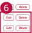

### 2. Dashboard Usage Guide

2.2 Components by Page > ADMIN > DICT Management

## Dashboard Screen

<table border=1 style='margin: auto; word-wrap: break-word;'><tr><td colspan="8">Admin</td></tr><tr><td colspan="2">1</td><td colspan="6">2</td></tr><tr><td style='text-align: center; word-wrap: break-word;'>Post List</td><td colspan="7">Change Log</td></tr><tr><td style='text-align: center; word-wrap: break-word;'>Country ID</td><td style='text-align: center; word-wrap: break-word;'>GMD</td><td style='text-align: center; word-wrap: break-word;'>Outdated List</td><td style='text-align: center; word-wrap: break-word;'>EDL List</td><td style='text-align: center; word-wrap: break-word;'>3</td><td style='text-align: center; word-wrap: break-word;'>4</td><td style='text-align: center; word-wrap: break-word;'>5</td><td style='text-align: center; word-wrap: break-word;'></td></tr><tr><td colspan="4">Country ISO\n2 items you can add, etc. or dates enter here</td><td style='text-align: center; word-wrap: break-word;'>Search</td><td style='text-align: center; word-wrap: break-word;'>&amp; Download</td><td style='text-align: center; word-wrap: break-word;'>+ Add Item</td><td style='text-align: center; word-wrap: break-word;'></td></tr><tr><td style='text-align: center; word-wrap: break-word;'>Region</td><td style='text-align: center; word-wrap: break-word;'>ASSASS</td><td style='text-align: center; word-wrap: break-word;'>COUNTRY</td><td style='text-align: center; word-wrap: break-word;'>LOCAL</td><td style='text-align: center; word-wrap: break-word;'>PAGE TYPE</td><td style='text-align: center; word-wrap: break-word;'>COUNTRY ISO</td><td style='text-align: center; word-wrap: break-word;'>OPPORT DATE</td><td style='text-align: center; word-wrap: break-word;'>ACTION</td></tr><tr><td style='text-align: center; word-wrap: break-word;'>ASIA</td><td style='text-align: center; word-wrap: break-word;'>USDEP</td><td style='text-align: center; word-wrap: break-word;'>Australia</td><td style='text-align: center; word-wrap: break-word;'>AU / AU (en)</td><td style='text-align: center; word-wrap: break-word;'>GPI</td><td style='text-align: center; word-wrap: break-word;'>Australia AU AP</td><td style='text-align: center; word-wrap: break-word;'>2020-00-01</td><td style='text-align: center; word-wrap: break-word;'>Edit</td></tr><tr><td style='text-align: center; word-wrap: break-word;'>ASIA</td><td style='text-align: center; word-wrap: break-word;'>USEN</td><td style='text-align: center; word-wrap: break-word;'>Indonesia</td><td style='text-align: center; word-wrap: break-word;'>ID (in)</td><td style='text-align: center; word-wrap: break-word;'>GPI</td><td style='text-align: center; word-wrap: break-word;'>USA</td><td style='text-align: center; word-wrap: break-word;'>2020-00-01</td><td style='text-align: center; word-wrap: break-word;'>6</td></tr><tr><td style='text-align: center; word-wrap: break-word;'>ASIA</td><td style='text-align: center; word-wrap: break-word;'>USDEPn</td><td style='text-align: center; word-wrap: break-word;'>Philippines</td><td style='text-align: center; word-wrap: break-word;'>PH (PH (en))</td><td style='text-align: center; word-wrap: break-word;'>—</td><td style='text-align: center; word-wrap: break-word;'>—</td><td style='text-align: center; word-wrap: break-word;'>—</td><td style='text-align: center; word-wrap: break-word;'>Edit</td></tr><tr><td style='text-align: center; word-wrap: break-word;'>ASIA</td><td style='text-align: center; word-wrap: break-word;'>USLETn</td><td style='text-align: center; word-wrap: break-word;'>Thailand</td><td style='text-align: center; word-wrap: break-word;'>TH (TH (en))</td><td style='text-align: center; word-wrap: break-word;'>GPI</td><td style='text-align: center; word-wrap: break-word;'>AlbertaTna</td><td style='text-align: center; word-wrap: break-word;'>2020-00-01</td><td style='text-align: center; word-wrap: break-word;'>Edit</td></tr><tr><td style='text-align: center; word-wrap: break-word;'>ASIA</td><td style='text-align: center; word-wrap: break-word;'>USDIN</td><td style='text-align: center; word-wrap: break-word;'>Venezuela</td><td style='text-align: center; word-wrap: break-word;'>VN (VN (en))</td><td style='text-align: center; word-wrap: break-word;'>GPI</td><td style='text-align: center; word-wrap: break-word;'>Vale Nam</td><td style='text-align: center; word-wrap: break-word;'>2020-00-01</td><td style='text-align: center; word-wrap: break-word;'>Edit</td></tr><tr><td style='text-align: center; word-wrap: break-word;'>EU</td><td style='text-align: center; word-wrap: break-word;'>USDEG</td><td style='text-align: center; word-wrap: break-word;'>Germany</td><td style='text-align: center; word-wrap: break-word;'>DE (DE (en)</td><td style='text-align: center; word-wrap: break-word;'>GPI</td><td style='text-align: center; word-wrap: break-word;'>Germany Deutschland Business, Deutschland, DE, DS</td><td style='text-align: center; word-wrap: break-word;'>2020-00-01</td><td style='text-align: center; word-wrap: break-word;'>Edit</td></tr><tr><td style='text-align: center; word-wrap: break-word;'>EU</td><td style='text-align: center; word-wrap: break-word;'>USGPS</td><td style='text-align: center; word-wrap: break-word;'>France</td><td style='text-align: center; word-wrap: break-word;'>FR, FR (fr)</td><td style='text-align: center; word-wrap: break-word;'>GPI</td><td style='text-align: center; word-wrap: break-word;'>France Professional</td><td style='text-align: center; word-wrap: break-word;'>2020-00-01</td><td style='text-align: center; word-wrap: break-word;'>Edit</td></tr><tr><td style='text-align: center; word-wrap: break-word;'>EU</td><td style='text-align: center; word-wrap: break-word;'>USDEPn</td><td style='text-align: center; word-wrap: break-word;'>Poland</td><td style='text-align: center; word-wrap: break-word;'>PL, PL (pl)</td><td style='text-align: center; word-wrap: break-word;'>GPI</td><td style='text-align: center; word-wrap: break-word;'>Polka</td><td style='text-align: center; word-wrap: break-word;'>2020-00-01</td><td style='text-align: center; word-wrap: break-word;'>Edit</td></tr><tr><td style='text-align: center; word-wrap: break-word;'>EU</td><td style='text-align: center; word-wrap: break-word;'>USGST</td><td style='text-align: center; word-wrap: break-word;'>Portugal</td><td style='text-align: center; word-wrap: break-word;'>PT (PT (en))</td><td style='text-align: center; word-wrap: break-word;'>GPI</td><td style='text-align: center; word-wrap: break-word;'>—</td><td style='text-align: center; word-wrap: break-word;'>—</td><td style='text-align: center; word-wrap: break-word;'>Edit</td></tr><tr><td style='text-align: center; word-wrap: break-word;'>EU</td><td style='text-align: center; word-wrap: break-word;'>USGUK</td><td style='text-align: center; word-wrap: break-word;'>UK</td><td style='text-align: center; word-wrap: break-word;'>UK, GB (en)</td><td style='text-align: center; word-wrap: break-word;'>GPI</td><td style='text-align: center; word-wrap: break-word;'>—</td><td style='text-align: center; word-wrap: break-word;'>2020-00-01</td><td style='text-align: center; word-wrap: break-word;'>Edit</td></tr><tr><td style='text-align: center; word-wrap: break-word;'>INDIA</td><td style='text-align: center; word-wrap: break-word;'>USDEI</td><td style='text-align: center; word-wrap: break-word;'>India</td><td style='text-align: center; word-wrap: break-word;'>IN (IN (en)</td><td style='text-align: center; word-wrap: break-word;'>GPI</td><td style='text-align: center; word-wrap: break-word;'>India, IN, IL</td><td style='text-align: center; word-wrap: break-word;'>2020-00-01</td><td style='text-align: center; word-wrap: break-word;'>Edit</td></tr><tr><td style='text-align: center; word-wrap: break-word;'>LATAM</td><td style='text-align: center; word-wrap: break-word;'>USDEB</td><td style='text-align: center; word-wrap: break-word;'>Colombia</td><td style='text-align: center; word-wrap: break-word;'>CO (CO (en))</td><td style='text-align: center; word-wrap: break-word;'>GPI</td><td style='text-align: center; word-wrap: break-word;'>CO Professional</td><td style='text-align: center; word-wrap: break-word;'>2020-00-01</td><td style='text-align: center; word-wrap: break-word;'>Edit</td></tr><tr><td style='text-align: center; word-wrap: break-word;'>LATAM</td><td style='text-align: center; word-wrap: break-word;'>USDES</td><td style='text-align: center; word-wrap: break-word;'>Mexico</td><td style='text-align: center; word-wrap: break-word;'>MEX (MX (en))</td><td style='text-align: center; word-wrap: break-word;'>GPI</td><td style='text-align: center; word-wrap: break-word;'>Mexico</td><td style='text-align: center; word-wrap: break-word;'>2020-00-01</td><td style='text-align: center; word-wrap: break-word;'>Edit</td></tr></table>

## Feature Guide

Manage DICT reference entries and view their change history in the admin view.

## 5 Add item

Open DICT List to manage the current entries. Open Change Log to review past changes.

## Edit & Delete

Click Edit or Delete to update or delete the corresponding entry.