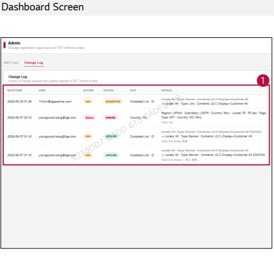

### 2. Dashboard Usage Guide

2.2 Components by Page > ADMIN > DICT Management

## Dashboard Screen

## Feature Guide

Click Change Log to view DICT change requests and update history.

## Change Log

View the DICT change history, including the date/time, user, action, status, and details.